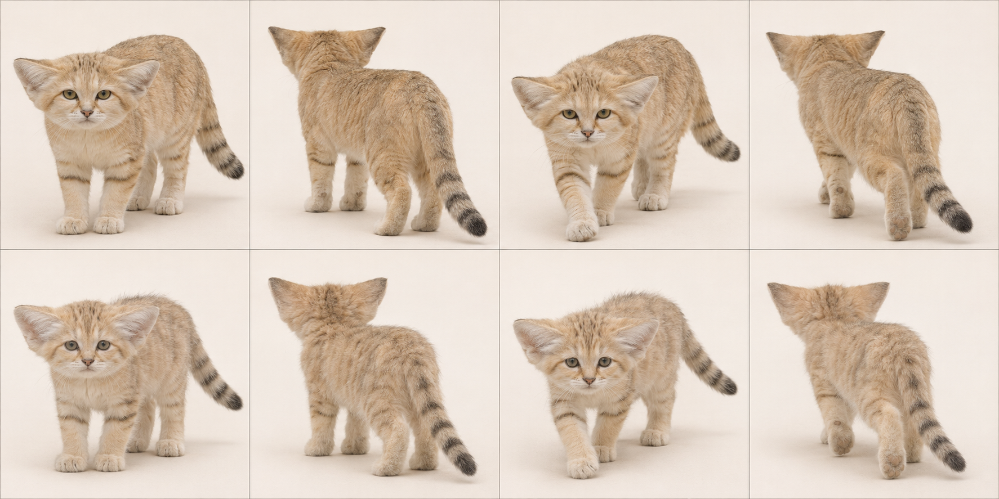
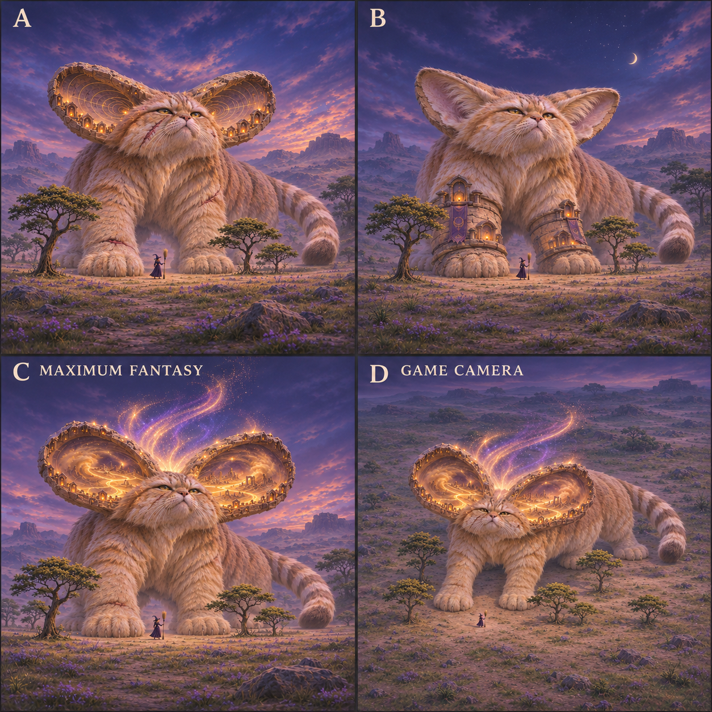
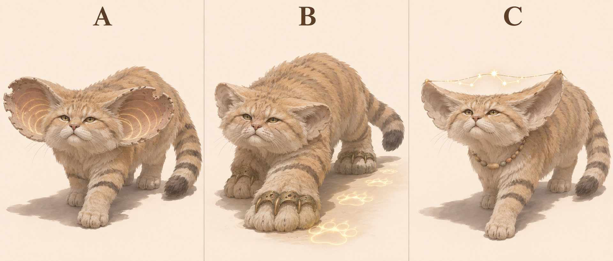
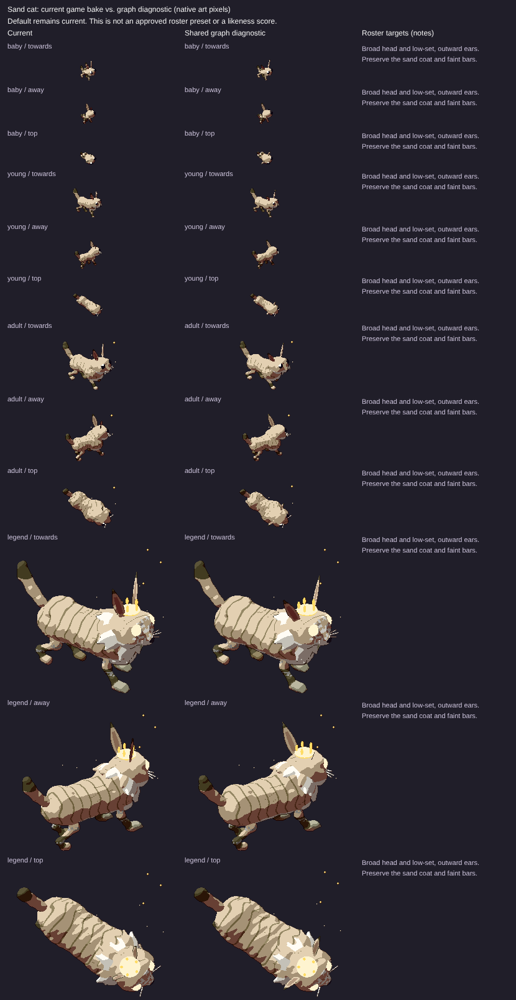

# Sand cat: L3 graph target

7 November 2026. Species ID `cat`; Felis margarita. Draft design reference for PR1906, source base524b0acaa43bb9975e7b2834ff9a55cbca4b3319. Ed judges the legend recommendation. No activation, implementation or claim that the current game passes.

## Reads-as target

Low sandy cat with broad flat face and very large low ears.

- Broad flattened head, short blunt muzzle and wide-set eyes
- Very large broad ears set low and outwards, not upright domestic-cat triangles
- Small stocky trunk and short digitigrade limbs
- Pale sandy coat with restrained leg bars
- Medium-long ringed tail with dark tip
- Broad furred soles; preserve paw silhouette instead of exposed dog-like toes

## Adult and mobile-young references



Top row adult, bottom row mobile young/age0 target; columns standing towards, standing away, walking towards, walking away. Ages scaled independently: NOT a world-size comparison. Age0 means a mobile cub/kitten, not a newborn. Game levels remain0 baby/1 young/2 adult/3 legend. This does not redefine their biology or game sizes.

## Proportions and mass

Use L = nose to tail base (head-body length), excluding tail, mane and decorative fur. These are **artist starting ranges**, not measured zoological statistics, pixel measurements or acceptance thresholds. Perspective, pose, sex, subspecies and coat vary. Refine against multiple orthogonal photos before implementation.

| Quantity | Fraction of L |
|---|---|
| Exposed leg: ground to ventral trunk | .22–.32 |
| Head: occiput to nose | .20–.25 |
| Visible neck bridge | .06–.10 |
| Tail: base to tip along curve | .50–.70 |
| Ground to shoulder | .38–.50 |

Low compact ribcage and broad head; short neck bridge. Keep abdomen supported and limbs light beneath the body, rather than a lion chest or fox muzzle.

Young: Mobile kitten target: relatively larger head/ears, shorter muzzle and softer trunk. Keep low ear roots and sandy identity; do not reuse a domestic-tabby kitten.

Feline hindlegs are digitigrade: the visible backward hock is an ankle, not a backward knee. Preserve fore/hind distinction and paw support; a still generated frame does not prove a gait cycle.

## Photograph and anatomy cross-check

Earlier domestic-cat adult/kitten photos were visually inspected but REJECTED as species evidence. Sand-cat expert description checked; direct adult/young sand-cat photo comparison remains pending. The generated replacement has broad low ears and all eight whole animals, but toward/away views are more frontal/rear than a calibrated 34.4° side angle.

- [adult: File:Standing Cat 01.jpg](https://commons.wikimedia.org/wiki/File:Standing_Cat_01.jpg) — rejected: domestic cat.
- [young: File:Tabby kitten profile standing facing right.jpg](https://commons.wikimedia.org/wiki/File:Tabby_kitten_profile_standing_facing_right.jpg) — rejected: domestic cat.

[Expert species description](https://www.catsg.org/living-species-sandcat) supports the identifying traits; ratios above are our design estimates. Commons photos are comparison-only, kept private and never published in this PR or shots.

## Iteration2: colossal fantasy concepts — current recommendation

Later Ed feedback on7November2026, COORDINATOR6708227119/6708229124, supersedes iteration1’s modest fantasy/plain-background direction. [DESIGN.md](../../DESIGN.md#look) says legends are about20times a baby’s height and taller than treetops; ART-GUIDE0b/0c asks for a recognisable animal’s nature made fantastic, epoch age, wisdom, power and reverence. These are proposed designs, not changes to game sizes.



2×2 board: A upper-left, B upper-right, C MAXIMUM FANTASY lower-left; D lower-right repeats C at an approximate game-camera elevation29.8° down/yaw34.4° from side-on. **Exactly three designs; D is another view, not a fourth concept.** Witch and trees are included in every panel. A/B/C use low hero views to convey mass, far-side haze and landscape weathering. The witch is a scale stand-in, not an exact render of the game’s witch.

- A: epoch-worn listening bowls with carved votive niches and gold sound contours.
- B: broad-pawed burrow elder with shrine-like sandstone wrist armour.
- C MAXIMUM FANTASY: Ears of the Lost Desert; immense low ears contain miniature lost dunes and rising sandstorm light.

**Recommend C for Ed’s second-pass review; signature element: Lost dune worlds inside low ear bowls.** C makes hearing an impossible landscape rather than adding a generic halo. The deep weathered ears hold a lost world; lamps along their rims suggest generations of reverence. Flat short face, low body, ringed tail and broad low ears remain sand-cat cues. A is clearer and quieter; B is dominated by wearable architecture. C is a recommendation for Ed, not approval.

Chosen legend body-plan/checklist: Retain low feline chassis and broad short face; ear cups become deeply concave landscape volumes, anchored on the head’s low lateral sockets. Votive niches follow cup rims, sand/light stays within/above ear-local bounds. Do not stretch muzzle into a fox or bury eyes under ear cliffs. Weathering/scars on a furry low body supply mass and history.

MISSING GRAPH FEATURES / shared integration needs: Nested ear-local surfaces/volumes, interior landscape and emissive-region attachment, rim-carved niche sockets, bounded particle curves and weathered material/geometry regions. Generic pointed ears do not provide this complete contract.

Actual inspected output/projection limits: All four panels show witch/trees; framed edit restores ear/tail margins. D exposes ear bowls clearly but miniature buildings/dunes may merge into bright gold at native size. Rear legs are naturally occluded; no gait proof. Cat’s desert-versus-legacy-Meadow mapping is still a coordinator decision, not silently resolved here.

Scale assessment: all four panels visibly contain a witch and trees; selected C/D read as colossal against the nearby witch and tree groups. Perspective/depth/variable tree size prevent an exact height comparison; no baby is depicted, so **20× baby height is a design prompt, not a verified measurement**. Native game projection, coverage/contact, accessory motion, occlusion and20× size must be tested on graph renders by the canonical owner. No local browser was allocated/run.

### Iteration2 exact generation prompt

```text
Witch videogame legendary creature second-pass design board. FOUR equal panels in a 2x2 grid, labelled A (upper left), B (upper right), C MAXIMUM FANTASY (lower left), D GAME CAMERA (lower right); no other text. A B C are THREE DIFFERENT concepts of SAME species; D repeats C's exact design from higher game camera. Every panel shows the ENTIRE huge creature including ALL ears/paws/tail, within ample margins. CRITICAL SCALE IN EVERY PANEL: a tiny human WITCH with pointed dark purple hat/dress holding broom STANDS on SAME ground plane next to front paw, clearly distinct and NOT riding animal; multiple complete FOREST TREES near paws and flank, with normal trunks/crowns and readable silhouettes. Creature head/shoulders TOWER ABOVE tree crowns; landscape-scale body mass, approximately20times a baby animal height, NOT a normal pet by a human. Trees about quarter to half creature shoulderheight, witch about one tenth to one fifteenth. Compose enough ground area to show scale without cropping creature. A B C cinematic slightly low/near-ground threequarter HERO viewpoint with atmospheric depth/haze on distant body, large weight-bearing landformlike masses. D SAME C at approximate actual game projection, elevation29.8deg DOWN, near-orthographic long lens, heading34.4deg from side-on facing viewer; whole giant+witch+trees still visible. Concept art: bold controlled painterly/small readable shape clusters, rich twilight with local magic light. Very ancient wise powerful mythical elder, animal's defining nature impossible, species instantly identifiable. No generic uniform, no gore, no modern buildings. Trees/environment support scale not hide anatomy. SAND CAT Felis margarita: flat broad short face, enormous LOW sideways ears, low stocky sandy body, short legs, medium ringed tail. Source current animal is desert sand cat (legacy Meadow mapping unresolved; don't imply mapping decision). Sparse real acacia and woodland-edge trees used as scale markers. A: colossal scarred dune listener, huge weathered ear bowls lined with ancient carved ear-rim votive niches and gold sound contours, sandy fur weathered into dune folds. B: nocturnal burrow elder, immense fur-soled paws half encased in worn sandstone armour, a few old listening shrines at wrists, tail ring patterns dimly lit. C MAXIMUM FANTASY RECOMMENDED: the Ears of the Lost Desert: each immense low ear is a coherent concave furry ear containing a DEPTHFUL miniature sandstorm and rotating map of vanished dunes, auroral sand pours upward between the ear rims, ear edges weathered like ancient sandstone cliffs with tiny votive lamps. Flat cat face remains visible BELOW ears; broad furry body, immense paws and tail all complete, no fennecfox muzzle. D exactly C with same ear-sandstorm design from higher game camera.
```

### Selected framing correction

Built-in imagegen edit of this species’ generated iteration2 board, preserving original privately; correction selected after visual inspection.

```text
Framing correction ONLY to this four-panel A/B/C/D concept board. Preserve all three designs, C/D matching identity, colours, camera elevations, witch/tree scale relationships and landscapes. In EACH panel pull the camera BACK about25percent and recompose so the ENTIRE animal fits with at least8percent empty sky/ground margin around ALL ears, mane/corona, paws and COMPLETE tail including tip. Several current hero panels crop animal/tail/mane at edges: restore them from the same design, no added limbs/tails. Keep each witch and nearby tree group same relative physical size to animal, but visible and inside frame. Body still towers above nearby tree crowns. Keep A B C cinematic low views; D same C higher game-camera view. Keep the FOUR panel labels A/B/C MAXIMUM FANTASY/D GAME CAMERA and 2x2 layout. Do not zoom any panel close. Do not enlarge head, change anatomy or turn tree scale cues into mere shrubs. It is a wider framing of same scenes, not a new concept. All animal silhouettes must be bounded by air/ground, not panel edges.
```

Generation: built-in imagegen,7November2026, model/seed unreported; text-only initial prompt; framing edits referenced only the species’ generated board, no real photos or game captures. No generated concept is activated.

## Iteration1: three historical concepts and existing comparison

Area/story: art/areas.js still calls cat the Meadow creature: grass/wildflowers, scattered hawthorn and lone oaks. However art/creatures/cat/genome.js explicitly identifies Sand cat/desert and contains older meadow-queen comments. Treat this as a source mapping discrepancy for the coordinator, not permission to rewrite biome or species. Dune/listening concepts follow the current animal identity; do not invent desert ruins as this cat’s area.

| Three new proposals, A/B/C left to right | Existing renderer comparison, ALL ages |
|---|---|
|  |  |

The right-hand sheet is **archival**, source/served SHA aad8b13327282d13d7d6a4e2e1b28aa2acfd6b6c, fixture cats-1. Read its Current column, level3 row for the old legend; its graph column is NOT the target. It is not a capture of today's524b0ac source. Fresh exact-head legend evidence must be supplied by the canonical renderer before a current-vs-target verdict; no laptop browser was allocated or run.

- A Dune Listener — huge weathered ear dishes holding amber sound contours.
- B Burrow Keeper — broad furred paws with bronze guards and glowing tracks.
- C Night Navigator — a constellation suspended between the low ears.

**Historical iteration1 recommendation A; signature element: Ear-interior sound contours.** Hearing and low broad ears become the mystery. Chipped ear rims and pale muzzle show age; the tiny animal listens to a desert older than it. B risks generic equipment, C risks a decorative constellation unrelated to the body.

Chosen legend checklist/body plan: Exaggerate ear width and concavity, not leg length. Retain low sandy body, ringed tail and broad short face. Bind sound contours to inner ear surface; scars break the ear rim and muzzle fur. The generated ears are intentionally fantastical, not adult anatomy.

These are three concepts generated together in one sheet, not three independent calibrated render trials. Inspect all whole bodies and recognisability; labels identify proposals, not approved in-game names. Only Ed/coordinator can adopt a pick.

## Top three priorities and MISSING GRAPH FEATURES

Top three: low broad ears; flat face; short-legged sandy body.

Head-local low ear cups and furred paw envelope; worn ear-edge and ear-interior magic attachments for legend.

At the pinned source, `art/body-graph/graph.js` has head/leg/wing/tail/shell sockets, torso spine stations, head ellipsoid, two-bone digitigrade legs and a foot ellipsoid. `quadruped.js` already has torso profile/flex, pointed-ear cup helpers and region patterns; `families.js` has feline adapter; `tail-markings.js` already supports rings/spots/rosettes/tip paint. `gait.js` has a two-bone straight-line diagnostic solve. Do NOT request basic tails, all ears, all patterns or all gait as wholly absent. Missing contract: rotating station frames/socket-to-socket attachments (explicit future work), nested head/foot-local feature inheritance, age-linked fur/tuft/accessory attachment data and scar/weathering regions. Legacy features may draw these today; this is a request for shared graph representation, not a demand for handwritten species fixes. Refer implementation to graph owner#1866.

## Provenance and limits

Built-in `image_gen.imagegen`, 7 November2026; no model identifier/seed reported. Text-only generation, no source photograph supplied as input. Anatomy prompts ask photorealism; legends use sculptural concept art. Actual camera source `art/model3d.js`: pitch0.52rad (29.8° down), yaw±0.6rad (34.4°). Tool output only approximates this; no camera calibration, native-size rendering, pixel-diff, locomotion/contact or graph-fit proof. All selected generated sheets were visually inspected for panel/age/pose coverage and complete animals; natural occlusion remains.

Area/story mapping and direct sand-cat photo evidence remain open.

### Exact anatomy generation prompt

```text
Photorealistic scientific anatomy reference contact sheet for SAND CAT Felis margarita, NOT domestic tabby. Eight complete whole animals, two rows four columns, plain ivory studio background. Top SAME adult in stand towards, stand away, slow walk towards, slow walk away. Bottom SAME mobile 8-week kitten in same order. Approximate game camera: elevation29.8 degrees downward, long lens orthographic-like, body34.4deg towards/away from side-on. Scale each age independently. Small stocky low sandy desert cat, very wide flattened head, HUGE broad LOW-SET triangular ears extending sideways, pale sandy coat faint leg bars, medium long black-ringed tail, furred soles, short legs, large eyes. Kitten larger head and ears proportionally, not scaled adult. All tails/paws/ears inside panels with padding, correct four-legged feline anatomy, natural unexaggerated proportions, no props/text/collars. No domestic cat tabby body stripes, no pointed tall domestic-cat ears.
```

### Exact legend generation prompt

```text
Concept art comparison sheet, THREE distinctly DIFFERENT legendary creature proposals in THREE equal columns labelled A, B, C only. One WHOLE creature per column, ears paws tail entirely visible with generous margin, plain warm ivory studio background and ground shadow, no scenery or extra animals. Approximate Witch GAME camera elevation29.8deg looking down, long-lens orthographic-like, body34.4deg toward camera from side-on. All are ancient powerful wise elders, animal's defining nature exaggerated into magic, still recognisably that exact species. Painterly sculptural concept art with bold coherent silhouettes, restrained palette/large readable shapes, not a UI/game sprite or calibrated render. Strong anatomy and natural quadruped standing or slow deliberate walking, no gore; healed scars only. Each concept its OWN idea, not uniform accessory swaps. SAND CAT Felis margarita, pale sandy stocky low body, very broad flat head, enormous low-set ears, ringed tail. Desert survival and listening. A: Dune Listener, ancient pale cat with ear pinnae grown into huge weathered listening dishes, chipped ear rims and pale muzzle, fine curved amber sound contours caught INSIDE ear bowls like sand ripples; no crown. B: Burrow Keeper, squat broad-pawed elder with colossal fur-soled paws, eroded bronze claw guards and faint luminous pawprints, scars across nose. C: Night Navigator, old sand cat whose wide low ears frame a single threadlike constellation suspended between their tips, sand-polished tiny stone bead collar. All feline, not fox, no tall fennec ears.
```

See [L3 summary](l3-summary.md) for evidence hashes, shared gaps and remaining checks.
