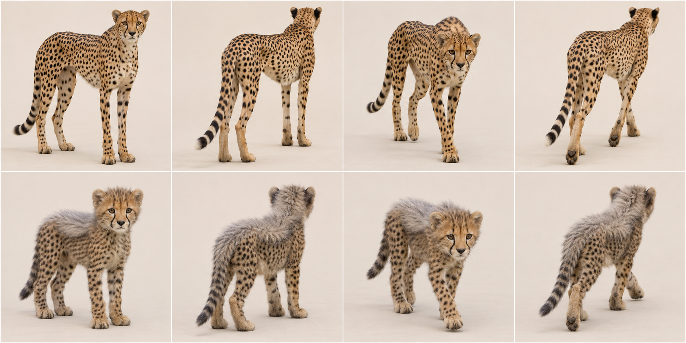
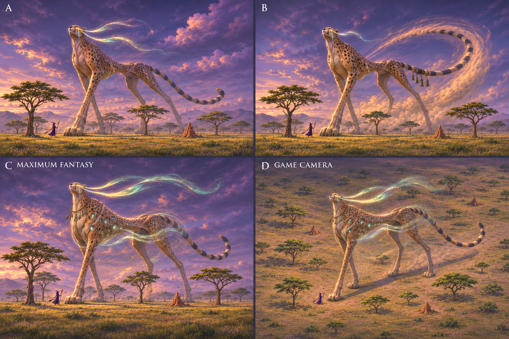
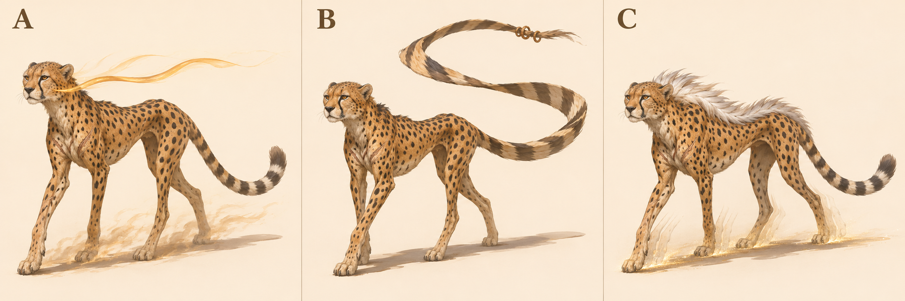
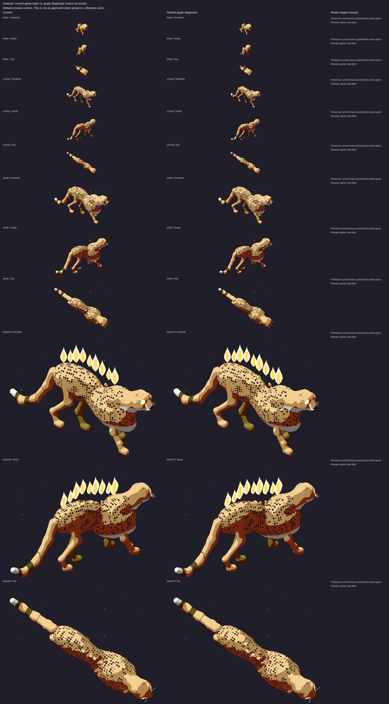

# Cheetah: L3 graph target

7 November 2026. Species ID `cheetah`; Acinonyx jubatus. Draft design reference for PR1906, source base524b0acaa43bb9975e7b2834ff9a55cbca4b3319. Ed judges the legend recommendation. No activation, implementation or claim that the current game passes.

## Reads-as target

Small-headed, long-legged sprinting cat with deep chest and tucked waist.

- Very deep but narrow chest
- Extreme abdominal tuck behind ribs
- Long thin digitigrade legs
- Small round head and short muzzle on visible neck
- Solid separated black spots, never rosettes
- Dark tear lines from eyes to mouth
- Long balancing tail with distal rings
- Young silver-grey dorsal mantle distinct from adult

## Adult and mobile-young references



Top row adult, bottom row mobile young/age0 target; columns standing towards, standing away, walking towards, walking away. Ages scaled independently: NOT a world-size comparison. Age0 means a mobile cub/kitten, not a newborn. Game levels remain0 baby/1 young/2 adult/3 legend. This does not redefine their biology or game sizes.

## Proportions and mass

Use L = nose to tail base (head-body length), excluding tail, mane and decorative fur. These are **artist starting ranges**, not measured zoological statistics, pixel measurements or acceptance thresholds. Perspective, pose, sex, subspecies and coat vary. Refine against multiple orthogonal photos before implementation.

| Quantity | Fraction of L |
|---|---|
| Exposed leg: ground to ventral trunk | .38–.50 |
| Head: occiput to nose | .13–.18 |
| Visible neck bridge | .12–.19 |
| Tail: base to tip along curve | .55–.75 |
| Ground to shoulder | .60–.75 |

Deep thorax seen from the side but narrow front; minimal belly volume behind it, elastic loin and strong lean hindquarters. Do not inflate limbs to panther bulk.

Young: Mobile cub has large head, short immature limbs and pale long mantle across crown/back; dark fuzzy spotted sides. Age0 mantle is a new fur shape, not just adult scaling.

Feline hindlegs are digitigrade: the visible backward hock is an ankle, not a backward knee. Preserve fore/hind distinction and paw support; a still generated frame does not prove a gait cycle.

## Photograph and anatomy cross-check

Adult photo is sitting in tall grass: useful small head/round ears/tears/spots, NOT evidence for full limb lengths. Cub photo is reclining with grass occlusion: face and spotted coat visible, mantle cannot be fully measured. Expert description supports diagnostic build. Generated mantle is clear; anatomy ratios remain design estimates.

- [adult: File:Cheetah Standing Tall.jpg](https://commons.wikimedia.org/wiki/File:Cheetah_Standing_Tall.jpg) — viewed privately.
- [young: File:Cheetah (Acinonyx jubatus) cub.jpg](https://commons.wikimedia.org/wiki/File:Cheetah_(Acinonyx_jubatus)_cub.jpg) — viewed privately.

[Expert species description](https://www.catsg.org/living-species-cheetah) supports the identifying traits; ratios above are our design estimates. Commons photos are comparison-only, kept private and never published in this PR or shots.

## Iteration2: colossal fantasy concepts — current recommendation

Later Ed feedback on7November2026, COORDINATOR6708227119/6708229124, supersedes iteration1’s modest fantasy/plain-background direction. [DESIGN.md](../../DESIGN.md#look) says legends are about20times a baby’s height and taller than treetops; ART-GUIDE0b/0c asks for a recognisable animal’s nature made fantastic, epoch age, wisdom, power and reverence. These are proposed designs, not changes to game sizes.



2×2 board: A upper-left, B upper-right, C MAXIMUM FANTASY lower-left; D lower-right repeats C at an approximate game-camera elevation29.8° down/yaw34.4° from side-on. **Exactly three designs; D is another view, not a fourth concept.** Witch and trees are included in every panel. A/B/C use low hero views to convey mass, far-side haze and landscape weathering. The witch is a scale stand-in, not an exact render of the game’s witch.

- A: horizon runner, tear-line wind ribbons and ancient narrow scarred frame.
- B: storm rudder, long ringed tail steering a huge dust arc and weathered windchimes.
- C MAXIMUM FANTASY: Still Wind; luminous wind-wells open within the spot pattern, air hangs through/around a tightly tucked waist.

**Recommend C for Ed’s second-pass review; signature element: Wind-wells within solid-spot coat.** C makes the cheetah’s narrow sprinting body a still vessel for impossible wind. Tiny head, long thin limbs, deep chest, tucked waist and long ringed tail are retained; luminous spots are the fantasy extension of solid spots, not leopard rosettes. Suspended leaves and worn windchimes imply a force people have revered for ages. A is more restrained, while B lets the tail overwhelm the body.

Chosen legend body-plan/checklist: Keep torso continuously connected across the very narrow waist; never literally remove its load-bearing bridge. Confine wind-wells to coat regions and curve two tear-line streams clear of eyes. Use one thin ringed tail and four limbs; do not turn echo light into additional legs. Let old scars/windworn planes convey epochs.

MISSING GRAPH FEATURES / shared integration needs: Coat-region inset/emissive volumes for spots, head-local stream roots, waist-relative bounded wind field, sparse necklace sockets and scar/weathering masks. This is beyond existing spot paint, while reusing its mapping rather than replacing the pattern system.

Actual inspected output/projection limits: Framing edit restores complete tail and head margins. Witch/acacia groups are visible in all panels, with body over nearby crowns. D preserves narrow silhouette and long tail, but wind-wells look like luminous gems at this scale; a future native render must distinguish air depth from jewellery. No exact20x baby measurement or accurate sprint physics is claimed.

Scale assessment: all four panels visibly contain a witch and trees; selected C/D read as colossal against the nearby witch and tree groups. Perspective/depth/variable tree size prevent an exact height comparison; no baby is depicted, so **20× baby height is a design prompt, not a verified measurement**. Native game projection, coverage/contact, accessory motion, occlusion and20× size must be tested on graph renders by the canonical owner. No local browser was allocated/run.

### Iteration2 exact generation prompt

```text
Witch videogame legendary creature second-pass design board. FOUR equal panels in a 2x2 grid, labelled A (upper left), B (upper right), C MAXIMUM FANTASY (lower left), D GAME CAMERA (lower right); no other text. A B C are THREE DIFFERENT concepts of SAME species; D repeats C's exact design from higher game camera. Every panel shows the ENTIRE huge creature including ALL ears/paws/tail, within ample margins. CRITICAL SCALE IN EVERY PANEL: a tiny human WITCH with pointed dark purple hat/dress holding broom STANDS on SAME ground plane next to front paw, clearly distinct and NOT riding animal; multiple complete FOREST TREES near paws and flank, with normal trunks/crowns and readable silhouettes. Creature head/shoulders TOWER ABOVE tree crowns; landscape-scale body mass, approximately20times a baby animal height, NOT a normal pet by a human. Trees about quarter to half creature shoulderheight, witch about one tenth to one fifteenth. Compose enough ground area to show scale without cropping creature. A B C cinematic slightly low/near-ground threequarter HERO viewpoint with atmospheric depth/haze on distant body, large weight-bearing landformlike masses. D SAME C at approximate actual game projection, elevation29.8deg DOWN, near-orthographic long lens, heading34.4deg from side-on facing viewer; whole giant+witch+trees still visible. Concept art: bold controlled painterly/small readable shape clusters, rich twilight with local magic light. Very ancient wise powerful mythical elder, animal's defining nature impossible, species instantly identifiable. No generic uniform, no gore, no modern buildings. Trees/environment support scale not hide anatomy. CHEETAH: extremely slim narrow body, VERY deep narrow chest, extreme tucked waist, long thin legs, tiny round short-muzzled head, solid black spots not rosettes, tear lines, long ringed rudder tail. Short gold-green plains with scattered whistling thorn/acacia trees and termite mounds, plus a few woodland-edge trees for scale. A: enormous Horizon Runner, wind filaments trail from glowing tear marks, very old silver muzzle and scars, enormous thin legs stride over thorn crowns. B: rudder of storms, elongated ringed tail curves through air and steers a visible immense arc of dust, small eroded bronze votives hang near tail base, keep tail slender not squirrel plume. C MAXIMUM FANTASY RECOMMENDED: the Still Wind, a towering CHEETAH whose huge deep chest and thin tucked body are solid sculptural tawny fur and wind-worn stone, its SOLID BLACK spots become tiny dark open wind-wells spiralling cloudlight, a continuous transparent wind ribbon runs through the narrow WAIST around but never severs torso; pale dust and little leaves hang suspended under high striding legs, tear-lines stream backward in two broad elegant auroral bands. Keep tiny head/round ears and great long curved ringed tail clearly visible. Epoch-carved flank scars and a sparse necklace of tiny windchimes. D same C game camera.
```

### Selected framing correction

Built-in imagegen edit of this species’ generated iteration2 board, preserving original privately; correction selected after visual inspection.

```text
Framing correction ONLY to this four-panel A/B/C/D concept board. Preserve all three designs, C/D matching identity, colours, camera elevations, witch/tree scale relationships and landscapes. In EACH panel pull the camera BACK about25percent and recompose so the ENTIRE animal fits with at least8percent empty sky/ground margin around ALL ears, mane/corona, paws and COMPLETE tail including tip. Several current hero panels crop animal/tail/mane at edges: restore them from the same design, no added limbs/tails. Keep each witch and nearby tree group same relative physical size to animal, but visible and inside frame. Body still towers above nearby tree crowns. Keep A B C cinematic low views; D same C higher game-camera view. Keep the FOUR panel labels A/B/C MAXIMUM FANTASY/D GAME CAMERA and 2x2 layout. Do not zoom any panel close. Do not enlarge head, change anatomy or turn tree scale cues into mere shrubs. It is a wider framing of same scenes, not a new concept. All animal silhouettes must be bounded by air/ground, not panel edges.
```

Generation: built-in imagegen,7November2026, model/seed unreported; text-only initial prompt; framing edits referenced only the species’ generated board, no real photos or game captures. No generated concept is activated.

## Iteration1: three historical concepts and existing comparison

Area/story: Plains: short gold-green grass, whistling thorns, grass tufts, small termite mounds and a cluster of tall mounds (art/areas/plains/recipe.js).

| Three new proposals, A/B/C left to right | Existing renderer comparison, ALL ages |
|---|---|
|  |  |

The right-hand sheet is **archival**, source/served SHA aad8b13327282d13d7d6a4e2e1b28aa2acfd6b6c, fixture cats-1. Read its Current column, level3 row for the old legend; its graph column is NOT the target. It is not a capture of today's524b0ac source. Fresh exact-head legend evidence must be supplied by the canonical renderer before a current-vs-target verdict; no laptop browser was allocated or run.

- A Horizon Runner — lit tear lines trail as two narrow wind filaments.
- B Wind Rudder — exaggerated curved fur tail with small bronze rings.
- C Last Sprint — silver mantle and faint leg afterimages.

**Historical iteration1 recommendation A; signature element: Wind trailing from tear lines.** The tear marks and plains speed become one animal-specific magical cue. A scarred narrow frame retains the cheetah’s nature without a common flame crest. B overwhelms the body with tail, C partly repeats juvenile mantle.

Chosen legend checklist/body plan: Retain thin limbs/deep narrow chest and tiny head. Extend two cheek tear regions into short trailing curves, readable from towards/away. Keep them clear of eyes and avoid a second full creature or extra legs. Pale muzzle and few healed scars supply age.

These are three concepts generated together in one sheet, not three independent calibrated render trials. Inspect all whole bodies and recognisability; labels identify proposals, not approved in-game names. Only Ed/coordinator can adopt a pick.

## Top three priorities and MISSING GRAPH FEATURES

Top three: deep narrow chest/tuck; thin long limbs; small tear-marked head.

Age-specific dorsal fur envelope and head-local tear marking regions; extra scapula/hock/foot articulation beyond two-bone diagnostic is a capability request, not a gait fix here.

At the pinned source, `art/body-graph/graph.js` has head/leg/wing/tail/shell sockets, torso spine stations, head ellipsoid, two-bone digitigrade legs and a foot ellipsoid. `quadruped.js` already has torso profile/flex, pointed-ear cup helpers and region patterns; `families.js` has feline adapter; `tail-markings.js` already supports rings/spots/rosettes/tip paint. `gait.js` has a two-bone straight-line diagnostic solve. Do NOT request basic tails, all ears, all patterns or all gait as wholly absent. Missing contract: rotating station frames/socket-to-socket attachments (explicit future work), nested head/foot-local feature inheritance, age-linked fur/tuft/accessory attachment data and scar/weathering regions. Legacy features may draw these today; this is a request for shared graph representation, not a demand for handwritten species fixes. Refer implementation to graph owner#1866.

## Provenance and limits

Built-in `image_gen.imagegen`, 7 November2026; no model identifier/seed reported. Text-only generation, no source photograph supplied as input. Anatomy prompts ask photorealism; legends use sculptural concept art. Actual camera source `art/model3d.js`: pitch0.52rad (29.8° down), yaw±0.6rad (34.4°). Tool output only approximates this; no camera calibration, native-size rendering, pixel-diff, locomotion/contact or graph-fit proof. All selected generated sheets were visually inspected for panel/age/pose coverage and complete animals; natural occlusion remains.

Full-body real-photo limb cross-check remains weaker than head/coat evidence; no calibrated stride review.

### Exact anatomy generation prompt

```text
Scientific-educational PHOTOREAL whole-animal anatomy contact sheet, eight equal panels, two rows of four. Plain warm off-white studio floor/background, soft neutral daylight, no objects/text/labels/collars. Camera approximately29.8 degrees looking down, long-lens orthographic-like, animal long axis34.4 degrees toward or away from side-on. Top row same ADULT: stand towards, stand away, slow natural walk towards, slow natural walk away. Bottom row same MOBILE YOUNG in identical order. Every animal entirely inside its own panel with ample padding including every paw/ear/tail; no crop. Four anatomically correct legs, digitigrade feline paws/hocks, clear weight-bearing slow-walk stance. No stylization, human expression, or distorted/extra limbs. Scale each age independently for anatomical inspection; not a size comparison. CHEETAH (Acinonyx jubatus), not leopard. Adult tall long thin legs, small rounded head, narrow chest front but deep thorax, very tucked abdomen, flexible slim body, long balancing tail, small rounded ears, amber coat with separate solid black spots, sharp dark tear lines eye-to-mouth. Young approximately8-week mobile cub with conspicuous long grey-silver dorsal mantle from crown/neck over back contrasting dark fuzzy spotted sides, large head and short immature legs, not an adult scaled down. No rosettes and no muscular lion build.
```

### Exact legend generation prompt

```text
Concept art comparison sheet, THREE distinctly DIFFERENT legendary creature proposals in THREE equal columns labelled A, B, C only. One WHOLE creature per column, ears paws tail entirely visible with generous margin, plain warm ivory studio background and ground shadow, no scenery or extra animals. Approximate Witch GAME camera elevation29.8deg looking down, long-lens orthographic-like, body34.4deg toward camera from side-on. All are ancient powerful wise elders, animal's defining nature exaggerated into magic, still recognisably that exact species. Painterly sculptural concept art with bold coherent silhouettes, restrained palette/large readable shapes, not a UI/game sprite or calibrated render. Strong anatomy and natural quadruped standing or slow deliberate walking, no gore; healed scars only. Each concept its OWN idea, not uniform accessory swaps. CHEETAH, long thin legs, small round head, deep narrow chest, extremely tucked waist, long ringed rudder tail, SOLID BLACK SPOTS and dark tear lines. Open short gold-green plains, whistling thorns and termite mounds. A: Horizon Runner, ancient lean scarred cheetah whose tear lines extend as two long narrow amber wind filaments backwards from cheeks, subtle duststream under slender legs, pale muzzle, all body visible. B: Wind Rudder, long ringed tail exaggerated into one slender twisting aerodynamic ribbon OF FUR, worn tip with tiny wind-carved bronze rings, no fabric wings. C: Last Sprint, old cheetah with pale silver spine crest echoing cub mantle, three faint offset LEG afterimages at paws only, gold dust underfoot, keep single solid trunk. No leopard rosettes, bulky lion body or wings.
```

See [L3 summary](l3-summary.md) for evidence hashes, shared gaps and remaining checks.
