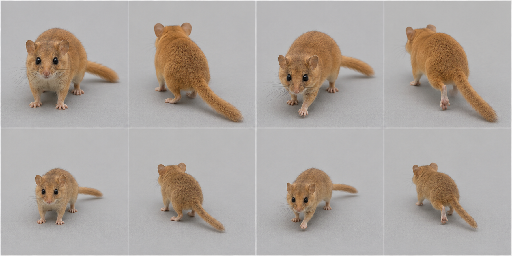
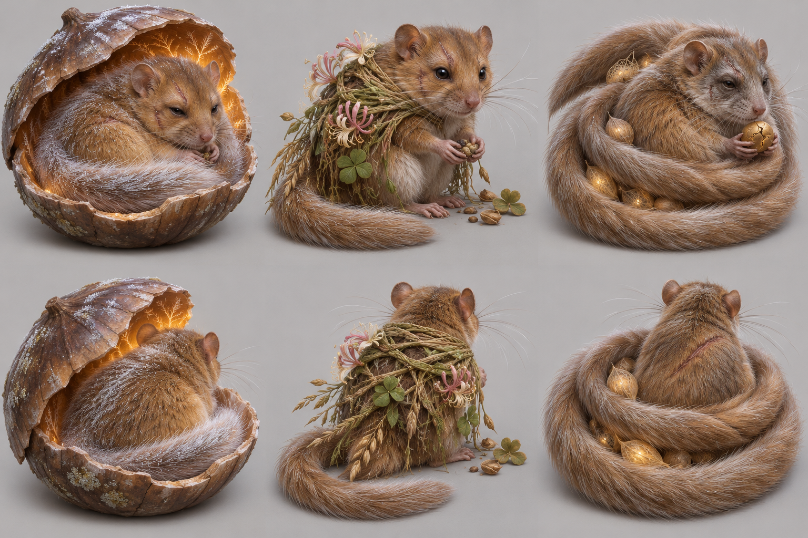

# Hazel dormouse target — graph target

Species scope: **dormouse** (Muscardinus avellanarius); L2, #1904. Target identity is inferred from the existing genome's natural cues, not a new gameplay/species decision. No hand-written-art fix or graph code is authorized here.

## Reference plate and provenance

Selected plate: [target-v1.png](https://raw.githubusercontent.com/edsaperia/witch/20d25e05fdc3b44a73ba23e7e270c8105498f1d0/previews/art-pass/dormouse/target-v1.png), SHA256 `3050ffb56e542fca7c3292a137891362f6f9cd771f8f7722579a3dedd3ace30d`. Generated 2026-11-07 with the built-in **image_gen.imagegen** tool (scientific-educational, photoreal target; model/version/seed not exposed). [Exact prompt](https://raw.githubusercontent.com/edsaperia/witch/20d25e05fdc3b44a73ba23e7e270c8105498f1d0/previews/art-pass/dormouse/prompt-v1.txt); [provenance](https://raw.githubusercontent.com/edsaperia/witch/20d25e05fdc3b44a73ba23e7e270c8105498f1d0/previews/art-pass/dormouse/provenance-v1.json). No Commons photo was input to imagegen or committed.

Eight cells: adult row1, mobile juvenile row2; columns standing-towards, standing-away, walking-towards, walking-away. Young represents game age0's mobile visual role, **not a literal neonate or scientifically verified age**. The game has young variants; many real neonatal mammals cannot stand/walk. Size ratios between generated cells are illustrative, not calibrated.

Camera target: art/model3d.js PITCH=.52rad (29.79° downward) and YAW={towards:.6,away:-.6}rad (±34.38°). Prompts approximate a long-lens affine-looking view. Generated heading, perspective, scale and foot contact are not constrained by the real renderer: some cells are more frontal/rearward, and v2 silhouettes can shift angle. **No pixel-exact game-camera match, game-size recognition verdict or actual motion cycle is claimed.**

## Real-photo comparison — real anatomy wins

[Commons comparison file: Haselmaus.JPG](https://commons.wikimedia.org/wiki/File:Haselmaus.JPG). Viewed locally for comparison only; not on either committed branch. The initially inspected Muscardinus_avellanarius_1.jpg is heavily obscured by branches and supports only golden coat/underside and climbing context, not tail or proportions. Haselmaus.JPG is the clearer comparison. Avoid the ambiguously labelled Muscardinus_avellanarius.jpg/wood-mouse redirect.

[Earlier obscured photo](https://commons.wikimedia.org/wiki/File:Muscardinus_avellanarius_1.jpg) was viewed but rejected for tail/proportion verification. Haselmaus.JPG clearly supports round eyes/ears, short muzzle, fur and climbing hands; tail remains outside useful view.

## Identifying checklist

1. Compact soft golden-brown trunk and pale underside.
2. Large round dark eyes and round ears.
3. Short blunt-to-tapered muzzle with prominent whiskers.
4. Long fully furred tail, not a naked mouse tail or squirrel fan.
5. Small grasping feet appropriate for climbing.
6. Narrow neck mostly buried in fur; no hamster cheek pouches.
7. Mobile kit: larger head/eyes, shorter muzzle and less full tail.

## Body plan and proportion targets

**L = nose to tail-base length in a neutral quadrupedal pose, excluding tail**, not the torso-only spine length. Head means muzzle tip to occiput; exposed neck is occiput-to-shoulder transition; limb reach means vertical shoulder/hip-to-ground in quiet stance, not summed bone lengths. Ratios below are **artist starting ranges inferred from general anatomy/photos, not specimen measurements, fitted genome values or universal biological bounds**. Adjust for pose and actual photo evidence.

Head 0.22–0.28; exposed neck0.03–0.07; standing limb reach0.16–0.24; tail0.70–1.00.

Rounded ribs and hips with soft seasonal fat, but retain a distinct neck-to-body taper and climbing limb articulation.

Age0 target: scale the whole animal down, then increase relative head/eye size and reduce muzzle/tail maturity as listed above; do not merely shrink an adult. These are qualitative age keys, not validated growth measurements. Preserve the natural four-limb body plan at every game age. Magical/legend adornments must not replace the identifiable natural silhouette; the separately authorized legend concepts below are proposals only.

## Graph requirements and missing features

Reusable gripping digits and rounded-pinna assembly; furred cylindrical tail profile independent of squirrel plume. Seasonal fat is a torso parameter, not a new graph kind.

Capability audit is source-only: prototype524b0acaa has generic head/leg/wing/tail/shell sockets. Read-only #1866 headde27db5154a3e8b1aa94255263bd2601b92aec36 additionally has neck, parent attachments and static triangular membrane sockets. Thus **neck and membrane kinds are present**, not missing. Its leg foot is an ellipsoid (hoof can split); no explicit reusable digging-palm/digit, ear/tuft, spine-field or folded-patagium deformation contract was verified. Generic ellipsoids can block out some shapes; absence of a named semantic control does not prove geometry is impossible. Requests here are shared graph/family capabilities to confirm with1866, never a permission to patch old builders.

## Ranked targets and image QA

1. Furred long tail.
2. round eyes+ears.
3. soft compact mass.

v1 has the furred tail and rounded ears/eyes; the generated head/muzzle is rather mouse-like and paws are simplified. Written checklist overrides it where snout length or tail fullness drifts.

All selected plates were visually inspected for whole framing, adult/young rows and towards/away standing/walking coverage. A lifted paw is not gait validation; hidden far-side feet and exact digit counts are not certified. Generated-photo discrepancies are excluded from the graph specification by the checklist and real-photo priority. Optional shipped-art critique omitted: no shipped renderer run or native/4× acceptance was allocated; the later instruction supersedes that exhaustive review.

Review boundary: target note/reference output complete for coordinator review, with explicit uncertainties above. Species migration and likeness acceptance remain #1866/canonical/Ed decisions; no source, rig, render, registry, gameplay, text or default changed.

## Legend concepts — 2026-11-07 proposal

Authorized by1476#6707981581 and correction6707992824. Read ART-GUIDE0b/0c and legend-audit; crystals, flame crests and spirit wings are allowed when fitting. Fit and variety win over a blanket adornment ban. Ed judges these proposals; nothing is implemented.

Area story: Honeysuckle tangle: grass and clover, bramble walls, honeysuckle, hazel coppice.

| Today’s awake legend | Three generated alternatives |
|---|---|
| **PENDING exact-source comparison.** Requested in1904#6708045677 from prototype524b0acaa. The5Oct atlas is historical and is deliberately not relabelled today. |  |

Columns left→right A/B/C; upper row towards, lower row away. Whole-animal plain-background photographic concept targets; approximate camera only, not game-rendered or game-size acceptance.

- **A:** The Winter Dream-Keeper: ancient golden hazel dormouse with large round dark eyes half-open wisely, small rounded ears and long FURRED tail curled around itself, sitting inside an opened enormous worn hazelnut shell used as a warm sanctuary; shell amber inner light and silver fur show deep hibernation magic, whole animal visible above shallow shell rim.
- **B:** The Honeysuckle Weaver: ancient rounded dormouse with exaggerated precise grasping hands, long silver whiskers, a light loose woven honeysuckle-and-grass shawl over shoulders holding tiny seed offerings, no royal robe and no crown; tail still furred and long.
- **C:** The Keeper of Lost Summers: ancient compact dormouse with a very long furred tail curled into three concentric nest-like loops, age-grey face and one cracked gold seed bead held in hands, a few dreamlike hazelnut motes nestle within loops, no stars blanket.

**Strongest proposed pick A; signature element: Opened hazelnut dream sanctuary.** A dormouse's deep seasonal sleep becomes something sacred. The old shell is a shelter offered by the hazel coppice, with breathing warmth and age-silvered fur; large dark eyes, round ears and the furred tail keep it a dormouse. It is a sleep refuge, not royal armour.

Actual image QA: A gives the clearest hibernation story and visible silver age, but its deep shell hides feet/back: open it farther and expose body anchors before migration. B looks younger and the cloak can hide anatomy; C overmultiplies the tail loops. No extra biological tail is approved.

### Chosen legend checklist

1. Round-eyed golden dormouse, small round ears and short muzzle.
2. Long furred tail wraps softly rather than becoming a naked mouse tail.
3. Worn opened hazelnut shell shelters but does not hide most of the animal.
4. Silver fur and slow half-open wise eyes show age.
5. Warm inner-shell light expresses hibernation/dream magic.
6. Feet/head/tail remain anatomically distinct from the shell.

### Chosen legend body plan and graph needs

Legend HBL target1.3–1.5×adult; head0.23–0.28L, tail0.80–1.10L. Low soft curled ribs/hips; shell footprint may be1.2–1.6L and must be audited separately from animal volume. All ratios are artist starting targets, not measured biology or accepted game size. L retains the nose-to-tail-base definition above; legend exaggeration is deliberate.

Separate shell/offerings attachment with visibility and footprint rules, fur-age mask, wrapped-tail pose and optional slow visual pulse. Not a biological shell fused to the spine. Shared graph work stays with1866. Existing neck/parent/static-membrane sockets are not reported missing; these requests describe species-ready behaviour/material/attachment contracts, not proof that generic geometry cannot express the shape.

### Exact generated evidence

[Plate](https://raw.githubusercontent.com/edsaperia/witch/e85e74d7ccff41e1ffc9447cfe0df7cd959d77bc/previews/art-pass/dormouse/legend-concepts-v1.png), SHA256 `b46fac4f13c512828e17edcd638da686b955aa19be0bdccbe524937152a19e37`; [exact prompt](https://raw.githubusercontent.com/edsaperia/witch/e85e74d7ccff41e1ffc9447cfe0df7cd959d77bc/previews/art-pass/dormouse/legend-prompt-v1.txt); [provenance and A/B/C briefs](https://raw.githubusercontent.com/edsaperia/witch/e85e74d7ccff41e1ffc9447cfe0df7cd959d77bc/previews/art-pass/dormouse/legend-provenance-v1.json). Built-in image_gen.imagegen,2026-11-07; model/seed not exposed. Three concepts with two views each; no real photo input. All eight plates were visually inspected; written QA and real anatomy override generated defects.

Legend-addition status: concepts/selection notes complete, **PARTIAL until today’s exact-source comparison is supplied and placed beside them**. This does not reopen the completed anatomy target milestone or authorize activation.
