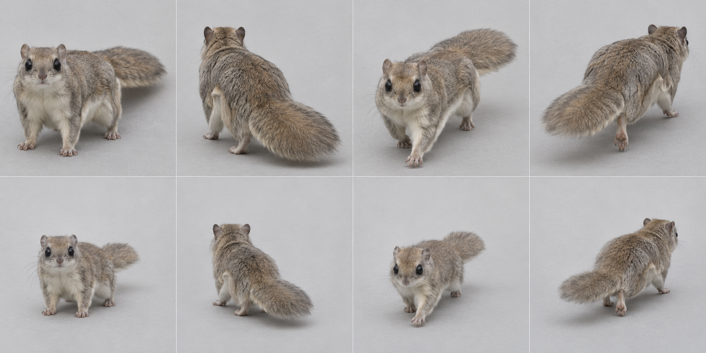
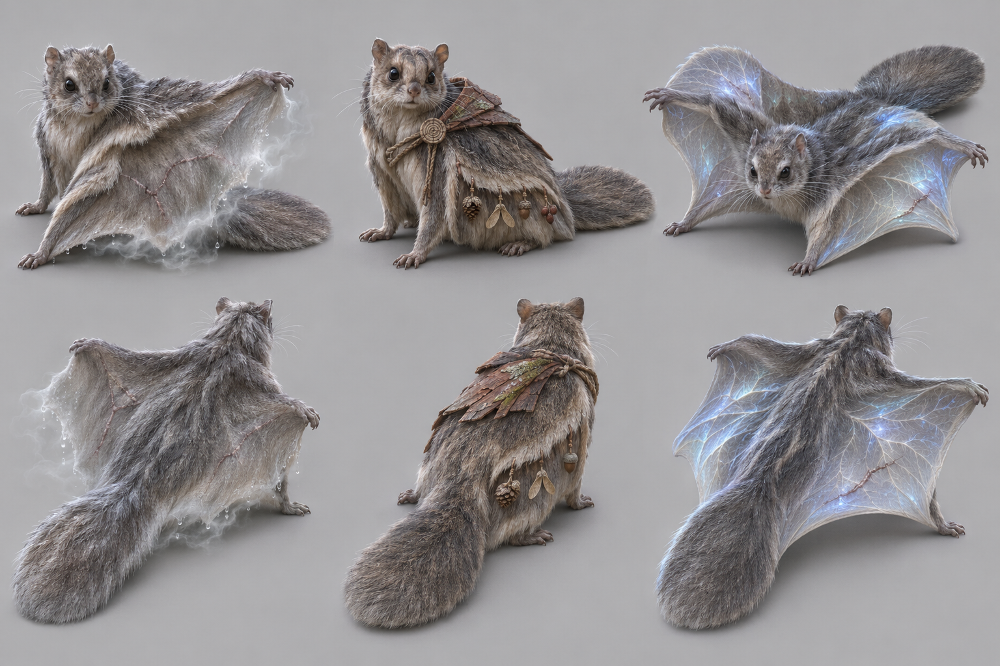
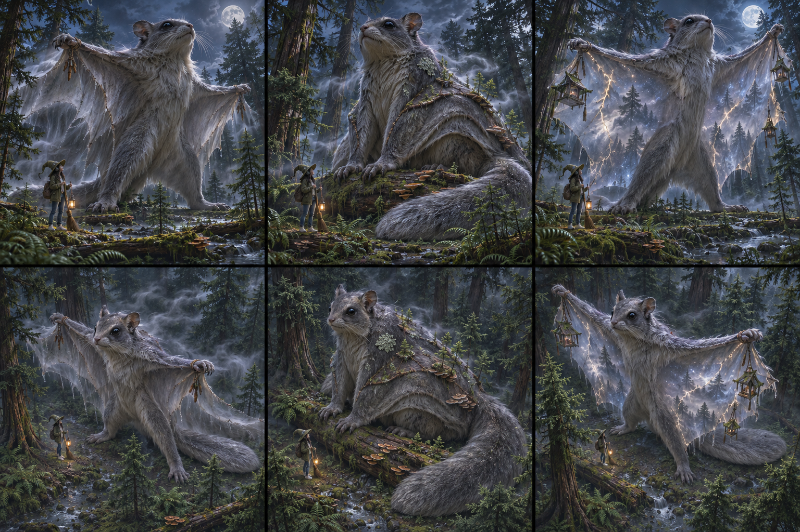

# Siberian flying squirrel target — graph target

Species scope: **flyingsquirrel** (Pteromys volans); L2, #1904. Target identity is inferred from the existing genome's natural cues, not a new gameplay/species decision. No hand-written-art fix or graph code is authorized here.

## Reference plate and provenance

Selected plate: [target-v1.png](https://raw.githubusercontent.com/edsaperia/witch/20d25e05fdc3b44a73ba23e7e270c8105498f1d0/previews/art-pass/flyingsquirrel/target-v1.png), SHA256 `d27b38fa1fc50437193983e7d27b0948d8fbdc111dad2090060aeff7d34d152b`. Generated 2026-11-07 with the built-in **image_gen.imagegen** tool (scientific-educational, photoreal target; model/version/seed not exposed). [Exact prompt](https://raw.githubusercontent.com/edsaperia/witch/20d25e05fdc3b44a73ba23e7e270c8105498f1d0/previews/art-pass/flyingsquirrel/prompt-v1.txt); [provenance](https://raw.githubusercontent.com/edsaperia/witch/20d25e05fdc3b44a73ba23e7e270c8105498f1d0/previews/art-pass/flyingsquirrel/provenance-v1.json). No Commons photo was input to imagegen or committed.

Eight cells: adult row1, mobile juvenile row2; columns standing-towards, standing-away, walking-towards, walking-away. Young represents game age0's mobile visual role, **not a literal neonate or scientifically verified age**. The game has young variants; many real neonatal mammals cannot stand/walk. Size ratios between generated cells are illustrative, not calibrated.

Camera target: art/model3d.js PITCH=.52rad (29.79° downward) and YAW={towards:.6,away:-.6}rad (±34.38°). Prompts approximate a long-lens affine-looking view. Generated heading, perspective, scale and foot contact are not constrained by the real renderer: some cells are more frontal/rearward, and v2 silhouettes can shift angle. **No pixel-exact game-camera match, game-size recognition verdict or actual motion cycle is claimed.**

## Real-photo comparison — real anatomy wins

[Commons comparison file: Pteromys volans.jpg](https://commons.wikimedia.org/wiki/File:Pteromys_volans.jpg). Viewed locally for comparison only; not on either committed branch. The inspected Commons photo shows a grey animal clinging to a tree, folded flanks and a tail, but head detail and attachment points are weak. Liito-orava4.jpg and Pteromysvolans.jpg were unavailable (HTTP429); their page metadata was read but their pixels were NOT reviewed. Grounded membrane/eye targets remain partly anatomy inference; no airborne membrane or juvenile-age validation is claimed.

Photo occlusion, fur, pose and lens prevent reliable joint/length measurement; do not treat this single photograph as a complete anatomical dataset.

## Identifying checklist

1. Large dark eyes, small round untufted ears and short muzzle.
2. Grey-brown upper fur and pale underside, no sugar-glider face stripe.
3. Furred wrist-to-ankle patagium on both sides of the trunk.
4. Grounded animal carries membrane as loose folded flank skin, not bat wings.
5. Broad flattened furry tail, not a cylindrical rat tail.
6. Climbing limbs/feet without extra wing limbs.
7. Mobile young: larger relative head and less expansive membrane/tail, still four limbs.

## Body plan and proportion targets

**L = nose to tail-base length in a neutral quadrupedal pose, excluding tail**, not the torso-only spine length. Head means muzzle tip to occiput; exposed neck is occiput-to-shoulder transition; limb reach means vertical shoulder/hip-to-ground in quiet stance, not summed bone lengths. Ratios below are **artist starting ranges inferred from general anatomy/photos, not specimen measurements, fitted genome values or universal biological bounds**. Adjust for pose and actual photo evidence.

Head 0.22–0.28; exposed neck0.03–0.08; grounded limb reach0.18–0.28; tail0.60–0.85, broad tail width about0.10–0.16.

Soft compact ribcage/hips with flank volume from folded membrane; broad tail is a light rudder, not a fifth supporting limb.

Age0 target: scale the whole animal down, then increase relative head/eye size and reduce muzzle/tail maturity as listed above; do not merely shrink an adult. These are qualitative age keys, not validated growth measurements. Preserve the natural four-limb body plan at every game age. Magical/legend adornments must not replace the identifiable natural silhouette; the separately authorized legend concepts below are proposals only.

## Graph requirements and missing features

1866 already has static triangular membrane sockets. Still unverified/missing is a documented limb-endpoint-bound folded-to-spread furry patagium contract and flattened furred tail cross-section. Do not request bat fingers or an extra limb pair.

Capability audit is source-only: prototype524b0acaa has generic head/leg/wing/tail/shell sockets. Read-only #1866 headde27db5154a3e8b1aa94255263bd2601b92aec36 additionally has neck, parent attachments and static triangular membrane sockets. Thus **neck and membrane kinds are present**, not missing. Its leg foot is an ellipsoid (hoof can split); no explicit reusable digging-palm/digit, ear/tuft, spine-field or folded-patagium deformation contract was verified. Generic ellipsoids can block out some shapes; absence of a named semantic control does not prove geometry is impossible. Requests here are shared graph/family capabilities to confirm with1866, never a permission to patch old builders.

## Ranked targets and image QA

1. Wrist-to-ankle membrane attachment.
2. flattened tail.
3. large eyes+round ears.

v1 reads as a large-eyed gliding squirrel with folded flanks and broad tail. The generated folds do not prove wrist/ankle attachment; no glide pose or quantitative membrane span is certified.

All selected plates were visually inspected for whole framing, adult/young rows and towards/away standing/walking coverage. A lifted paw is not gait validation; hidden far-side feet and exact digit counts are not certified. Generated-photo discrepancies are excluded from the graph specification by the checklist and real-photo priority. Optional shipped-art critique omitted: no shipped renderer run or native/4× acceptance was allocated; the later instruction supersedes that exhaustive review.

Review boundary: target note/reference output complete for coordinator review, with explicit uncertainties above. Species migration and likeness acceptance remain #1866/canonical/Ed decisions; no source, rig, render, registry, gameplay, text or default changed.

## Legend concepts v1 — preserved earlier iteration

Authorized by1476#6707981581 and correction6707992824. Read ART-GUIDE0b/0c and legend-audit; crystals, flame crests and spirit wings are allowed when fitting. Fit and variety win over a blanket adornment ban. Ed judges these proposals; nothing is implemented.

Area story: Mistwood: deep wet moss, fallen nurse logs, sword ferns and fungi, giant spruce and cedar, young spruce from a fallen giant.

| Today’s awake legend | Three generated alternatives |
|---|---|
| **PENDING exact-source comparison.** Requested in1904#6708045677 from prototype524b0acaa. The5Oct atlas is historical and is deliberately not relabelled today. |  |

Columns left→right A/B/C; upper row towards, lower row away. Whole-animal plain-background photographic concept targets; approximate camera only, not game-rendered or game-size acceptance.

- **A:** The Mist-Sail Elder: ancient grey Siberian flying squirrel, huge dark eyes, small round ears, four real limbs; broad wrist-to-ankle furry patagium partly spread as a living fog sail, dew and pale mist cling only to membrane edge, broad flattened furred tail, old membrane repair scars and grey whiskers. NO detached wings, NO bat fingers, NO feathers.
- **B:** The Nurse-Log Keeper: aged flying squirrel grounded with folded patagium and broad flat tail, several tiny seed-and-cone offerings suspended from membrane-edge fur, a small weathered cedar-bark shoulder clasp, large wise eyes, no plant/tree growing from body.
- **C:** The Moonlit Glider: ancient flying squirrel in a low poised glide, membrane hugely but anatomically enlarged between real wrists/ankles, translucent moonlike vein patterns inside the membrane, one healed tear, dark eyes and flat tail; restrained blue light, not spirit bird wings.

**Strongest proposed pick A; signature element: Furred patagium as a living fog sail.** The animal's actual gliding skin becomes the Mistwood's mist-bearing sail. Repaired membrane tears, grey whiskers and dew show an elder that has crossed the nurse-log canopy for ages. The magic stays on its own wrist-to-ankle membrane, not a detached spirit-bird wing.

Actual image QA: A gives the best mist-sail identity with four-limb anatomical intent and healed membrane wear. B conceals the patagium under a cape; C has attractive moon veins but risks a common luminous-wing signature. A far-side wrist/ankle attachments are partly occluded; confirm both in geometry.

### Chosen legend checklist

1. Large dark eyes, small rounded ears and grey/pale flying-squirrel family.
2. Exactly four animal limbs; membrane links wrist to ankle on both sides.
3. Furred patagium partly spreads without bat fingers or feathers.
4. Broad flattened tail balances the body.
5. Healed membrane tears and old fur show age without destroying flight surface continuity.
6. Fog/dew cling to membrane edges, leaving eyes, paws and silhouette visible.

### Chosen legend body plan and graph needs

Legend HBL target1.4–1.6×adult; tail0.70–0.95L. Part-spread total membrane width about1.2–1.6L as a concept target; actual limb-joint geometry and folded pose must be reviewed in1866, not inferred from generated pixels. All ratios are artist starting targets, not measured biology or accepted game size. L retains the nose-to-tail-base definition above; legend exaggeration is deliberate.

Limb-endpoint-bound folding furred patagium, membrane scar/repair mask, bounded edge-mist/dew sockets and flattened tail section. Static triangular membrane kind exists; this is a deformation/attachment contract request. Shared graph work stays with1866. Existing neck/parent/static-membrane sockets are not reported missing; these requests describe species-ready behaviour/material/attachment contracts, not proof that generic geometry cannot express the shape.

### Exact generated evidence

[Plate](https://raw.githubusercontent.com/edsaperia/witch/e85e74d7ccff41e1ffc9447cfe0df7cd959d77bc/previews/art-pass/flyingsquirrel/legend-concepts-v1.png), SHA256 `40a23161d8b37f7ecad88f8702161148facc9eafcc92c9aadb3777c4569e4755`; [exact prompt](https://raw.githubusercontent.com/edsaperia/witch/e85e74d7ccff41e1ffc9447cfe0df7cd959d77bc/previews/art-pass/flyingsquirrel/legend-prompt-v1.txt); [provenance and A/B/C briefs](https://raw.githubusercontent.com/edsaperia/witch/e85e74d7ccff41e1ffc9447cfe0df7cd959d77bc/previews/art-pass/flyingsquirrel/legend-provenance-v1.json). Built-in image_gen.imagegen,2026-11-07; model/seed not exposed. Three concepts with two views each; no real photo input. All eight plates were visually inspected; written QA and real anatomy override generated defects.

Legend-addition status: concepts/selection notes complete, **PARTIAL until today’s exact-source comparison is supplied and placed beside them**. This does not reopen the completed anatomy target milestone or authorize activation.

## Legend concepts v2 — colossal mythic second pass

This is the current proposal, superseding v1 picks/body-size suggestions for legend review, not erasing that history. Authority:1476#6708227119 and later6708229124, fully read. ART-GUIDE0b/0c: each level evolves; nature plus ancient wisdom/power/magic; each its own. Later instruction explicitly permits fitting crystals/flame/spirit wings and supersedes the earlier plain-background constraint. Area text source/story remains as cited above.

DESIGN, Art direction: legends are **about20times a baby’s height, taller than the treetops**. These are the revised concept-scale targets; v1’s adult-relative size multipliers do not constrain this pass. Witch about50px in game is a contextual ruler, not a generated-image calibration. No source size parameters were edited.

| Today’s exact-source awake legend | Revised A / B / C; hero above, game-camera approximation below |
|---|---|
| **PENDING canonical pixels**, requested1904#6708045677. No historical image relabelled current. |  |

Three columns A/B/C; top row low hero view, bottom row the same three designs from an elevated game-camera approximation (target29.79° down/34.38° toward). **Every cell includes a witch and forest trees. C is the clear maximum-fantasy option.** No exact projection,20×measurement, native-size/game-render or mature-canopy-clearance acceptance is claimed.

- **A:** Mist Sail: colossal grey flying squirrel, huge dark eyes/roundears, fourlimbs with wrist-to-ankle FURRED patagium, flat tail; immense old membrane draws banks of fog above wet cedar canopy, healed tears edged with dew, tiny bark offerings at wrist.
- **B:** Nurse-Log Glider: huge grey flying squirrel with recognizable face and folded furred patagium, flat tail curls beside fallen giant cedar, old membrane seams carry tiny nurse-log seedlings/fungi offerings, body lichen scars and mist threads, no cape hiding attachments.
- **C — MAXIMUM FANTASY:** MAXIMUM FANTASY Keeper of the Cloud Canopy: colossal GREY FLYING SQUIRREL exactly fourlimbs, huge black eyes/small roundears/flatfurredtail; real wrist-to-ankle patagium becomes a vast translucent furred living weather-front holding star-reflecting mist and cedar-silhouette shadows, repaired tears resemble lightning seams, tiny suspended cedar-bark shrines at membrane edge; giant animal above forest, no feathers/bat fingers/detached spirit wings.

**Revised strongest proposed pick C — SIGNATURE ELEMENT: Limb-bound gliding membrane as a living cloud front.** The true patagium becomes the Mistwood’s weather. Lightning-like healed seams and cedar-bark shrines show age and reverence while huge dark eyes, round ears and flattened tail retain flying-squirrel anatomy. Ed judges how far to take it; no activation.

Actual inspected image result: C makes the patagium a mist/star weather front, stronger than A’s simpler fog sail and B’s concealing cape. Witch and cedar/spruce trees appear in all six cells. C preserves four-limb intent and large dark eyes, but stands anthropomorphically upright and far membrane ankle attachments are obscured. Top tail is partly hidden, lower row clearer; no anatomical flight validation. It overtops smaller crowns but not every foreground tree;20×baby and game projection remain uncalibrated.

### Revised chosen checklist

1. Grey flying squirrel, huge dark eyes and small rounded ears.
2. Exactly four limbs and furred wrist-to-ankle membrane on both sides.
3. Flat furred tail, no feather/bat-finger substitute.
4. Cloud/star reflection is localized inside the anatomical membrane.
5. Repaired tear seams and tiny cedar shrines preserve continuous membrane surface.
6. Witch and cedar canopy trees remain visible in both views.

### Revised body plan and missing shared features

Membrane spreads between actual limb endpoints and folds with them; body silhouette must remain visible through atmospheric magic. Surface/edge effects are a concept, not permission for detached extra wings or runtime weather changes. Proportion/anatomy checklist remains the control over image defects; colossal mass/world-grown layers must not merely rescale the adult outline.

Limb-bound folding patagium with translucent fur material, localized cloud/repair mask and edge shrine attachment limits; existing static triangular membrane is insufficient evidence of that complete contract. Graph owner1866 confirms feasibility/implementation; existing neck/parent/static membrane kinds are not new requests. Shrines, ecology and environmental magic here are reference proposals only, no permission to change terrain, combat, effects or gameplay.

### Revision provenance and acceptance

[Full v2 plate](https://raw.githubusercontent.com/edsaperia/witch/eaae72457fe50d7f8312991168a7b41448ea6e62/previews/art-pass/flyingsquirrel/legend-concepts-v2.png), SHA256 `90a0436f986bf15964e71f77683fb9ce4afe85b17d0ce5ecf8b2559734495ec3`; [exact prompt](https://raw.githubusercontent.com/edsaperia/witch/eaae72457fe50d7f8312991168a7b41448ea6e62/previews/art-pass/flyingsquirrel/legend-prompt-v2.txt); [provenance and3briefs](https://raw.githubusercontent.com/edsaperia/witch/eaae72457fe50d7f8312991168a7b41448ea6e62/previews/art-pass/flyingsquirrel/legend-provenance-v2.json). Built-in image_gen.imagegen on2026-11-07; model/version/seed not exposed. All requested second-pass plates actually generated/saved/inspected; no source image edit or real-photo input. Earlier v1/anatomy images and their immutable provenance remain intact.

Second-pass reference milestone complete for review, with image defects/scale-camera limits above. Overall comparison remains PARTIAL until canonical exact-source today panels arrive and are placed beside v2. Ed acceptance and migration are separate; nothing activated.
