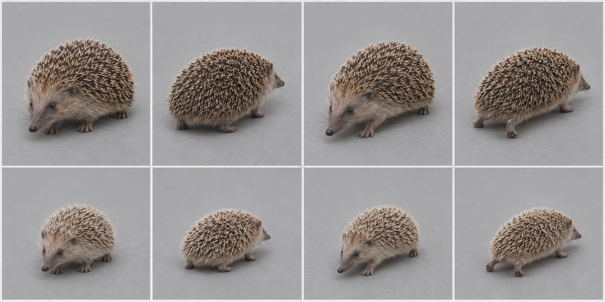
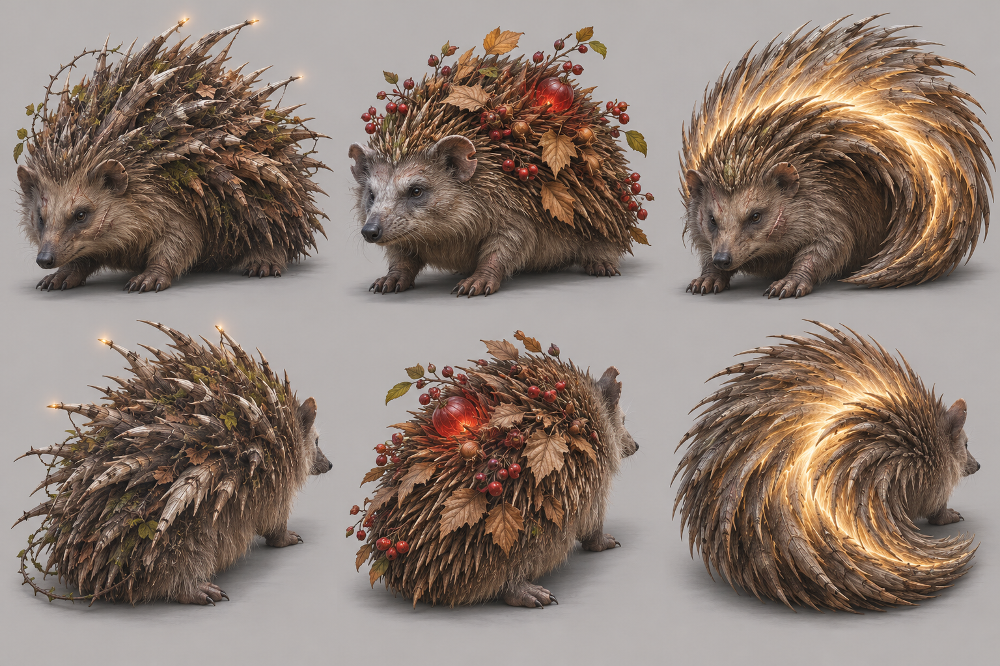

# European hedgehog — graph target

Species scope: **hedgehog** (Erinaceus europaeus); L2, #1904. Target identity is inferred from the existing genome's natural cues, not a new gameplay/species decision. No hand-written-art fix or graph code is authorized here.

## Reference plate and provenance

Selected plate: [target-v2.png](https://raw.githubusercontent.com/edsaperia/witch/20d25e05fdc3b44a73ba23e7e270c8105498f1d0/previews/art-pass/hedgehog/target-v2.png), SHA256 `cc7d6c14ffcdca8fbf97e98376875527e5343211b237d5e6afe5641cd03cdaf0`. Generated 2026-11-07 with the built-in **image_gen.imagegen** tool (scientific-educational, photoreal target; model/version/seed not exposed). [Exact prompt](https://raw.githubusercontent.com/edsaperia/witch/20d25e05fdc3b44a73ba23e7e270c8105498f1d0/previews/art-pass/hedgehog/prompt-v2.txt); [provenance](https://raw.githubusercontent.com/edsaperia/witch/20d25e05fdc3b44a73ba23e7e270c8105498f1d0/previews/art-pass/hedgehog/provenance-v2.json). No Commons photo was input to imagegen or committed.

Eight cells: adult row1, mobile juvenile row2; columns standing-towards, standing-away, walking-towards, walking-away. Young represents game age0's mobile visual role, **not a literal neonate or scientifically verified age**. The game has young variants; many real neonatal mammals cannot stand/walk. Size ratios between generated cells are illustrative, not calibrated.

Camera target: art/model3d.js PITCH=.52rad (29.79° downward) and YAW={towards:.6,away:-.6}rad (±34.38°). Prompts approximate a long-lens affine-looking view. Generated heading, perspective, scale and foot contact are not constrained by the real renderer: some cells are more frontal/rearward, and v2 silhouettes can shift angle. **No pixel-exact game-camera match, game-size recognition verdict or actual motion cycle is claimed.**

## Real-photo comparison — real anatomy wins

[Commons comparison file: Erinaceus europaeus (Linnaeus, 1758).jpg](https://commons.wikimedia.org/wiki/File:Erinaceus_europaeus_(Linnaeus%2C_1758).jpg). Viewed locally for comparison only; not on either committed branch. The Commons file explicitly identifies a young European hedgehog. It is useful for snout/ear/spine boundary, not neonatal anatomy. Generated leg height is checked against the low body envelope; full biological growth curves are not established.

Photo occlusion, fur, pose and lens prevent reliable joint/length measurement; do not treat this single photograph as a complete anatomical dataset.

## Identifying checklist

1. Low domed oval trunk, not a tall-legged spiny dog.
2. Long pointed furry muzzle below the dorsal mantle.
3. Dense short banded spines on back/flanks only.
4. Furry belly, face and limbs; no spines on the nose or underside.
5. Small round ears and small dark eyes.
6. Short real legs/feet beneath the body and tiny tail.
7. Mobile hoglet: finer paler spines and larger head; not a naked newborn forced to walk.

## Body plan and proportion targets

**L = nose to tail-base length in a neutral quadrupedal pose, excluding tail**, not the torso-only spine length. Head means muzzle tip to occiput; exposed neck is occiput-to-shoulder transition; limb reach means vertical shoulder/hip-to-ground in quiet stance, not summed bone lengths. Ratios below are **artist starting ranges inferred from general anatomy/photos, not specimen measurements, fitted genome values or universal biological bounds**. Adjust for pose and actual photo evidence.

Head 0.20–0.27; exposed neck0.02–0.05; quiet stance limb reach0.12–0.20; tail0.03–0.07.

Rounded high mid-back with bulk over ribs/hips; face forms a low taper. Low belly and broad support, but feet must not be erased.

Age0 target: scale the whole animal down, then increase relative head/eye size and reduce muzzle/tail maturity as listed above; do not merely shrink an adult. These are qualitative age keys, not validated growth measurements. Preserve the natural four-limb body plan at every game age. Magical/legend adornments must not replace the identifiable natural silhouette; the separately authorized legend concepts below are proposals only.

## Graph requirements and missing features

Surface-attached directional spine/quill field with fur/spine boundary, age-dependent density and orientation; shell socket alone is not a hedgehog coat. Curling/deformation under future nap review remains unverified.

Capability audit is source-only: prototype524b0acaa has generic head/leg/wing/tail/shell sockets. Read-only #1866 headde27db5154a3e8b1aa94255263bd2601b92aec36 additionally has neck, parent attachments and static triangular membrane sockets. Thus **neck and membrane kinds are present**, not missing. Its leg foot is an ellipsoid (hoof can split); no explicit reusable digging-palm/digit, ear/tuft, spine-field or folded-patagium deformation contract was verified. Generic ellipsoids can block out some shapes; absence of a named semantic control does not prove geometry is impossible. Requests here are shared graph/family capabilities to confirm with1866, never a permission to patch old builders.

## Ranked targets and image QA

1. Low mantle silhouette.
2. long furry snout.
3. bounded spine field.

v1 rejected for the high belly and overly exposed long limbs. v2 requested a low rounded body and reduced visible legs; do not use the juvenile's generated spine density as a measured age key.

v2 restores a low dome and furry tapered snout. Walking is only a lifted-foot pose, and feet are partly hidden by the low body; not an accepted gait cycle.

All selected plates were visually inspected for whole framing, adult/young rows and towards/away standing/walking coverage. A lifted paw is not gait validation; hidden far-side feet and exact digit counts are not certified. Generated-photo discrepancies are excluded from the graph specification by the checklist and real-photo priority. Optional shipped-art critique omitted: no shipped renderer run or native/4× acceptance was allocated; the later instruction supersedes that exhaustive review.

Review boundary: target note/reference output complete for coordinator review, with explicit uncertainties above. Species migration and likeness acceptance remain #1866/canonical/Ed decisions; no source, rig, render, registry, gameplay, text or default changed.

## Legend concepts — 2026-11-07 proposal

Authorized by1476#6707981581 and correction6707992824. Read ART-GUIDE0b/0c and legend-audit; crystals, flame crests and spirit wings are allowed when fitting. Fit and variety win over a blanket adornment ban. Ed judges these proposals; nothing is implemented.

Area story: Hazel forest: short grass, brown ground lumps and red-berried shrubs, crooked many-branched trees.

| Today’s awake legend | Three generated alternatives |
|---|---|
| **PENDING exact-source comparison.** Requested in1904#6708045677 from prototype524b0acaa. The5Oct atlas is historical and is deliberately not relabelled today. |  |

Columns left→right A/B/C; upper row towards, lower row away. Whole-animal plain-background photographic concept targets; approximate camera only, not game-rendered or game-size acceptance.

- **A:** The Bramble Bastion: low enormous European hedgehog with long pointed furry snout and a dorsal mantle of huge thick age-weathered spines, some broken and regrown, resembling a defensive lance forest; a few tiny warm lights only at oldest quill tips, not body-covering crystal armour. Feet short, no quills on face/belly.
- **B:** The Berry Offering Keeper: old low hedgehog with layered natural spines holding several red berry sprigs and dry hazel leaves as offerings, silver muzzle and a worn notch on one ear; a single translucent red berry larger than the rest glows gently within the spine mantle, no whole trees.
- **C:** The Shielding Curl: huge hedgehog half-curled protectively, recognisable face and feet still visible; immense spines fan backwards into a crescent shell of warm pale light following actual spine roots, weathered bristles and old scars. No free-floating eye halo or wings.

**Strongest proposed pick A; signature element: Weathered dorsal quill bastion.** The hedgehog's defence becomes an ancient protective fortress. Thick worn/broken quills and a low heavy dome show survival, while the furry pointed face and short feet preserve its family. Sparse old-quill tip lights add mystery without turning it into a generic crystal beast.

Actual image QA: A best joins defence, age and the hazel thicket. It is still too tall and thorn/wood-like in places: lower the dome, retain true quills and do not copy literal branches as every spine. B hides the coat under foliage; C resembles a luminous crest rather than a protective half-curl.

### Chosen legend checklist

1. Low oval dome, short feet and long furry pointed snout.
2. No quills on face, limbs or belly.
3. Dorsal quills are the exaggerated main silhouette.
4. Broken/regrown/worn quills vary in a coherent age pattern.
5. Small eyes and rounded ears remain visible beneath the mantle.
6. Any quill-tip light is sparse and attached, not an independent halo hiding the creature.

### Chosen legend body plan and graph needs

Legend HBL target1.4–1.6×adult; dorsal quills may reach0.25–0.40L for the concept, not twice total body height. Head0.20–0.25L; preserve a low belly and feet, avoid a tall porcupine profile. All ratios are artist starting targets, not measured biology or accepted game size. L retains the nose-to-tail-base definition above; legend exaggeration is deliberate.

Directional dorsal spine field with per-spine wear/regrowth and sparse emissive tips, fur/spine boundary and safe deformation. Shell ellipsoid alone cannot define the quill coat. Shared graph work stays with1866. Existing neck/parent/static-membrane sockets are not reported missing; these requests describe species-ready behaviour/material/attachment contracts, not proof that generic geometry cannot express the shape.

### Exact generated evidence

[Plate](https://raw.githubusercontent.com/edsaperia/witch/e85e74d7ccff41e1ffc9447cfe0df7cd959d77bc/previews/art-pass/hedgehog/legend-concepts-v1.png), SHA256 `7d6903c8aea16bec88c8b8cf3e05e9ce27eef6df5aec7969d2bb42a347d054c6`; [exact prompt](https://raw.githubusercontent.com/edsaperia/witch/e85e74d7ccff41e1ffc9447cfe0df7cd959d77bc/previews/art-pass/hedgehog/legend-prompt-v1.txt); [provenance and A/B/C briefs](https://raw.githubusercontent.com/edsaperia/witch/e85e74d7ccff41e1ffc9447cfe0df7cd959d77bc/previews/art-pass/hedgehog/legend-provenance-v1.json). Built-in image_gen.imagegen,2026-11-07; model/seed not exposed. Three concepts with two views each; no real photo input. All eight plates were visually inspected; written QA and real anatomy override generated defects.

Legend-addition status: concepts/selection notes complete, **PARTIAL until today’s exact-source comparison is supplied and placed beside them**. This does not reopen the completed anatomy target milestone or authorize activation.
