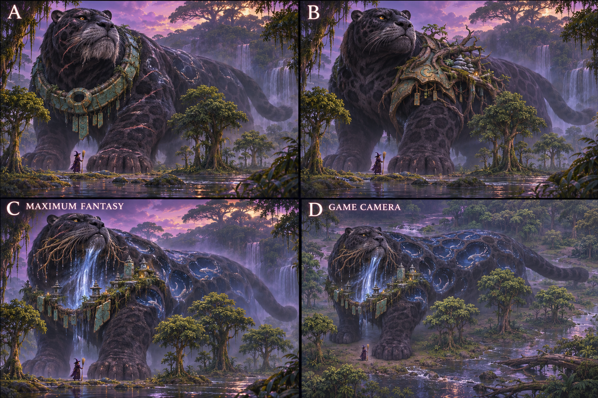

# Black jaguar: L3 graph target

7 November 2026. Species ID `jaguar`; Panthera onca, melanistic. Draft design reference for PR1906, source base524b0acaa43bb9975e7b2834ff9a55cbca4b3319. Ed judges the legend recommendation. No activation, implementation or claim that the current game passes.

## Reads-as target

Broad-headed, short-legged powerful black cat, faint rosettes in light.

- Broad round skull and heavy short muzzle/jaw
- Thick neck merging into muscular forequarters
- Stocky deep trunk and strong shoulders
- Short thick legs with broad paws
- Moderate long tail, neither bobtail nor snow-leopard plume
- Rounded small ears
- Broken rosettes with internal spots; melanistic coat keeps black-on-charcoal contrast

## Adult and mobile-young references


Top row adult, bottom row mobile young/age0 target; columns standing towards, standing away, walking towards, walking away. Ages scaled independently: NOT a world-size comparison. Age0 means a mobile cub/kitten, not a newborn. Game levels remain0 baby/1 young/2 adult/3 legend. This does not redefine their biology or game sizes.

## Proportions and mass

Use L = nose to tail base (head-body length), excluding tail, mane and decorative fur. These are **artist starting ranges**, not measured zoological statistics, pixel measurements or acceptance thresholds. Perspective, pose, sex, subspecies and coat vary. Refine against multiple orthogonal photos before implementation.

| Quantity | Fraction of L |
|---|---|
| Exposed leg: ground to ventral trunk | .25–.35 |
| Head: occiput to nose | .19–.24 |
| Visible neck bridge | .09–.14 |
| Tail: base to tip along curve | .35–.55 |
| Ground to shoulder | .47–.60 |

Forehead/jaw/neck and forequarters carry substantial mass; deep ribcage with modest waist pinch. Hindquarters remain powerful, not a tiny rear attached to a huge head.

Young: Round large head, broad short muzzle and paws, softer short trunk. Dark rosettes remain visible under suitable light, not a featureless black silhouette.

Feline hindlegs are digitigrade: the visible backward hock is an ankle, not a backward knee. Preserve fore/hind distinction and paw support; a still generated frame does not prove a gait cycle.

## Photograph and anatomy cross-check

Tawny adult photo clearly shows broad head, heavy shoulders, short stout legs, tail and central-spotted rosettes. Cub photo shows rounded head and big paws but crouching distorts leg ratio. Both are NON-melanistic anatomy comparisons. Generated anatomy sheet is tawny too: shape/pattern reference only; current game target and all legend proposals are explicitly black.

- [adult: File:Standing jaguar.jpg](https://commons.wikimedia.org/wiki/File:Standing_jaguar.jpg) — viewed privately.
- [young: File:Jaguar cub with armadillo - DPLA - 9e700a29f0b5b62f4c4b78fbd979439d.jpg](https://commons.wikimedia.org/wiki/File:Jaguar_cub_with_armadillo_-_DPLA_-_9e700a29f0b5b62f4c4b78fbd979439d.jpg) — viewed privately.

[Expert species description](https://www.catsg.org/living-species-jaguar) supports the identifying traits; ratios above are our design estimates. Commons photos are comparison-only, kept private and never published in this PR or shots.

## Iteration2: colossal fantasy concepts — current recommendation

Later Ed feedback on7November2026, COORDINATOR6708227119/6708229124, supersedes iteration1’s modest fantasy/plain-background direction. [DESIGN.md](../../DESIGN.md#look) says legends are about20times a baby’s height and taller than treetops; ART-GUIDE0b/0c asks for a recognisable animal’s nature made fantastic, epoch age, wisdom, power and reverence. These are proposed designs, not changes to game sizes.



2×2 board: A upper-left, B upper-right, C MAXIMUM FANTASY lower-left; D lower-right repeats C at an approximate game-camera elevation29.8° down/yaw34.4° from side-on. **Exactly three designs; D is another view, not a fourth concept.** Witch and trees are included in every panel. A/B/C use low hero views to convey mass, far-side haze and landscape weathering. The witch is a scale stand-in, not an exact render of the game’s witch.

- A: Deep River Jaw, colossal grey muzzle, worn jade torque and river-reflection coat.
- B: Root Warden, asymmetric ancient bronze shoulder guard with rooted offerings.
- C MAXIMUM FANTASY: Drowned Constellation; river pools in rosettes, rootlike whiskers and a chin-to-coat water cascade above a shrine torque.

**Recommend C for Ed’s second-pass review; signature element: Deep river pools within black rosettes.** C makes a black jungle river manifest in its heavy hunter’s coat. The short stout legs, broad crushing jaw, black fur and moderate tail remain unmistakable panther anatomy; rooted whiskers, worn shrines and water give age and reverence. Unlike a generic blue starfield, the glints belong to river pools and fish currents. A is less transformative; B obscures the shoulder with equipment.

Chosen legend body-plan/checklist: Maintain broad low feline head/neck/forequarters. Place inset water-pool volumes inside existing rosette coordinates, not holes through the skeleton. Rootlike whiskers hang clear of mouth; throat/shoulder torque carries sparse eroded shrines. Cascade direction is a magical concept; image cannot prove upward flow.

MISSING GRAPH FEATURES / shared integration needs: Inset coat volumes and water/emissive layer mapping, head-local whisker/flow roots, accessory torque/mini-shrine sockets and clearance, aged jade/bronze/scar regions. Existing rosette paint/tail markings should remain the basis.

Actual inspected output/projection limits: All four panels show witch and jungle trees; C/D show full tail and big black head. Near trees partially hide rear limbs. D shows pool shapes but cannot establish fish detail or water flow direction; C’s cascade reads visually downward despite the upward-flow prompt. Do not claim that requested motion succeeded.

Scale assessment: all four panels visibly contain a witch and trees; selected C/D read as colossal against the nearby witch and tree groups. Perspective/depth/variable tree size prevent an exact height comparison; no baby is depicted, so **20× baby height is a design prompt, not a verified measurement**. Native game projection, coverage/contact, accessory motion, occlusion and20× size must be tested on graph renders by the canonical owner. No local browser was allocated/run.

### Iteration2 exact generation prompt

```text
Witch videogame legendary creature second-pass design board. FOUR equal panels in a 2x2 grid, labelled A (upper left), B (upper right), C MAXIMUM FANTASY (lower left), D GAME CAMERA (lower right); no other text. A B C are THREE DIFFERENT concepts of SAME species; D repeats C's exact design from higher game camera. Every panel shows the ENTIRE huge creature including ALL ears/paws/tail, within ample margins. CRITICAL SCALE IN EVERY PANEL: a tiny human WITCH with pointed dark purple hat/dress holding broom STANDS on SAME ground plane next to front paw, clearly distinct and NOT riding animal; multiple complete FOREST TREES near paws and flank, with normal trunks/crowns and readable silhouettes. Creature head/shoulders TOWER ABOVE tree crowns; landscape-scale body mass, approximately20times a baby animal height, NOT a normal pet by a human. Trees about quarter to half creature shoulderheight, witch about one tenth to one fifteenth. Compose enough ground area to show scale without cropping creature. A B C cinematic slightly low/near-ground threequarter HERO viewpoint with atmospheric depth/haze on distant body, large weight-bearing landformlike masses. D SAME C at approximate actual game projection, elevation29.8deg DOWN, near-orthographic long lens, heading34.4deg from side-on facing viewer; whole giant+witch+trees still visible. Concept art: bold controlled painterly/small readable shape clusters, rich twilight with local magic light. Very ancient wise powerful mythical elder, animal's defining nature impossible, species instantly identifiable. No generic uniform, no gore, no modern buildings. Trees/environment support scale not hide anatomy. BLACK MELANISTIC JAGUAR: broad round crushing jaw, huge stout forequarters, thick short legs and paws, moderate long tail, rounded small ears, black-on-charcoal rosettes. River jungle with canopy rainforest trees/lianas, dark river/fallen giant trees. A: grey-muzzled Deep River Jaw wearing colossal tarnished jade throat torque, dark rosettes ripple like river reflections, heavy scars. B: Root Warden, one asymmetric root-shaped ancient bronze pauldron, fallen branches and river offerings embedded at its edge, huge low powerful black feline body. C MAXIMUM FANTASY RECOMMENDED: Drowned Constellation, a colossal black jaguar whose rosettes contain deep pools of midnight RIVER WATER with glowing silver fish currents, its huge heavy jowls hang above a waterfall flowing UPWARDS from its chin into the rosette pools; rootlike whiskers trailing droplets, weathered jade fragments and worn river-stone shrines sit along the massive collarbone but never hide black cat head. Rear body disappears slightly into cool atmospheric haze yet full tail visible. No wings, no leopard yellow fur, no bear anatomy. D same C game camera.
```

Selected first iteration2 generation; no framing edit.

Generation: built-in imagegen,7November2026, model/seed unreported; text-only initial prompt; framing edits referenced only the species’ generated board, no real photos or game captures. No generated concept is activated.

## Iteration1: three historical concepts and existing comparison

Area/story: River jungle: dark wet loam, river banks, ferns/reeds, rainforest giants hung with lianas, mossed fallen giants (art/areas/river-jungle/recipe.js).

| Three new proposals, A/B/C left to right | Existing renderer comparison, ALL ages |
|---|---|
|  |  |

The right-hand sheet is **archival**, source/served SHA aad8b13327282d13d7d6a4e2e1b28aa2acfd6b6c, fixture cats-1. Read its Current column, level3 row for the old legend; its graph column is NOT the target. It is not a capture of today's524b0ac source. Fresh exact-head legend evidence must be supplied by the canonical renderer before a current-vs-target verdict; no laptop browser was allocated or run.

- A Deep River Jaw — broad grey muzzle and jade/bronze throat torque.
- B Underwater Shadow — river-dark rosettes with tiny silver fish glints.
- C Fallen Giant — asymmetric worn root-shaped shoulder armour.

**Historical iteration1 recommendation B; signature element: River life within dark rosettes.** A hidden river appears in the coat of the river’s stealthy hunter. The massive low jaw and scarred old body remain primary; tiny fish glints add mystery rather than a uniform costume. A repeats ceremonial collars, C obscures shoulder anatomy.

Chosen legend checklist/body plan: Retain low muscular black body and crushing jaw. Place sparse fish-like glints inside rosette regions with sufficient contrast, never replace fur with literal aquarium panels. Grey muzzle, scarred brow, ears and full tail stay clear.

These are three concepts generated together in one sheet, not three independent calibrated render trials. Inspect all whole bodies and recognisability; labels identify proposals, not approved in-game names. Only Ed/coordinator can adopt a pick.

## Top three priorities and MISSING GRAPH FEATURES

Top three: broad head/jaw; stocky limbs; black-on-black rosettes.

Independent jaw/cheek landmarks under inherited head frame; shared coat-region mapping for subtle rosettes plus aged scar overlays. Existing rosette/tail paint already exists.

At the pinned source, `art/body-graph/graph.js` has head/leg/wing/tail/shell sockets, torso spine stations, head ellipsoid, two-bone digitigrade legs and a foot ellipsoid. `quadruped.js` already has torso profile/flex, pointed-ear cup helpers and region patterns; `families.js` has feline adapter; `tail-markings.js` already supports rings/spots/rosettes/tip paint. `gait.js` has a two-bone straight-line diagnostic solve. Do NOT request basic tails, all ears, all patterns or all gait as wholly absent. Missing contract: rotating station frames/socket-to-socket attachments (explicit future work), nested head/foot-local feature inheritance, age-linked fur/tuft/accessory attachment data and scar/weathering regions. Legacy features may draw these today; this is a request for shared graph representation, not a demand for handwritten species fixes. Refer implementation to graph owner#1866.

## Provenance and limits

Built-in `image_gen.imagegen`, 7 November2026; no model identifier/seed reported. Text-only generation, no source photograph supplied as input. Anatomy prompts ask photorealism; legends use sculptural concept art. Actual camera source `art/model3d.js`: pitch0.52rad (29.8° down), yaw±0.6rad (34.4°). Tool output only approximates this; no camera calibration, native-size rendering, pixel-diff, locomotion/contact or graph-fit proof. All selected generated sheets were visually inspected for panel/age/pose coverage and complete animals; natural occlusion remains.

Tawny generated base sheet intentionally not a final colour target; no native-size proof that fish glints survive.

### Exact anatomy generation prompt

```text
Scientific-educational PHOTOREAL whole-animal anatomy contact sheet, eight equal panels, two rows of four. Plain warm off-white studio floor/background, soft neutral daylight, no objects/text/labels/collars. Camera approximately29.8 degrees looking down, long-lens orthographic-like, animal long axis34.4 degrees toward or away from side-on. Top row same ADULT: stand towards, stand away, slow natural walk towards, slow natural walk away. Bottom row same MOBILE YOUNG in identical order. Every animal entirely inside its own panel with ample padding including every paw/ear/tail; no crop. Four anatomically correct legs, digitigrade feline paws/hocks, clear weight-bearing slow-walk stance. No stylization, human expression, or distorted/extra limbs. Scale each age independently for anatomical inspection; not a size comparison. JAGUAR (Panthera onca), not leopard. Adult heavily muscled stocky compact trunk, very broad short-muzzled powerful head and jaws, thick neck, stout relatively short limbs and large round paws, relatively short thick tail. Tawny coat with large irregular broken rosettes containing small central black dots, spots on head/legs. Young approximately3-month mobile cub, broad large head, compact soft fuzzy torso and sturdy large paws, short muzzle, retained rosettes, smaller proportional limbs. Do not use long slim leopard torso or extra-long tail.
```

### Exact legend generation prompt

```text
Concept art comparison sheet, THREE distinctly DIFFERENT legendary creature proposals in THREE equal columns labelled A, B, C only. One WHOLE creature per column, ears paws tail entirely visible with generous margin, plain warm ivory studio background and ground shadow, no scenery or extra animals. Approximate Witch GAME camera elevation29.8deg looking down, long-lens orthographic-like, body34.4deg toward camera from side-on. All are ancient powerful wise elders, animal's defining nature exaggerated into magic, still recognisably that exact species. Painterly sculptural concept art with bold coherent silhouettes, restrained palette/large readable shapes, not a UI/game sprite or calibrated render. Strong anatomy and natural quadruped standing or slow deliberate walking, no gore; healed scars only. Each concept its OWN idea, not uniform accessory swaps. MELANISTIC BLACK JAGUAR, very broad head and heavy crushing jaw, stocky short powerful limbs, long moderate tail, rosettes faint black-on-charcoal. River jungle: dark wet loam, rainforest giants lianas, fallen mossed logs over river. A: Deep River Jaw, broad greying scarred muzzle and huge blunt jaw, weathered jade-and-bronze throat torque bearing river worn tooth-shaped pendants; faint water-caustic rosettes on BLACK fur, no water background. B: Underwater Shadow, black jaguar with ancient pale scars and glassy river-dark rosettes containing tiny silver fish-shaped glints, oversized broad paws, no wings. C: Fallen Giant, huge low black jaguar with one asymmetric eroded bronze shoulder guard shaped like root buttress, old broken canine visible, algae-green bead at throat; no trees on back.
```

See [L3 summary](l3-summary.md) for evidence hashes, shared gaps and remaining checks.
