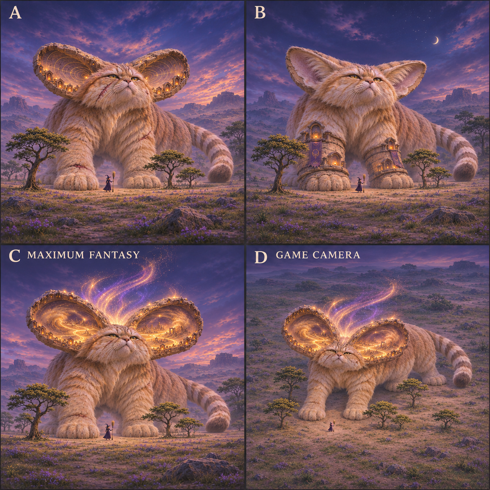
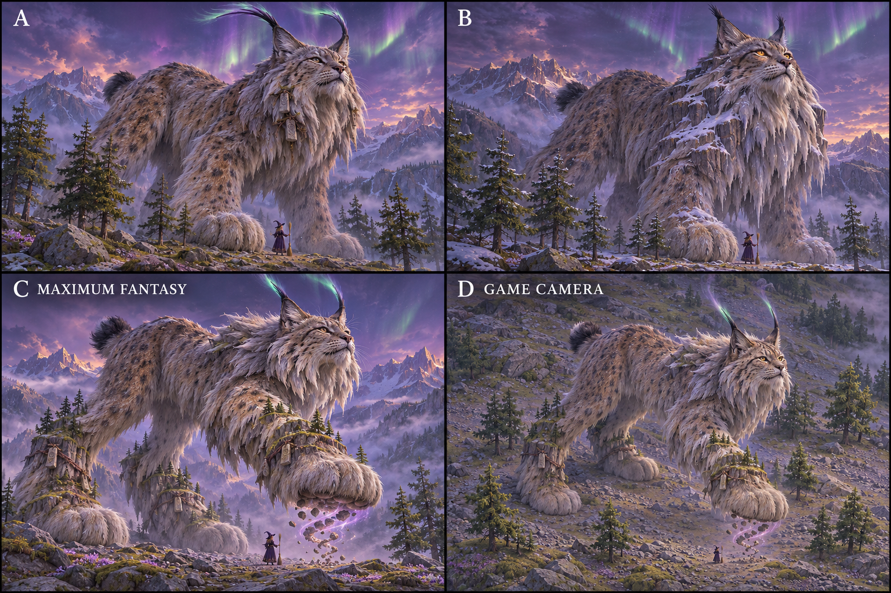
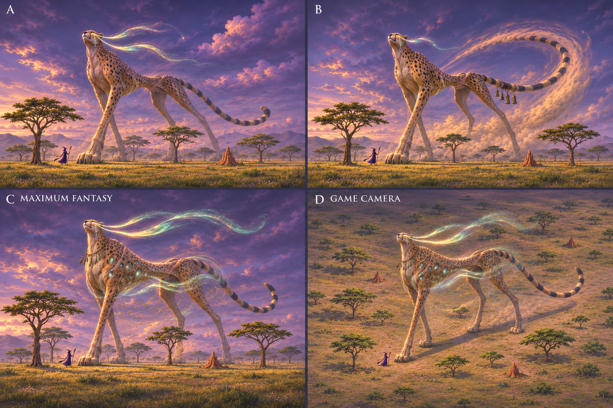
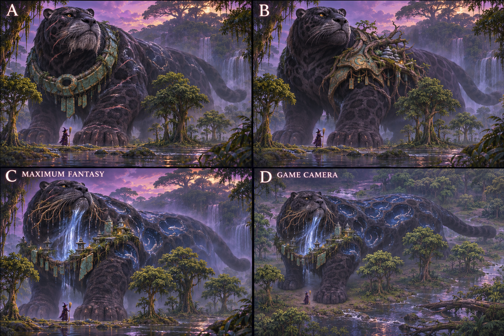
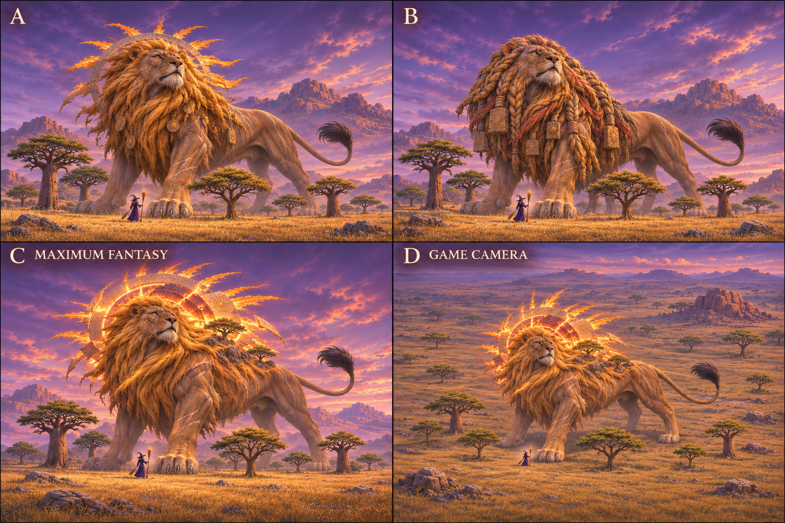
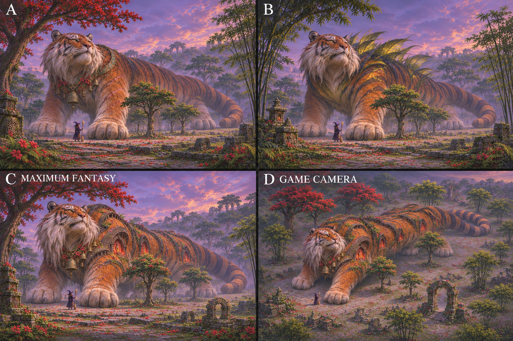
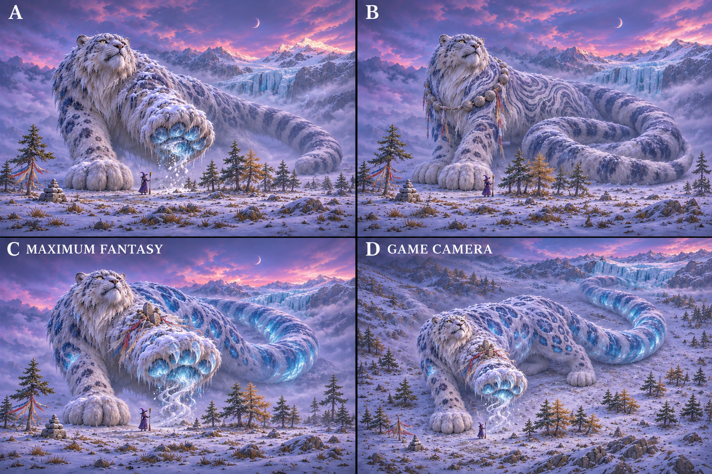

# L3 feline targets and legend recommendations

PR1906, branch codex/art-pass-l3, worktree work/art-pass-l3, source524b0acaa43bb9975e7b2834ff9a55cbca4b3319. Seven owned species, no graph/game edits. This is a reviewable design package with explicit evidence gaps, **not a finished likeness or current-vs-target acceptance verdict**.

Ed’s 7 November correction wins over ART-GUIDE0c’s older blanket wording: crystals/flames/spirit wings are allowed where animal/story fit; avoid a uniform. Three generated proposals per species, one recommendation each for Ed to judge. The generated sheets are concepts, not imported assets.

## Iteration2: current colossal-fantasy recommendations

New feedback6708227119/6708229124: preserve iteration1, push further into myth/epoch age, witch+trees in EVERY concept, approximately20×baby height/taller than treetops as design target, plus game-camera version of selected pick. All seven boards now contain A/B/C three concepts with C maximum fantasy and D a higher-camera version of C. All28panels were visually inspected; five boards received one framing correction. Full prompts and candid per-species output limits are above iteration1 in each note. No numerical scale/camera/native-pixel acceptance is claimed.

| Species | Current pick | SIGNATURE ELEMENT | MISSING GRAPH FEATURES / integration needs |
|---|---|---|---|
| [Sand cat](cat.md) | C (D camera check) | Lost dune worlds inside low ear bowls | Nested ear-local surfaces/volumes, interior landscape and emissive-region attachment, rim-carved niche sockets, bounded particle curves and weathered material/geometry regions. Generic pointed ears do not provide this complete contract. |
| [Eurasian lynx](lynx.md) | C (D camera check) | Scree lifted by terraced mountain paws | Foot/ankle-local layered fur/rock/vegetation sockets and clearance envelopes; a separately bounded airborne scree field linked to planted/raised state; asymmetric wear/offerings. Existing two-bone diagnostic legs lack the complete accessory/clearance contract. |
| [Cheetah](cheetah.md) | C (D camera check) | Wind-wells within solid-spot coat | Coat-region inset/emissive volumes for spots, head-local stream roots, waist-relative bounded wind field, sparse necklace sockets and scar/weathering masks. This is beyond existing spot paint, while reusing its mapping rather than replacing the pattern system. |
| [Black jaguar](jaguar.md) | C (D camera check) | Deep river pools within black rosettes | Inset coat volumes and water/emissive layer mapping, head-local whisker/flow roots, accessory torque/mini-shrine sockets and clearance, aged jade/bronze/scar regions. Existing rosette paint/tail markings should remain the basis. |
| [Lion](lion.md) | C (D camera check) | Broken solar corona within monumental mane | Nested neck/mane radial frame and discontinuous corona geometry, accessory sundial/carving sockets, emissive interior regions, sparse vegetation ledge attachments and age/weathering. Existing mane primitives are not the whole graph contract. |
| [Tiger](tiger.md) | C (D camera check) | Tiger stripes become sacred relief architecture | Surface-region-following relief meshes with age/weathering and cavity/niche data; nested votive lights/ferns, accessory throat curves, deformation/clearance constraints across shoulders. Existing stripe paint supplies coordinates but not carved architecture. |
| [Snow leopard](snowleopard.md) | C (D camera check) | Glacial paw vaults lifting an avalanche | Foot-local translucent cavity volumes/ice-claw attachment, bounded avalanche field, coat crevasse-region depth/light, cylindrical-tail surface layering and sparse wrist votive sockets. Reuse existing tail chains/rosette mapping; do not invent a new bespoke species renderer. |

C is recommended in each revised board because it best answers Ed’s request to explore beyond a merely big old animal. A/B remain alternatives, not rejected by Ed. The seven recommendations remain proposals pending Ed/coordinator judgement and canonical cross-lane spread.

Variety: sand-cat ear worlds, lynx scree-lifting paws, cheetah wind-wells, jaguar river-pools, lion solar mane, tiger stripe architecture and snow-leopard glacial pads. Paw magic repeats for lynx/snowleopard because both have unusually large feet; dry-rock levitation versus glacial vault/avalanche is the distinction. Miniature shrines recur as signs of reverence, but their supporting animal feature differs (ear rims, river torque, tiger stripes); avoid the same temple-building costume across all. Vegetation on lion/lynx supports specific weathering/landform ideas; it is not a mandatory back ornament. Water/air/ice use distinct host regions and behaviour. Coordinator must check eventual other-lane signatures.

Scale: witch+nearby tree groups demonstrate intended colossal mass. Some foreground or background canopy is taller through depth/variable tree size; do not equate every tree crown to a common-height ruler. No baby appears, so20× is unmeasured. Current game size settings are not changed or asserted to match this concept target. The D panels are generated approximations, not captures.

Iteration2 adds seven PNGs under own species paths, preserving all old plates/history. Publication/hash receipt follows below. Missing photos, exact-current legend comparisons and cat area mapping remain explicit conditions; independent legend revision is complete and reviewable while those wait.

## Iteration2 published integrity

Safe publisher added exactly7 PNGs, no deletions or iteration1 overwrites; shots commit 4cf4e44eaff9061e3c99fdc753b8c1fc1ef1efe1. All selected boards were visually inspected, including five framing edits.

Iteration2 checks PASS: `npm run typecheck`; `git diff --check`; seven species with three concepts per iteration and seven game-camera counterparts; all21 published PNG hashes/dimensions and28 pinned species-image Git links. No unit/build/smoke/browser/art-render run for this documentation/reference-only revision. Twenty-eight panel scale-cue inspections were visual, not automated image measurements.

| Selected board | PNG size | SHA256 |
|---|---|---|
| cat/legends-scale-v2.png | 1254×1254 | 396772b9d4dcc5596d1d78321f126fbbe01ac97f8adfd20c448160ad18eb0cc4 |
| lynx/legends-scale-v2.png | 1536×1024 | 1143512abc743f237674e3a2f1dba9cab85150c5268b7aa7e626b49c49f27dd0 |
| cheetah/legends-scale-v2.png | 1536×1024 | a57320ed052148f59d47889aee539088c946220dbb27a9c0c6bc1c031d6d67fc |
| jaguar/legends-scale-v2.png | 1536×1024 | b83ef39eefa9b215e08f9814f2a7b1043e80dffbd81a9647258d49b2c4012a65 |
| lion/legends-scale-v2.png | 1536×1024 | 43a72bc6161250ebee5d5b22f0995f524821a16da56f43d9bc0ff24751bc645f |
| tiger/legends-scale-v2.png | 1536×1024 | dd09f806673cca26e31bfc9aab984ec802ea5825d605c588bdc6d2629dcc14a3 |
| snowleopard/legends-scale-v2.png | 1536×1024 | 6fbabb36dc4f589b7c8a7baec8592b31df46d48c38a56e829aba5a8bc3b57cb6 |

## Iteration2 review contact sheet

Three candidates per board; C lower-left is proposed maximum-fantasy pick, D lower-right is its approximate game-camera counterpart. Ed may select A/B instead or request another direction.

### cat: recommend C, D checks game-camera projection

### lynx: recommend C, D checks game-camera projection

### cheetah: recommend C, D checks game-camera projection

### jaguar: recommend C, D checks game-camera projection

### lion: recommend C, D checks game-camera projection

### tiger: recommend C, D checks game-camera projection

### snowleopard: recommend C, D checks game-camera projection

## Iteration1 retained checkpoint

| Species | Reads-as TARGET | Top3 priorities | Pick | SIGNATURE ELEMENT | MISSING GRAPH FEATURES / integration needs |
|---|---|---|---|---|---|
| [Sand cat](cat.md) | Low sandy cat with broad flat face and very large low ears | low broad ears; flat face; short-legged sandy body | A | Ear-interior sound contours | Head-local low ear cups and furred paw envelope; worn ear-edge and ear-interior magic attachments for legend. |
| [Eurasian lynx](lynx.md) | High-rumped, long-legged spotted cat with bobtail and ear tufts | bobtail; high rump and paws; ear tufts | A | Luminous ear-tuft quills | Separate cheek/ear fur attachment data, paw width and tuft curves; age-linked inherited head sockets. |
| [Cheetah](cheetah.md) | Small-headed, long-legged sprinting cat with deep chest and tucked waist | deep narrow chest/tuck; thin long limbs; small tear-marked head | A | Wind trailing from tear lines | Age-specific dorsal fur envelope and head-local tear marking regions; extra scapula/hock/foot articulation beyond two-bone diagnostic is a capability request, not a gait fix here. |
| [Black jaguar](jaguar.md) | Broad-headed, short-legged powerful black cat, faint rosettes in light | broad head/jaw; stocky limbs; black-on-black rosettes | B | River life within dark rosettes | Independent jaw/cheek landmarks under inherited head frame; shared coat-region mapping for subtle rosettes plus aged scar overlays. Existing rosette/tail paint already exists. |
| [Lion](lion.md) | Powerful tawny cat, adult male mane and narrow tuft-ended tail | mane distinct from skull; forequarters; tuft-ended tail | A | Sun within ragged mane | Layered head/neck fur envelopes and graph-native tail-tip tuft attachment, age-linked mane/ruff regions. Existing primitives/legacy mane do not imply graph-native inheritance. |
| [Tiger](tiger.md) | Long heavy striped cat with powerful shoulder and white cheek ruff | long heavy torso; wrapped stripes; cheek ruff/paws | A | Weathered temple offerings | Head-local cheek ruff and attached throat garland contract, scar/age overlays preserving stripe identity. Torso profiles and surface markings exist and should be reused. |
| [Snow leopard](snowleopard.md) | Smoky broad-faced cat with large furred paws and very long thick tail | long cylindrical tail; round ears/broad face; furred paws | B | Glacier crystals within paw fur | Independent fur envelope and paw underside regions; attached tail/shoulder relationship for any stole proposal; selected concept needs sole-local crystal attachments and age scars. |

## Variety and existing graph capabilities

Sand cat and lynx both emphasise ears for animal-specific reasons: broad low sound-catching cups versus tall hair tufts on pointed ears. Do not make both identical glowing ear horns. Cheetah’s wind starts at its diagnostic tear lines, lion’s light lives within its mane, jaguar’s magic is inside its black river-coat, tiger’s weathered offerings belong to the temple and snow leopard’s crystals grow within the paw fur of an ice traveller. Age/scars recur as the brief’s shared theme, not a shared accessory.

At publication-time shared shots tree inspection, other lanes had anatomy sheets but no paths named legend under previews/art-pass; no completed other-lane legend picks were available there for visual cross-lane comparison. Coordinator must check the eventual combined spread before adoption. Do not claim cross-lane uniqueness or delay independent concept work waiting on unpublished lanes.

Source audit: generic torso profiles/flex, head/leg/tail sockets, pointed ear helpers, feline adapter, wrapped region patterns, tail rings/spots/rosettes and straight-line two-bone diagnostic gait already exist. Requests concern graph-native nested attachment/age/fur/weathering/accessory contracts and richer articulation; no bespoke fixes or new rules. Implementation belongs to#1866.

## Actual evidence and remaining conditions

- Fourteen selected generated PNGs,56 adult/mobile-young panels and21 legend proposals, visually reviewed for whole-creature framing and identity. Natural limb occlusion, perspective and generated anatomy errors remain possible. The sand-cat replacement is v2; domestic-cat v1 is rejected/unpublished. Snow-leopard v2 replaces a plume-like tail. Jaguar base sheet is tawny, explicitly shape/pattern-only; game/legend target is melanistic.
- Real photos viewed privately: adult lynx; adult/young cheetah, jaguar, lion, tiger, snow leopard. Some are reclining/cropped/occluded and cannot establish all limb/tail ratios. Domestic-cat photos were viewed then rejected as sand-cat evidence. No photo is published or used as imagegen input.
- **Pending photo evidence:** young lynx thumbnail HTTP429 on original fetch and a later spaced retry; adult/young sand-cat photographs not yet directly inspected. Trigger: accessible correctly identified photos; then inspect and amend observations. No additional polling loop.
- **Pending today’s legend comparison:** existing cats-1 sheets source/served SHA aad8b13327282d13d7d6a4e2e1b28aa2acfd6b6c are displayed beside proposals and clearly labelled archival. Trigger: canonical supplies exact-current-head all-seven legend images/servedSHA, or allocates its renderer; replace archival comparisons and assess. No local browser/listener was started.
- **Pending source mapping:** cat ID is Sand cat in genome, but art/areas.js’s legacy cat area is Meadow and older legend comment calls it meadow queen. Trigger: coordinator resolves authoritative area mapping. No source mapping changed here.
- Ed decides concept picks; then graph owner may implement adopted target using shared features. No concept is activated.

## Image publication and integrity

Safe publisher tools/shots/push.mjs added exactly14 files; shots commit cf21dc94c118b95377e395f7e1fdec3d14c4db2e, no deletions, all L3 paths only. Images above are pinned to this commit. Archived comparisons pinned to d00884c0b23532ce8ef35138fa90ee69da76cf72; source metadata names the earlier renderer SHA. Full exact prompts/provenance are in each species note. Built-in imagegen reported no seed/model identifier.

| Selected image | PNG size | SHA256 |
|---|---|---|
| cat/refs-v2.png | 1774×887 | 9a7f84f9797ae0973318303fc133d88da133fb5c2d6e3a12e8af08b81d67c48b |
| cat/legends-v1.png | 1920×819 | 4396d06bda924f3d2ce7524f30575344de155c0e9d656406372700451279eb33 |
| lynx/refs-v1.png | 1774×887 | 0ab2e488136bfc68f059f17635f472f9ecaac24d94118b58089962df64ff1cba |
| lynx/legends-v1.png | 1774×887 | ea65ef1db0b3e260f82a2250897fcfb8f984b3451ca3bed98e08bd17e6901afe |
| cheetah/refs-v1.png | 1774×887 | 54e23c0f0bd7bcc767a6baed8f527941d84738d541328c3a158aeccab0132dd0 |
| cheetah/legends-v1.png | 2172×724 | 5017968558eff3345f02b1902555e0ec6c58bde96f3a6a97b03e717885e46e89 |
| jaguar/refs-v1.png | 1774×887 | f098b8e5c964a3b92f2049168734c56c30a2eb6bb8640ffab99f5a646c2e71ce |
| jaguar/legends-v1.png | 2172×724 | 29a40090d57598432bee477aa07c6b1fed4a92cae388d8229a5ea50c6c9eb107 |
| lion/refs-v1.png | 1774×887 | e3aebd6dabf171784b2c9d1a845d3747d429da7941ac9b832b39b2a1d881212f |
| lion/legends-v1.png | 2172×724 | be3321ec99e2f79e1bc88efa15b8acf0b2214b7043c58f2547ec694f222ff251 |
| tiger/refs-v1.png | 1774×887 | 4c3206dd0847429e16baf23e95cd2ee2f4b18f074cad31a5772b0b58b8fa43d9 |
| tiger/legends-v1.png | 2172×724 | 8d3443f5fede2a6cda84820fbd6f6fe0eaba25d5d1c9930c6376c3b0cd4ba042 |
| snowleopard/refs-v2.png | 1774×887 | fcf142c4dce80affdbcfc347b0946a8ac8d90927c16a515c4601d2851cbe1846 |
| snowleopard/legends-v1.png | 2172×724 | 7ea6891ff1c708485db0a46676c46847ce3f125185d3321b38663cf584689aa3 |

## Checks

Validation: seven species notes, 21 concept entries, 14 published PNG hashes/dimensions and 21 pinned image links resolve as Git blobs; required headings and full prompts present. `npm run typecheck` PASS after installing this worktree’s locked dependencies with `npm ci --ignore-scripts --no-audit --no-fund`. The first attempt used the parent dependency set and failed because `yaml` was unavailable; no source or lockfile change was needed. `git diff --check` PASS. No unit-test target changes: unit suite, game build, smoke and art browser checks are intentionally not run locally for Markdown/reference-only work. No user-visible game text changed. Game camera remains a prompt approximation: no calibrated camera, native-pixel likeness, gait/contact or graph-fit pass is claimed.
