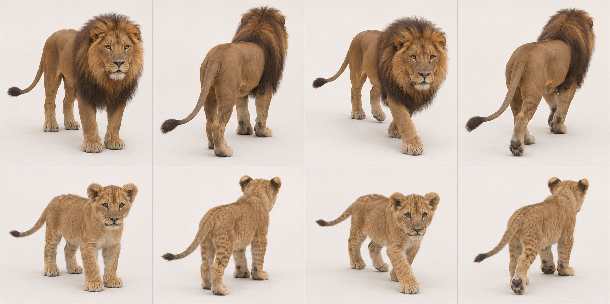
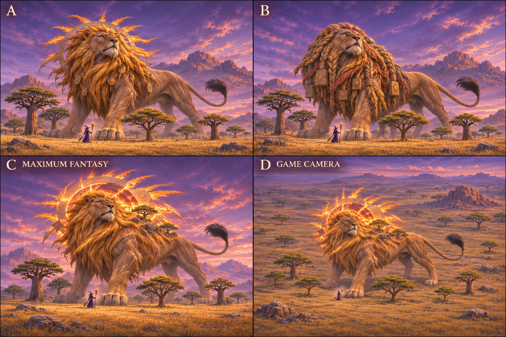
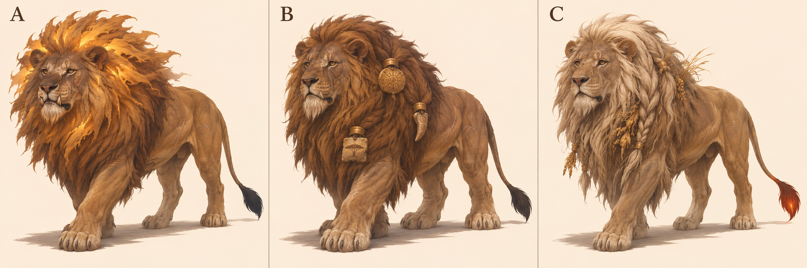
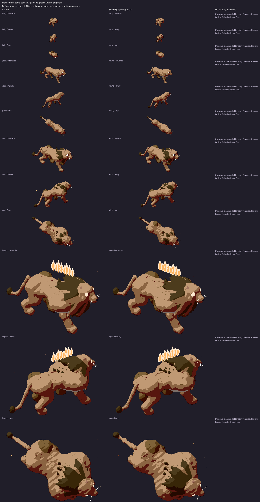

# Lion: L3 graph target

7 November 2026. Species ID `lion`; Panthera leo. Draft design reference for PR1906, source base524b0acaa43bb9975e7b2834ff9a55cbca4b3319. Ed judges the legend recommendation. No activation, implementation or claim that the current game passes.

## Reads-as target

Powerful tawny cat, adult male mane and narrow tuft-ended tail.

- Powerful deep forequarters and substantial paws
- Adult male mane forms fur around skull/neck, not enlarged skull
- Short broad feline muzzle and round ears partly exposed
- Tawny trunk with modest waist tuck
- Long narrow tail ending in dark tuft
- Cub has spots and lacks mature mane
- Hindquarters muscular but less visually heavy than maned front

## Adult and mobile-young references



Top row adult, bottom row mobile young/age0 target; columns standing towards, standing away, walking towards, walking away. Ages scaled independently: NOT a world-size comparison. Age0 means a mobile cub/kitten, not a newborn. Game levels remain0 baby/1 young/2 adult/3 legend. This does not redefine their biology or game sizes.

## Proportions and mass

Use L = nose to tail base (head-body length), excluding tail, mane and decorative fur. These are **artist starting ranges**, not measured zoological statistics, pixel measurements or acceptance thresholds. Perspective, pose, sex, subspecies and coat vary. Refine against multiple orthogonal photos before implementation.

| Quantity | Fraction of L |
|---|---|
| Exposed leg: ground to ventral trunk | .30–.40 |
| Head: occiput to nose | .17–.22 |
| Visible neck bridge | .10–.17 |
| Tail: base to tip along curve | .40–.60 |
| Ground to shoulder | .53–.66 |

Separate skeletal skull/chest from mane volume. Chest/shoulder mass is strong, abdomen tapers and hips retain support. Adult male is selected because the current genome is maned; not a claim that all adult lions have manes.

Young: Spotted cub, shorter muzzle/legs, larger head and paws. No adult mane; young stage may gain small ruff before full male mane.

Feline hindlegs are digitigrade: the visible backward hock is an ankle, not a backward knee. Preserve fore/hind distinction and paw support; a still generated frame does not prove a gait cycle.

## Photograph and anatomy cross-check

Adult male reclining photo confirms mane/face/round ears but hides weight-bearing stance and full tail. Standing cub photo confirms spots, big paws, round ears, short muzzle and narrow tail. Generated adult male/cub contrast is clear; do not infer common world scale from separate rows.

- [adult: File:Lion waiting in Namibia.jpg](https://commons.wikimedia.org/wiki/File:Lion_waiting_in_Namibia.jpg) — viewed privately.
- [young: File:Lion Cub (2404649731).jpg](https://commons.wikimedia.org/wiki/File:Lion_Cub_(2404649731).jpg) — viewed privately.

[Expert species description](https://www.catsg.org/living-species-lions) supports the identifying traits; ratios above are our design estimates. Commons photos are comparison-only, kept private and never published in this PR or shots.

## Iteration2: colossal fantasy concepts — current recommendation

Later Ed feedback on7November2026, COORDINATOR6708227119/6708229124, supersedes iteration1’s modest fantasy/plain-background direction. [DESIGN.md](../../DESIGN.md#look) says legends are about20times a baby’s height and taller than treetops; ART-GUIDE0b/0c asks for a recognisable animal’s nature made fantastic, epoch age, wisdom, power and reverence. These are proposed designs, not changes to game sizes.



2×2 board: A upper-left, B upper-right, C MAXIMUM FANTASY lower-left; D lower-right repeats C at an approximate game-camera elevation29.8° down/yaw34.4° from side-on. **Exactly three designs; D is another view, not a fourth concept.** Witch and trees are included in every panel. A/B/C use low hero views to convey mass, far-side haze and landscape weathering. The witch is a scale stand-in, not an exact render of the game’s witch.

- A: Noon Elder, ragged sun-disc mane and ancient votives.
- B: Kopje King, sandstone-like mane braids bearing worn carvings and offerings.
- C MAXIMUM FANTASY: Walking Solstice; immense mane becomes a fractured blazing solar corona with ancient sundial fragments and weathered shoulder ledges.

**Recommend C for Ed’s second-pass review; signature element: Broken solar corona within monumental mane.** C turns the lion’s own mane and the sun-warmed savanna into sovereign, epoch-old solar power. Tawny trunk, round ears, short cat muzzle and thin tuft-ended tail remain visible. The broken corona and eroded sundials suggest time lived through; small rooted acacias on mane ledges indicate geological age, not a general trees-on-back uniform. A is a simpler sun elder; B trades magic for jewellery.

Chosen legend body-plan/checklist: Separate skull and face from mane/corona mass; keep dark face readable inside the broken sun. Corona is layered around neck/shoulders, not a flat disc replacing head. A few shoulder-mane ledges support rooted vegetation; no forest hides the torso. Keep one long narrow tail ending in black tuft.

MISSING GRAPH FEATURES / shared integration needs: Nested neck/mane radial frame and discontinuous corona geometry, accessory sundial/carving sockets, emissive interior regions, sparse vegetation ledge attachments and age/weathering. Existing mane primitives are not the whole graph contract.

Actual inspected output/projection limits: Framing edit restores full corona rays and tail. Witch and savanna trees show in all views; D keeps face and tuft tail visible. C/D corona rays are partly hard sundial geometry and partly flame-like energy, so implementation must preserve both rather than treating it as ordinary fur. Small shoulder trees compete with mane edges from above.

Scale assessment: all four panels visibly contain a witch and trees; selected C/D read as colossal against the nearby witch and tree groups. Perspective/depth/variable tree size prevent an exact height comparison; no baby is depicted, so **20× baby height is a design prompt, not a verified measurement**. Native game projection, coverage/contact, accessory motion, occlusion and20× size must be tested on graph renders by the canonical owner. No local browser was allocated/run.

### Iteration2 exact generation prompt

```text
Witch videogame legendary creature second-pass design board. FOUR equal panels in a 2x2 grid, labelled A (upper left), B (upper right), C MAXIMUM FANTASY (lower left), D GAME CAMERA (lower right); no other text. A B C are THREE DIFFERENT concepts of SAME species; D repeats C's exact design from higher game camera. Every panel shows the ENTIRE huge creature including ALL ears/paws/tail, within ample margins. CRITICAL SCALE IN EVERY PANEL: a tiny human WITCH with pointed dark purple hat/dress holding broom STANDS on SAME ground plane next to front paw, clearly distinct and NOT riding animal; multiple complete FOREST TREES near paws and flank, with normal trunks/crowns and readable silhouettes. Creature head/shoulders TOWER ABOVE tree crowns; landscape-scale body mass, approximately20times a baby animal height, NOT a normal pet by a human. Trees about quarter to half creature shoulderheight, witch about one tenth to one fifteenth. Compose enough ground area to show scale without cropping creature. A B C cinematic slightly low/near-ground threequarter HERO viewpoint with atmospheric depth/haze on distant body, large weight-bearing landformlike masses. D SAME C at approximate actual game projection, elevation29.8deg DOWN, near-orthographic long lens, heading34.4deg from side-on facing viewer; whole giant+witch+trees still visible. Concept art: bold controlled painterly/small readable shape clusters, rich twilight with local magic light. Very ancient wise powerful mythical elder, animal's defining nature impossible, species instantly identifiable. No generic uniform, no gore, no modern buildings. Trees/environment support scale not hide anatomy. ADULT MALE LION: tawny muscular forequarters, enormous true mane around head/neck, round ears, cat muzzle, long thin tail with black tuft. Savanna tall gold grass, flat acacias, baobabs and warm boulder kopje plus forest trees as size cues. A: giant Noon Elder with ragged sun-disc mane, healed scars, tiny old votive discs in coarse fur. B: epoch-worn kopje king, mane hair becomes long layered sandstone braids bearing carved offerings, large tufted tail, wise scarred face. C MAXIMUM FANTASY RECOMMENDED: the Walking Solstice, a vast lion with a mane that is BOTH monumental coarse golden hair and a blazing broken SOLAR CORONA arch around head/shoulders; huge open rays contain fragments of ancient sun-dials and ember-red daylight, dark weathered face and round ears remain clearly visible in centre. Torso fur weathered in great dry-grass/rock striations, pale scars, a few acacias rooted in outer shoulder mane-ledges (NOT trees replacing animal), the tail long and thin with a single coal-black tuft catching gold light. Full animal identifiable immediately, sovereign calm, not human king. D same C game camera.
```

### Selected framing correction

Built-in imagegen edit of this species’ generated iteration2 board, preserving original privately; correction selected after visual inspection.

```text
Framing correction ONLY to this four-panel A/B/C/D concept board. Preserve all three designs, C/D matching identity, colours, camera elevations, witch/tree scale relationships and landscapes. In EACH panel pull the camera BACK about25percent and recompose so the ENTIRE animal fits with at least8percent empty sky/ground margin around ALL ears, mane/corona, paws and COMPLETE tail including tip. Several current hero panels crop animal/tail/mane at edges: restore them from the same design, no added limbs/tails. Keep each witch and nearby tree group same relative physical size to animal, but visible and inside frame. Body still towers above nearby tree crowns. Keep A B C cinematic low views; D same C higher game-camera view. Keep the FOUR panel labels A/B/C MAXIMUM FANTASY/D GAME CAMERA and 2x2 layout. Do not zoom any panel close. Do not enlarge head, change anatomy or turn tree scale cues into mere shrubs. It is a wider framing of same scenes, not a new concept. All animal silhouettes must be bounded by air/ground, not panel edges.
```

Generation: built-in imagegen,7November2026, model/seed unreported; text-only initial prompt; framing edits referenced only the species’ generated board, no real photos or game captures. No generated concept is activated.

## Iteration1: three historical concepts and existing comparison

Area/story: Savanna: tall gold grass, thorn scrub, acacias, baobabs and sun-warmed boulder kopje (art/areas/savanna/recipe.js).

| Three new proposals, A/B/C left to right | Existing renderer comparison, ALL ages |
|---|---|
|  |  |

The right-hand sheet is **archival**, source/served SHA aad8b13327282d13d7d6a4e2e1b28aa2acfd6b6c, fixture cats-1. Read its Current column, level3 row for the old legend; its graph column is NOT the target. It is not a capture of today's524b0ac source. Fresh exact-head legend evidence must be supplied by the canonical renderer before a current-vs-target verdict; no laptop browser was allocated or run.

- A Noon Elder — ragged sun-disc of coarse glowing mane hair.
- B Kopje King — worn votive clasps in a heavy dark mane.
- C Drought Rememberer — bleached seed-braided mane and coal-like tail tuft.

**Historical iteration1 recommendation A; signature element: Sun within ragged mane.** The lion’s existing mane becomes sun-warmed savanna power. Scars, chipped tooth and old face carry epochs rather than a new generic back crest. The glow belongs within mane hair; keep it distinct from literal loose flames.

Chosen legend checklist/body plan: Broaden layered mane around neck/shoulders without swallowing face/ears. Keep long narrow black-tufted tail, paws and tawny flank exposed. Put light into large inner mane clusters; outer hair stays weathered and irregular.

These are three concepts generated together in one sheet, not three independent calibrated render trials. Inspect all whole bodies and recognisability; labels identify proposals, not approved in-game names. Only Ed/coordinator can adopt a pick.

## Top three priorities and MISSING GRAPH FEATURES

Top three: mane distinct from skull; forequarters; tuft-ended tail.

Layered head/neck fur envelopes and graph-native tail-tip tuft attachment, age-linked mane/ruff regions. Existing primitives/legacy mane do not imply graph-native inheritance.

At the pinned source, `art/body-graph/graph.js` has head/leg/wing/tail/shell sockets, torso spine stations, head ellipsoid, two-bone digitigrade legs and a foot ellipsoid. `quadruped.js` already has torso profile/flex, pointed-ear cup helpers and region patterns; `families.js` has feline adapter; `tail-markings.js` already supports rings/spots/rosettes/tip paint. `gait.js` has a two-bone straight-line diagnostic solve. Do NOT request basic tails, all ears, all patterns or all gait as wholly absent. Missing contract: rotating station frames/socket-to-socket attachments (explicit future work), nested head/foot-local feature inheritance, age-linked fur/tuft/accessory attachment data and scar/weathering regions. Legacy features may draw these today; this is a request for shared graph representation, not a demand for handwritten species fixes. Refer implementation to graph owner#1866.

## Provenance and limits

Built-in `image_gen.imagegen`, 7 November2026; no model identifier/seed reported. Text-only generation, no source photograph supplied as input. Anatomy prompts ask photorealism; legends use sculptural concept art. Actual camera source `art/model3d.js`: pitch0.52rad (29.8° down), yaw±0.6rad (34.4°). Tool output only approximates this; no camera calibration, native-size rendering, pixel-diff, locomotion/contact or graph-fit proof. All selected generated sheets were visually inspected for panel/age/pose coverage and complete animals; natural occlusion remains.

No claim of female variant coverage or accurate physical sunlight simulation.

### Exact anatomy generation prompt

```text
Scientific-educational PHOTOREAL whole-animal anatomy reference contact sheet; eight equal panels, two rows of four. Clean off-white studio ground/background, soft even daylight, no objects, no text or labels. Approximate game camera: elevation29.8 degrees looking down, long-lens orthographic-like perspective, long body axis34.4 degrees toward/away from side-on. TOP ROW SAME ADULT: standing towards, standing away, slow walking towards, slow walking away. BOTTOM ROW SAME MOBILE YOUNG: identical four poses/order. Exactly one animal in each panel, four anatomically correct digitigrade legs and clear natural slow-walk paw placement. Whole body, every ear/paw and ENTIRE TAIL including tip in frame with generous padding; no cropping or tail hidden behind body: gently sweep tail outward where needed. Adult/young scaled independently for inspection, not direct size comparison. Neutral natural expression, no stylization, no collars, no extra limbs. LION (Panthera leo): adult male with full natural tawny-to-dark-brown mane framing cheeks, throat, shoulders and chest; mane is hair over a muscular feline skeleton, not a circular rigid head or bear hump. Tawny powerful long trunk, deep chest, stout long legs, broad round paws, small rounded ears visible in mane, long slender tail ending in distinct dark hair tuft, muzzle short and broad. Young3-month mobile lion cub has NO adult mane, proportionately large round head, rounded ears, short muzzle and broad paws, softly spotted tawny coat with subtle juvenile spots, thin tail with emerging small dark tuft. Preserve tail length and slender shaft; not a jaguar cub coat and not a domestic kitten.
```

### Exact legend generation prompt

```text
Concept art comparison sheet, THREE distinctly DIFFERENT legendary creature proposals in THREE equal columns labelled A, B, C only. One WHOLE creature per column, ears paws tail entirely visible with generous margin, plain warm ivory studio background and ground shadow, no scenery or extra animals. Approximate Witch GAME camera elevation29.8deg looking down, long-lens orthographic-like, body34.4deg toward camera from side-on. All are ancient powerful wise elders, animal's defining nature exaggerated into magic, still recognisably that exact species. Painterly sculptural concept art with bold coherent silhouettes, restrained palette/large readable shapes, not a UI/game sprite or calibrated render. Strong anatomy and natural quadruped standing or slow deliberate walking, no gore; healed scars only. Each concept its OWN idea, not uniform accessory swaps. ADULT MALE LION, massive tawny forequarters, true round ears, enormous mane, long narrow tail BLACK TUFT at end. Savanna tall gold grass, thorn scrub, flat acacias, baobabs and sun-warmed boulder kopje. A: Noon Elder, ancient lion mane transformed into broad ragged sun-disc of coarse tawny/gold hair, dark weathered face, one chipped canine and pale old scars, emberlike light deep WITHIN mane, not rows of flames on spine. B: Kopje King, heavy scarred lion wearing three asymmetrical worn sandstone/bronze mane clasps like votive tokens, pale chin, huge paws; no human crown or giant armour suit. C: Drought Rememberer, lion with long bleached mane braided in a few places with dry grass and seed offerings, tail tuft glowing like last coal, wise tired amber eyes. Keep powerful feline body and full tail.
```

See [L3 summary](l3-summary.md) for evidence hashes, shared gaps and remaining checks.
