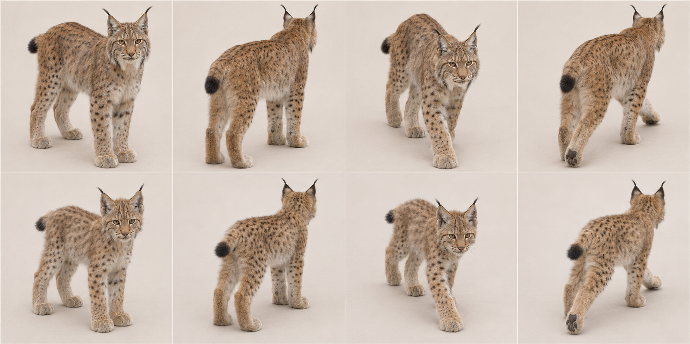
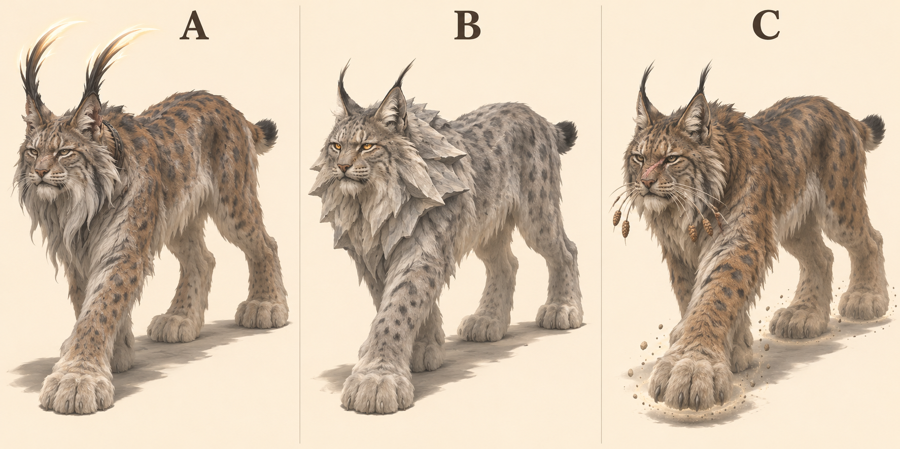
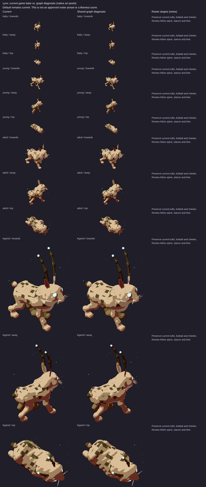

# Eurasian lynx: L3 graph target

7 November 2026. Species ID `lynx`; Lynx lynx. Draft design reference for PR1906, source base524b0acaa43bb9975e7b2834ff9a55cbca4b3319. Ed judges the legend recommendation. No activation, implementation or claim that the current game passes.

## Reads-as target

High-rumped, long-legged spotted cat with bobtail and ear tufts.

- Short bobtail ending in a complete black tip
- Long legs with hindquarters slightly high
- Huge broad furred paws
- Pointed ears with separate thin black tufts
- Broad cheek ruff around a short feline face
- Spotted tawny-grey coat, not stripes
- Compact trunk; no dog snout or long domestic-cat tail

## Adult and mobile-young references



Top row adult, bottom row mobile young/age0 target; columns standing towards, standing away, walking towards, walking away. Ages scaled independently: NOT a world-size comparison. Age0 means a mobile cub/kitten, not a newborn. Game levels remain0 baby/1 young/2 adult/3 legend. This does not redefine their biology or game sizes.

## Proportions and mass

Use L = nose to tail base (head-body length), excluding tail, mane and decorative fur. These are **artist starting ranges**, not measured zoological statistics, pixel measurements or acceptance thresholds. Perspective, pose, sex, subspecies and coat vary. Refine against multiple orthogonal photos before implementation.

| Quantity | Fraction of L |
|---|---|
| Exposed leg: ground to ventral trunk | .35–.46 |
| Head: occiput to nose | .18–.23 |
| Visible neck bridge | .07–.12 |
| Tail: base to tip along curve | .10–.20 |
| Ground to shoulder | .58–.72 |

Ribcage carried high between long limbs, strong thigh/hip mass, large feet. Cheek fur widens the face without enlarging the skull into a bear.

Young: Relatively larger head/paws, short muzzle and immature legs; already a bobtail. Tufts remain slender and distinguishable from ear cups.

Feline hindlegs are digitigrade: the visible backward hock is an ankle, not a backward knee. Preserve fore/hind distinction and paw support; a still generated frame does not prove a gait cycle.

## Photograph and anatomy cross-check

Adult photograph visibly confirms pointed tufted ears, short black-ended tail, cheek ruff and long limbs. Slope biases apparent leg height. Young thumbnail returned HTTP429 twice with a spaced retry: NOT visually inspected, no young-photo claim.

- [adult: File:Lynx lynx carpathicus Germany (standing).jpg](https://commons.wikimedia.org/wiki/File:Lynx_lynx_carpathicus_Germany_(standing).jpg) — viewed privately.
- [young: File:Lynx lynx cub 20050709.jpg](https://commons.wikimedia.org/wiki/File:Lynx_lynx_cub_20050709.jpg) — NOT viewed: HTTP429.

[Expert species description](https://www.catsg.org/living-species-eurasianlynx) supports the identifying traits; ratios above are our design estimates. Commons photos are comparison-only, kept private and never published in this PR or shots.

## Three legend concepts and existing comparison

Area/story: Rocky slope: scree and moss, boulders, rocks, pines and rocky outcrop (art/areas.js).

| Three new proposals, A/B/C left to right | Existing renderer comparison, ALL ages |
|---|---|
|  |  |

The right-hand sheet is **archival**, source/served SHA aad8b13327282d13d7d6a4e2e1b28aa2acfd6b6c, fixture cats-1. Read its Current column, level3 row for the old legend; its graph column is NOT the target. It is not a capture of today's524b0ac source. Fresh exact-head legend evidence must be supplied by the canonical renderer before a current-vs-target verdict; no laptop browser was allocated or run.

- A Ridge Listener — long swept black ear quills with pale lit tips.
- B Scree Oracle — angular grey cheek ruff recalling layered shale.
- C Silent Tracker — enormous paws displacing suspended grit, pine-seed whisker beads.

**Recommended A; signature element: Luminous ear-tuft quills.** The lynx’s ear tufts become a tall, austere silhouette above its silent body; greying beard and worn face give an old ridge guardian. Unlike the sand cat, magic is at narrow hair tips, not inside broad listening cups.

Chosen legend checklist/body plan: Keep bobtail, high rump and large paws. Grow two curved ear-tuft chains from the actual ear tips, keep ears below them visible, weather the cheeks and muzzle. Reduce the generated extra beard if it overwhelms the lynx face.

These are three concepts generated together in one sheet, not three independent calibrated render trials. Inspect all whole bodies and recognisability; labels identify proposals, not approved in-game names. Only Ed/coordinator can adopt a pick.

## Top three priorities and MISSING GRAPH FEATURES

Top three: bobtail; high rump and paws; ear tufts.

Separate cheek/ear fur attachment data, paw width and tuft curves; age-linked inherited head sockets.

At the pinned source, `art/body-graph/graph.js` has head/leg/wing/tail/shell sockets, torso spine stations, head ellipsoid, two-bone digitigrade legs and a foot ellipsoid. `quadruped.js` already has torso profile/flex, pointed-ear cup helpers and region patterns; `families.js` has feline adapter; `tail-markings.js` already supports rings/spots/rosettes/tip paint. `gait.js` has a two-bone straight-line diagnostic solve. Do NOT request basic tails, all ears, all patterns or all gait as wholly absent. Missing contract: rotating station frames/socket-to-socket attachments (explicit future work), nested head/foot-local feature inheritance, age-linked fur/tuft/accessory attachment data and scar/weathering regions. Legacy features may draw these today; this is a request for shared graph representation, not a demand for handwritten species fixes. Refer implementation to graph owner#1866.

## Provenance and limits

Built-in `image_gen.imagegen`, 7 November2026; no model identifier/seed reported. Text-only generation, no source photograph supplied as input. Anatomy prompts ask photorealism; legends use sculptural concept art. Actual camera source `art/model3d.js`: pitch0.52rad (29.8° down), yaw±0.6rad (34.4°). Tool output only approximates this; no camera calibration, native-size rendering, pixel-diff, locomotion/contact or graph-fit proof. All selected generated sheets were visually inspected for panel/age/pose coverage and complete animals; natural occlusion remains.

Young real-photo cross-check pending HTTP429.

### Exact anatomy generation prompt

```text
Scientific-educational PHOTOREAL whole-animal anatomy contact sheet, eight equal panels, two rows of four. Plain warm off-white studio floor/background, soft neutral daylight, no objects/text/labels/collars. Camera approximately29.8 degrees looking down, long-lens orthographic-like, animal long axis34.4 degrees toward or away from side-on. Top row same ADULT: stand towards, stand away, slow natural walk towards, slow natural walk away. Bottom row same MOBILE YOUNG in identical order. Every animal entirely inside its own panel with ample padding including every paw/ear/tail; no crop. Four anatomically correct legs, digitigrade feline paws/hocks, clear weight-bearing slow-walk stance. No stylization, human expression, or distorted/extra limbs. Scale each age independently for anatomical inspection; not a size comparison. EURASIAN LYNX (Lynx lynx), not caracal or bobcat. Adult robust long-legged high-rumped cat, large broad furred paws, short bobtail with complete black tip, triangular ears with long black tufts, wide cheek ruff, tawny-grey spotted coat. Young approximately3-month-old lynx cub with relatively larger head and paws, shorter muzzle/legs, visible ear tufts and already short black-tipped tail. Keep species proportions, do not turn it into a domestic kitten with ears added.
```

### Exact legend generation prompt

```text
Concept art comparison sheet, THREE distinctly DIFFERENT legendary creature proposals in THREE equal columns labelled A, B, C only. One WHOLE creature per column, ears paws tail entirely visible with generous margin, plain warm ivory studio background and ground shadow, no scenery or extra animals. Approximate Witch GAME camera elevation29.8deg looking down, long-lens orthographic-like, body34.4deg toward camera from side-on. All are ancient powerful wise elders, animal's defining nature exaggerated into magic, still recognisably that exact species. Painterly sculptural concept art with bold coherent silhouettes, restrained palette/large readable shapes, not a UI/game sprite or calibrated render. Strong anatomy and natural quadruped standing or slow deliberate walking, no gore; healed scars only. Each concept its OWN idea, not uniform accessory swaps. EURASIAN LYNX, high-rumped long legs, HUGE paws, SHORT BLACK-TIPPED BOBTAIL, pointed ears and cheek ruff. Rocky slope with scree moss boulders pines. A: Ridge Listener, ear tufts grown into sweeping tall black quills with pale glowing tips, deeply weathered muzzle and nicked ear, grey cheek beard, strong large snowshoe paws. B: Scree Oracle, enormous angular cheek ruff like layered shale, old silver fur and amber slit eyes reflecting a distant ridge, no rock on its back. C: Silent Tracker, gigantic broad furred paws outlined by suspended grit under soles, whiskers threaded with a few worn pine-seed beads, scarred nose. No long tail and no lion mane.
```

See [L3 summary](l3-summary.md) for evidence hashes, shared gaps and remaining checks.
