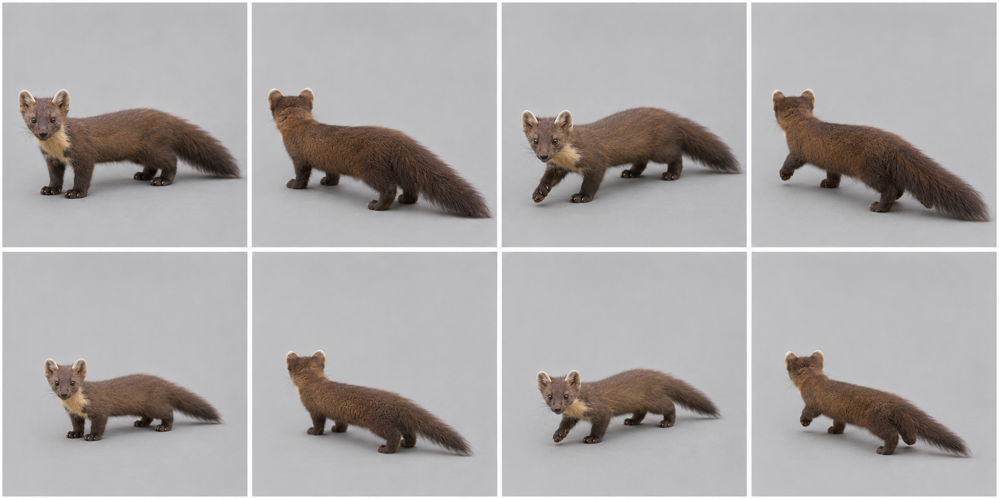
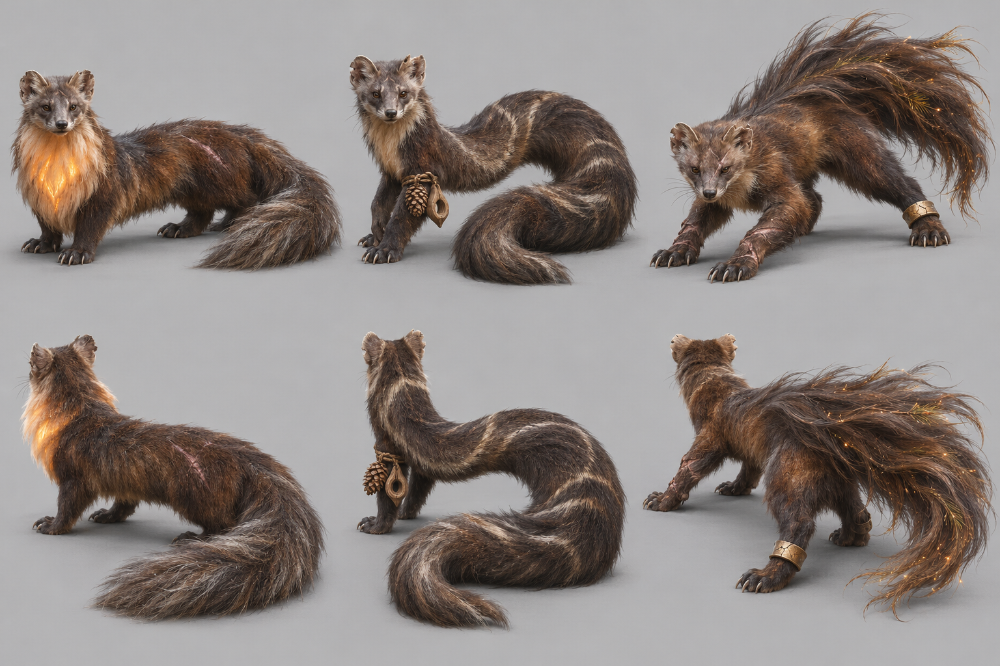
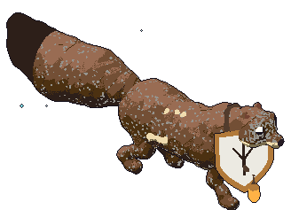
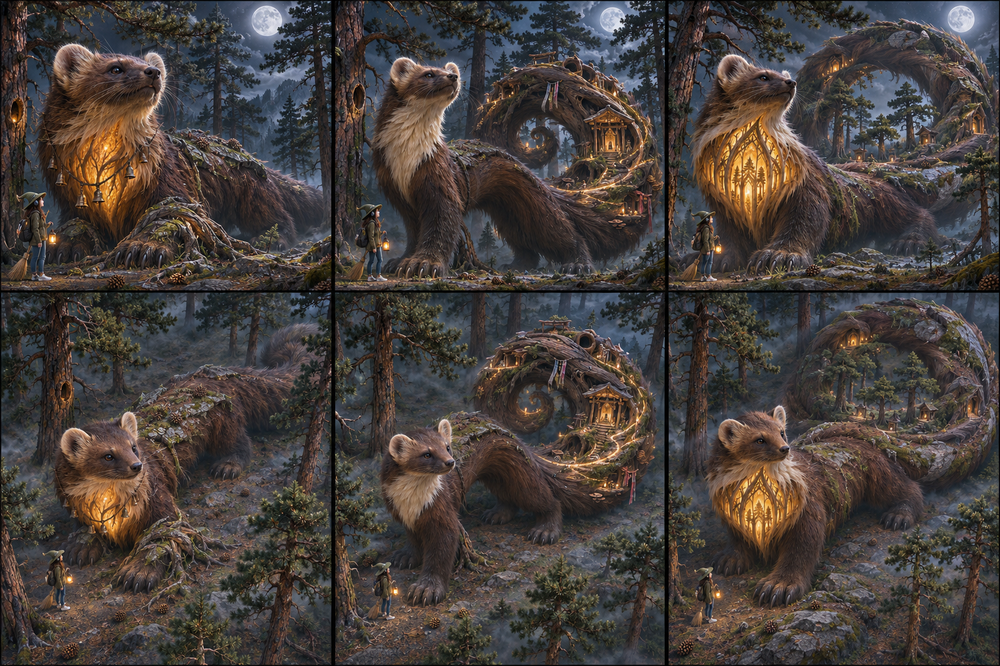
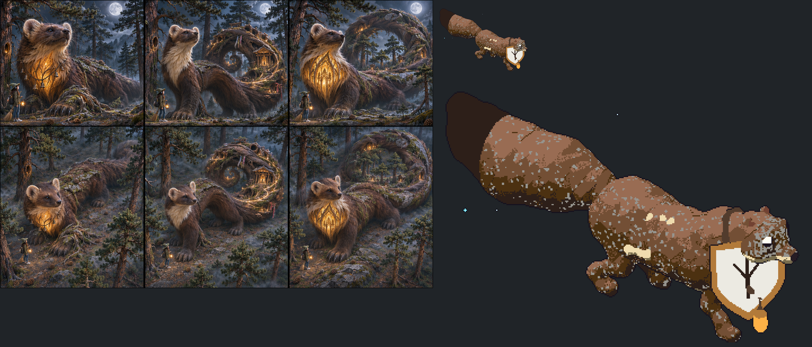

# European pine marten — graph target

Species scope: **marten** (Martes martes); L2, #1904. Target identity is inferred from the existing genome's natural cues, not a new gameplay/species decision. No hand-written-art fix or graph code is authorized here.

## Reference plate and provenance

Selected plate: [target-v2.png](https://raw.githubusercontent.com/edsaperia/witch/20d25e05fdc3b44a73ba23e7e270c8105498f1d0/previews/art-pass/marten/target-v2.png), SHA256 `1ffe92a6f22e3b9b2ad6f1e3e7d9f5f320cc5401c5c06615758827824308f579`. Generated 2026-11-07 with the built-in **image_gen.imagegen** tool (scientific-educational, photoreal target; model/version/seed not exposed). [Exact prompt](https://raw.githubusercontent.com/edsaperia/witch/20d25e05fdc3b44a73ba23e7e270c8105498f1d0/previews/art-pass/marten/prompt-v2.txt); [provenance](https://raw.githubusercontent.com/edsaperia/witch/20d25e05fdc3b44a73ba23e7e270c8105498f1d0/previews/art-pass/marten/provenance-v2.json). No Commons photo was input to imagegen or committed.

Eight cells: adult row1, mobile juvenile row2; columns standing-towards, standing-away, walking-towards, walking-away. Young represents game age0's mobile visual role, **not a literal neonate or scientifically verified age**. The game has young variants; many real neonatal mammals cannot stand/walk. Size ratios between generated cells are illustrative, not calibrated.

Camera target: art/model3d.js PITCH=.52rad (29.79° downward) and YAW={towards:.6,away:-.6}rad (±34.38°). Prompts approximate a long-lens affine-looking view. Generated heading, perspective, scale and foot contact are not constrained by the real renderer: some cells are more frontal/rearward, and v2 silhouettes can shift angle. **No pixel-exact game-camera match, game-size recognition verdict or actual motion cycle is claimed.**

## Real-photo comparison — real anatomy wins

[Commons comparison file: Pine Marten.jpg](https://commons.wikimedia.org/wiki/File:Pine_Marten.jpg). Viewed locally for comparison only; not on either committed branch. Photo shows a much longer lower neck/back and tapered muzzle than the first generated sheet. Bib and pale-rimmed ears agree. Tail tip and some feet are cropped/occluded; this photo does not measure tail length or stance.

Photo occlusion, fur, pose and lens prevent reliable joint/length measurement; do not treat this single photograph as a complete anatomical dataset.

## Identifying checklist

1. Long supple trunk with a low, continuous back rather than a cat's short barrel.
2. Rounded prominent ears with pale rims, not pointed fox ears.
3. Tapered wedge muzzle, dark nose and small forward-set eyes.
4. Cream/yellow throat bib distinct from the brown flank.
5. Moderately short supporting limbs and broad furry paws.
6. Long bushy cylindrical tail, without the squirrel's upright fan.
7. Kit: larger head relative to trunk, shorter muzzle and less full tail.

## Body plan and proportion targets

**L = nose to tail-base length in a neutral quadrupedal pose, excluding tail**, not the torso-only spine length. Head means muzzle tip to occiput; exposed neck is occiput-to-shoulder transition; limb reach means vertical shoulder/hip-to-ground in quiet stance, not summed bone lengths. Ratios below are **artist starting ranges inferred from general anatomy/photos, not specimen measurements, fitted genome values or universal biological bounds**. Adjust for pose and actual photo evidence.

Head 0.20–0.25; exposed neck0.10–0.16; standing fore/hind girdle-to-ground0.22–0.30; tail0.45–0.60.

Length is distributed through ribcage and loin; modest shoulder and hip masses, narrow mobile waist. Do not replace the long axis with one round blob.

Age0 target: scale the whole animal down, then increase relative head/eye size and reduce muzzle/tail maturity as listed above; do not merely shrink an adult. These are qualitative age keys, not validated growth measurements. Preserve the natural four-limb body plan at every game age. Magical/legend adornments must not replace the identifiable natural silhouette; the separately authorized legend concepts below are proposals only.

## Graph requirements and missing features

Reusable rounded ear/pale-rim assembly and furry tail cross-section/coat boundary; spine-frame flex remains an owner follow-up, not a new species branch.

Capability audit is source-only: prototype524b0acaa has generic head/leg/wing/tail/shell sockets. Read-only #1866 headde27db5154a3e8b1aa94255263bd2601b92aec36 additionally has neck, parent attachments and static triangular membrane sockets. Thus **neck and membrane kinds are present**, not missing. Its leg foot is an ellipsoid (hoof can split); no explicit reusable digging-palm/digit, ear/tuft, spine-field or folded-patagium deformation contract was verified. Generic ellipsoids can block out some shapes; absence of a named semantic control does not prove geometry is impossible. Requests here are shared graph/family capabilities to confirm with1866, never a permission to patch old builders.

## Ranked targets and image QA

1. Low flexible trunk.
2. round ears+tapered face.
3. bushy tail and throat bib.

v1 legs/chest too tall and compact; targeted v2 requested. Whole-animal sheet is a target, not proof of final dimensions.

v2 is substantially lower and longer, closer to the real trunk/neck silhouette. Ears remain large and tail fullness exaggerated; use written ratios/photo rather than copying pixel dimensions.

All selected plates were visually inspected for whole framing, adult/young rows and towards/away standing/walking coverage. A lifted paw is not gait validation; hidden far-side feet and exact digit counts are not certified. Generated-photo discrepancies are excluded from the graph specification by the checklist and real-photo priority. Optional shipped-art critique omitted: no shipped renderer run or native/4× acceptance was allocated; the later instruction supersedes that exhaustive review.

Review boundary: target note/reference output complete for coordinator review, with explicit uncertainties above. Species migration and likeness acceptance remain #1866/canonical/Ed decisions; no source, rig, render, registry, gameplay, text or default changed.

## Legend concepts v1 — preserved earlier iteration

Authorized by1476#6707981581 and correction6707992824. Read ART-GUIDE0b/0c and legend-audit; crystals, flame crests and spirit wings are allowed when fitting. Fit and variety win over a blanket adornment ban. Ed judges these proposals; nothing is implemented.

Area story: Old pinewood: pine needles, pine cones, tall ancient pines with knotholes.

| Today’s awake legend | Three generated alternatives |
|---|---|
| **PENDING exact-source comparison.** Requested in1904#6708045677 from prototype524b0acaa. The5Oct atlas is historical and is deliberately not relabelled today. |  |

Columns left→right A/B/C; upper row towards, lower row away. Whole-animal plain-background photographic concept targets; approximate camera only, not game-rendered or game-size acceptance.

- **A:** The Hearth-Bib Elder: a very long low pine marten with a huge shield-shaped cream throat bib, softly glowing like preserved hearth embers within the FUR itself, silver muzzle, worn round ears, one healed flank scar, thick age-worn tail; no literal shield or crown.
- **B:** The Knothole Keeper: pine marten curled in an elongated S with exceptionally supple spine, pale rings of age worn into dark fur, a single old pine-cone offering tied near one forepaw and a small hollow wooden pendant, no portable tree, no antlers.
- **C:** The Branch-Leaper: pine marten low in a poised leap-ready stance, enormous wind-swept bushy tail like an old cloak, scarred powerful wrists, one cracked bronze anklet, tiny pine-needle sparks caught in the tail, not wings.

**Strongest proposed pick A; signature element: Luminous cream-bib shield grown in fur.** The marten's own throat bib becomes a guardian's blaze, while the long low body, round ears and tapering face stay intact. Worn fur/ear and healed scars show survival, not a young animal enlarged. Warm light belongs to the pinewood keeper rather than a detachable generic crown.

Actual image QA: A has the clearest family/age/power balance. B overarches the trunk and C overgrows the tail toward squirrel-like display. A still has a taller chest than the natural target; lower its stance in graph work.

### Chosen legend checklist

1. Long low flexible mustelid trunk and bushy cylindrical tail.
2. Rounded pale-rimmed ears and tapered muzzle remain recognisable.
3. Cream bib is broadened into one coherent shield-like fur marking, not a metal breastplate.
4. Silver muzzle, one worn ear and limited scars show age.
5. Chest radiance is local to the bib; no obligatory crystals/wings on the rest of the body.
6. Forepaws carry a quiet grounded, powerful stance.

### Chosen legend body plan and graph needs

Legend length starting target1.4×adult; head0.18–0.22L, tail0.50–0.65L, broad bib0.25–0.35L long. Keep a narrow mobile waist, not an upright bear shoulder hump. All ratios are artist starting targets, not measured biology or accepted game size. L retains the nose-to-tail-base definition above; legend exaggeration is deliberate.

Body-following emissive bib mask, aged-fur/scar overlay and worn-pinna shape control; not a new shield socket. Tail and feet retain the natural family contracts. Shared graph work stays with1866. Existing neck/parent/static-membrane sockets are not reported missing; these requests describe species-ready behaviour/material/attachment contracts, not proof that generic geometry cannot express the shape.

### Exact generated evidence

[Plate](https://raw.githubusercontent.com/edsaperia/witch/e85e74d7ccff41e1ffc9447cfe0df7cd959d77bc/previews/art-pass/marten/legend-concepts-v1.png), SHA256 `fab4a1462a4f63bac1ab32bbec9b93327436fa086ab37260cc5e0a0cb4d2e2e8`; [exact prompt](https://raw.githubusercontent.com/edsaperia/witch/e85e74d7ccff41e1ffc9447cfe0df7cd959d77bc/previews/art-pass/marten/legend-prompt-v1.txt); [provenance and A/B/C briefs](https://raw.githubusercontent.com/edsaperia/witch/e85e74d7ccff41e1ffc9447cfe0df7cd959d77bc/previews/art-pass/marten/legend-provenance-v1.json). Built-in image_gen.imagegen,2026-11-07; model/seed not exposed. Three concepts with two views each; no real photo input. All eight plates were visually inspected; written QA and real anatomy override generated defects.

Legend-addition status: concepts/selection notes complete, **PARTIAL until today’s exact-source comparison is supplied and placed beside them**. This does not reopen the completed anatomy target milestone or authorize activation.

## Legend concepts v2 — colossal mythic second pass

This is the current proposal, superseding v1 picks/body-size suggestions for legend review, not erasing that history. Authority:1476#6708227119 and later6708229124, fully read. ART-GUIDE0b/0c: each level evolves; nature plus ancient wisdom/power/magic; each its own. Later instruction explicitly permits fitting crystals/flame/spirit wings and supersedes the earlier plain-background constraint. Area text source/story remains as cited above.

DESIGN, Art direction: legends are **about20times a baby’s height, taller than the treetops**. These are the revised concept-scale targets; v1’s adult-relative size multipliers do not constrain this pass. Witch about50px in game is a contextual ruler, not a generated-image calibration. No source size parameters were edited.

| Today’s exact-source awake legend | Revised A / B / C; hero above, game-camera approximation below |
|---|---|
|  Source524b0acaa/art231a7285; native transparent RGBA. CPU extraction below resolves this species’ toward/frame0 input; not live lighting or Bold-style parity. |  |

Three columns A/B/C; top row low hero view, bottom row the same three designs from an elevated game-camera approximation (target29.79° down/34.38° toward). **Every cell includes a witch and forest trees. C is the clear maximum-fantasy option.** No exact projection,20×measurement, native-size/game-render or mature-canopy-clearance acceptance is claimed.

- **A:** Pinewood Hearth Guardian: colossal long low brown marten, rounded pale-rim ears and cream throat bib expanded into a furnace of ancient amber light, stone-weathered fur ridges and pine roots around huge paws, tiny devotional bells in bib.
- **B:** Knothole Waykeeper: long supple marten arches between old pines, cream bib and round ears, tail becomes a great spiral of hollow weathered wood with doorway shrines/offerings yet visibly fur-grown, luminous ancestral paths winding through tail.
- **C — MAXIMUM FANTASY:** MAXIMUM FANTASY First Pine Hearth: immense recognisable pine marten, low long trunk and round ears, cream throat bib opens visually as a living amber cathedral of light held within fur, impossibly long bushy tail coils into a mountain-sized ring enclosing miniature old pines and knothole shrines; epochs of rock seams/moss/scars, no extra limbs.

**Revised strongest proposed pick C — SIGNATURE ELEMENT: Amber cathedral within the cream throat bib; shrine-ring tail.** The identifying cream bib becomes a sacred impossible hearth, and the long supple marten becomes a keeper of the first pine grove. Tail ecology and worn devotional niches express epochs, rather than just grey fur. Ed judges how far to take it; no activation.

Actual inspected image result: C wins over A’s simpler light bib and B’s tail-only sanctuary because the impossible hearth and shrine-ring work together without losing the marten face. Both rows visibly contain witch and pines. The raised tail overtops smaller trees, but large foreground pines and perspective make body-vs-canopy scale ambiguous. The bottom row is more elevated, not calibrated to29.79°. Ring curvature and shoulder height differ slightly between views.

### Revised chosen checklist

1. Long low mustelid axis, rounded pale-rim ears and tapering face.
2. Cream throat bib remains the source of cathedral light.
3. Bushy tail attaches to pelvis and encloses a grove without becoming another limb.
4. Ancient rock seams, scars and moss coexist with recognizable brown fur.
5. Shrines and offerings have small human scale, not body-sized generic jewels.
6. Tiny witch and mature pines establish colossal scale in both views.

### Revised body plan and missing shared features

Preserve low shoulders/narrow waist and long natural tail root; enlarge chest bib into a volumetric light-filled fur recess, not a human torso. Tail curls around a ground grove; carry its supports and clear ground anchor explicitly. Proportion/anatomy checklist remains the control over image defects; colossal mass/world-grown layers must not merely rescale the adult outline.

Bib volume/material light mask, curving fur tail with attached shrine/ecology sockets and bounded emissive interior; conservative silhouette/footprint budget and anchor handling. Graph owner1866 confirms feasibility/implementation; existing neck/parent/static membrane kinds are not new requests. Shrines, ecology and environmental magic here are reference proposals only, no permission to change terrain, combat, effects or gameplay.

### Revision provenance and acceptance

[Full v2 plate](https://raw.githubusercontent.com/edsaperia/witch/eaae72457fe50d7f8312991168a7b41448ea6e62/previews/art-pass/marten/legend-concepts-v2.png), SHA256 `91c7feeb7ce499ee6c0054a29dad62e9f1e3a241d492891e785a027b8e49f8a0`; [exact prompt](https://raw.githubusercontent.com/edsaperia/witch/eaae72457fe50d7f8312991168a7b41448ea6e62/previews/art-pass/marten/legend-prompt-v2.txt); [provenance and3briefs](https://raw.githubusercontent.com/edsaperia/witch/eaae72457fe50d7f8312991168a7b41448ea6e62/previews/art-pass/marten/legend-provenance-v2.json). Built-in image_gen.imagegen on2026-11-07; model/version/seed not exposed. All requested second-pass plates actually generated/saved/inspected; no source image edit or real-photo input. Earlier v1/anatomy images and their immutable provenance remain intact.

Second-pass reference milestone complete for review, with image defects/scale-camera limits above. Overall comparison remains PARTIAL until canonical exact-source today panels arrive and are placed beside v2. Ed acceptance and migration are separate; nothing activated.

## Current comparison — actual bounded CPU extraction

**Label key:** LEFT = generated v2 A/B/C hero and elevated approximation; RIGHT UPPER = actual defaultStyle() level3/frame0/towards native albedo; RIGHT LOWER = same pixels nearest-neighbour4×. These are visually distinct reference styles: current is plain default-style albedo, NOT a live/browser screenshot, lighting readback, Bold parity or generated substitute. Original transparent PNGs/rawRGBA preserved; montage alpha-composites over RGB32/36/40 without crop/resizing. Full sheet opens at original dimensions; chat/browser may downscale display.

Source: executing docs HEAD e7133f00bc43441faf72cede1b6a6e013552aa38 and named current prototype524b0acaa43bb9975e7b2834ff9a55cbca4b3319 share art tree231a72851575d44e88e7cc85380d809ceb8bd69c and config treeb9e0e0ae57c51ae8310068cea2ddfc4d8204553b. Actual recipe: critter(id,3,0,defaultStyle(),"towards"), speciesColours, bake with style.cOutline and in-memory canvas. defaultStyle pixel3, artStyle absent (not forcedBold); config/style.json declares Lab default with empty overrides. Full actual style/colour objects, tuning/style hashes, source recipe/watchdog and dimensions/hashes are in provenance. No packages, browser, GL or server.

This species completed in **572.7ms**, native328×237. RawRGBA SHA256 `3392b86f9ff49272074958d18c6039d3c72695c5586ef530fd5a70c1994e37cf`. [Native PNG](https://raw.githubusercontent.com/edsaperia/witch/ceccabe731778cd23cd6aa480210132a0818a101/previews/art-pass/marten/today-legend/current-native.png), [exact4× PNG](https://raw.githubusercontent.com/edsaperia/witch/ceccabe731778cd23cd6aa480210132a0818a101/previews/art-pass/marten/today-legend/current-nearest4x.png), [rawRGBA](https://raw.githubusercontent.com/edsaperia/witch/ceccabe731778cd23cd6aa480210132a0818a101/previews/art-pass/marten/today-legend/albedo.rgba), [capture metadata](https://raw.githubusercontent.com/edsaperia/witch/ceccabe731778cd23cd6aa480210132a0818a101/previews/art-pass/marten/today-legend/capture.json), [full source/style/hash/timing provenance](https://raw.githubusercontent.com/edsaperia/witch/ceccabe731778cd23cd6aa480210132a0818a101/previews/art-pass/marten/today-legend/provenance.json). PNG/raw roundtrip, exact4×pixel replication and all24published evidence files verified byte-exact. Actual montage visually inspected.

Root assigned one serial light CPU slot. External3s/species and30s/process watchdog stopped the next slow species hedgehog; no retry. Four captures exist, four do not. SlotFREE/worker terminated. QUESTION6708045677 is resolved for this species’ specified toward/frame0 plain-albedo input only; other facings/live-lit style acceptance are not claimed. Current-panel composition for this species is now complete for reference review; latest v2 anatomy/scale uncertainties and Ed acceptance remain unchanged.
