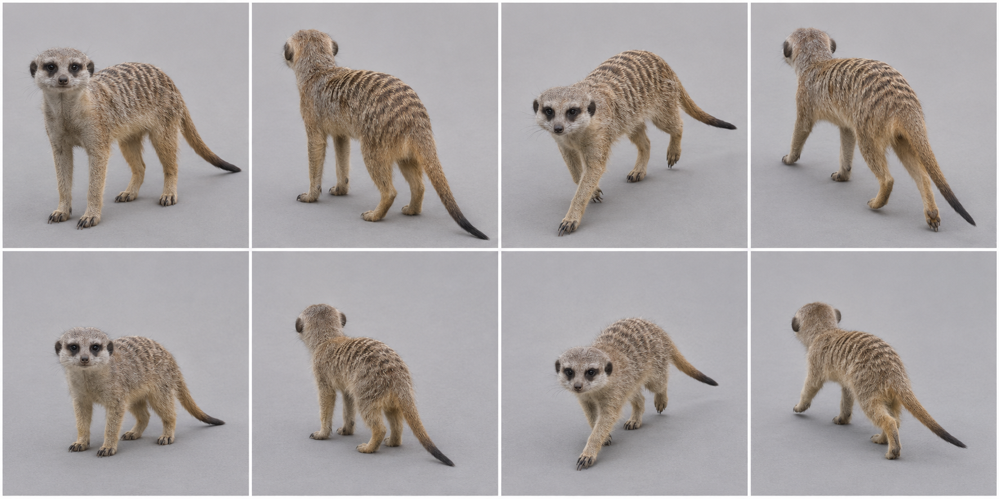
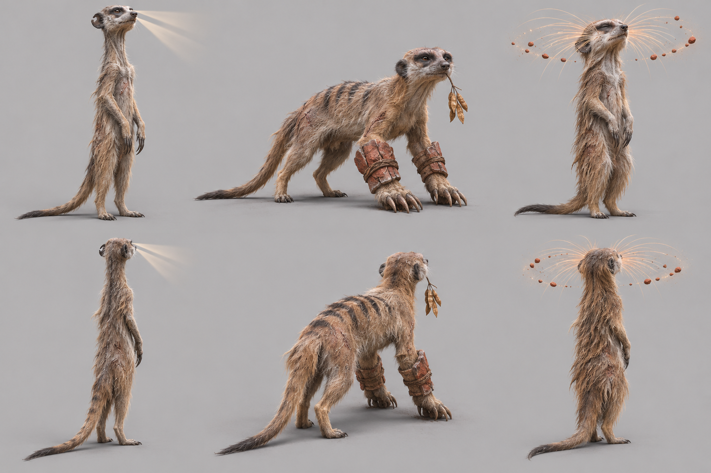
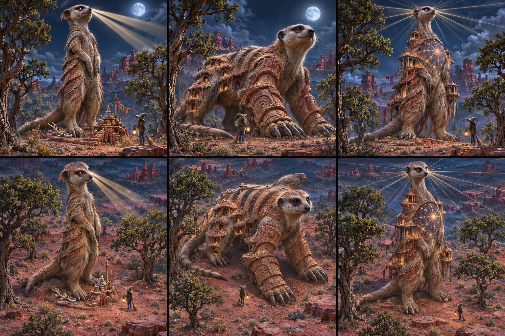

# Meerkat — graph target

Species scope: **meerkat** (Suricata suricatta); L2, #1904. Target identity is inferred from the existing genome's natural cues, not a new gameplay/species decision. No hand-written-art fix or graph code is authorized here.

## Reference plate and provenance

Selected plate: [target-v1.png](https://raw.githubusercontent.com/edsaperia/witch/20d25e05fdc3b44a73ba23e7e270c8105498f1d0/previews/art-pass/meerkat/target-v1.png), SHA256 `8925b45f0384712d55d5bc4c3667773eaf525bbfb0395df8e85aa0742ea3daf4`. Generated 2026-11-07 with the built-in **image_gen.imagegen** tool (scientific-educational, photoreal target; model/version/seed not exposed). [Exact prompt](https://raw.githubusercontent.com/edsaperia/witch/20d25e05fdc3b44a73ba23e7e270c8105498f1d0/previews/art-pass/meerkat/prompt-v1.txt); [provenance](https://raw.githubusercontent.com/edsaperia/witch/20d25e05fdc3b44a73ba23e7e270c8105498f1d0/previews/art-pass/meerkat/provenance-v1.json). No Commons photo was input to imagegen or committed.

Eight cells: adult row1, mobile juvenile row2; columns standing-towards, standing-away, walking-towards, walking-away. Young represents game age0's mobile visual role, **not a literal neonate or scientifically verified age**. The game has young variants; many real neonatal mammals cannot stand/walk. Size ratios between generated cells are illustrative, not calibrated.

Camera target: art/model3d.js PITCH=.52rad (29.79° downward) and YAW={towards:.6,away:-.6}rad (±34.38°). Prompts approximate a long-lens affine-looking view. Generated heading, perspective, scale and foot contact are not constrained by the real renderer: some cells are more frontal/rearward, and v2 silhouettes can shift angle. **No pixel-exact game-camera match, game-size recognition verdict or actual motion cycle is claimed.**

## Real-photo comparison — real anatomy wins

[Commons comparison file: Suricata suricatta (Meerkat).jpg](https://commons.wikimedia.org/wiki/File:Suricata_suricatta_(Meerkat).jpg). Viewed locally for comparison only; not on either committed branch. Commons sentinel photo shows narrow muzzle, low ears, dark eye patches, long foreclaws and upright hind-foot support. Back and full tail are not shown well; band count and tail ratios are not measured from it.

Photo occlusion, fur, pose and lens prevent reliable joint/length measurement; do not treat this single photograph as a complete anatomical dataset.

## Identifying checklist

1. Slim elongated body, with an upright sentinel pose as well as quadrupedal travel.
2. Small rounded dark ears low on the head.
3. Dark eye patches around eyes; pointed narrow muzzle.
4. Long neck in sentinel pose, not a spherical rodent head on a ball.
5. Sandy grizzled coat with transverse back bands.
6. Long narrow tapering tail and strong curved foreclaws.
7. Pup: larger rounder head and shorter neck while preserving eye mask and tail.

## Body plan and proportion targets

**L = nose to tail-base length in a neutral quadrupedal pose, excluding tail**, not the torso-only spine length. Head means muzzle tip to occiput; exposed neck is occiput-to-shoulder transition; limb reach means vertical shoulder/hip-to-ground in quiet stance, not summed bone lengths. Ratios below are **artist starting ranges inferred from general anatomy/photos, not specimen measurements, fitted genome values or universal biological bounds**. Adjust for pose and actual photo evidence.

Head 0.17–0.22; exposed neck0.12–0.20; quadrupedal standing limb reach0.22–0.32; tail0.60–0.80.

Narrow shoulders/ribs, tucked abdomen and somewhat stronger hips; upright weight carried over hind feet, tail a support/counterbalance rather than a giant fan.

Age0 target: scale the whole animal down, then increase relative head/eye size and reduce muzzle/tail maturity as listed above; do not merely shrink an adult. These are qualitative age keys, not validated growth measurements. Preserve the natural four-limb body plan at every game age. Magical/legend adornments must not replace the identifiable natural silhouette; the separately authorized legend concepts below are proposals only.

## Graph requirements and missing features

Reusable transition between quadrupedal walking and upright hind-foot support; grasp/dig forepaw/claw assembly and body-relative back-band placement. Neck sockets now exist in1866; no new neck-kind request.

Capability audit is source-only: prototype524b0acaa has generic head/leg/wing/tail/shell sockets. Read-only #1866 headde27db5154a3e8b1aa94255263bd2601b92aec36 additionally has neck, parent attachments and static triangular membrane sockets. Thus **neck and membrane kinds are present**, not missing. Its leg foot is an ellipsoid (hoof can split); no explicit reusable digging-palm/digit, ear/tuft, spine-field or folded-patagium deformation contract was verified. Generic ellipsoids can block out some shapes; absence of a named semantic control does not prove geometry is impossible. Requests here are shared graph/family capabilities to confirm with1866, never a permission to patch old builders.

## Ranked targets and image QA

1. Sentinel-compatible spine/hip pose.
2. eye mask+small ears.
3. long tail and foreclaws.

v1 supplies four-foot standing and walking targets with clear mask and bands; back stripes are stronger than the muted natural target, and the plate omits the sentinel pose shown by the real photo. Use the photo for upright body plan, not a new sprite verdict.

All selected plates were visually inspected for whole framing, adult/young rows and towards/away standing/walking coverage. A lifted paw is not gait validation; hidden far-side feet and exact digit counts are not certified. Generated-photo discrepancies are excluded from the graph specification by the checklist and real-photo priority. Optional shipped-art critique omitted: no shipped renderer run or native/4× acceptance was allocated; the later instruction supersedes that exhaustive review.

Review boundary: target note/reference output complete for coordinator review, with explicit uncertainties above. Species migration and likeness acceptance remain #1866/canonical/Ed decisions; no source, rig, render, registry, gameplay, text or default changed.

## Legend concepts v1 — preserved earlier iteration

Authorized by1476#6707981581 and correction6707992824. Read ART-GUIDE0b/0c and legend-audit; crystals, flame crests and spirit wings are allowed when fitting. Fit and variety win over a blanket adornment ban. Ed judges these proposals; nothing is implemented.

Area story: Warren: red sand and pebbles, low ledges, dry tussocks, twisted juniper and mesquite among red hoodoos, red-stone heap above burrows.

| Today’s awake legend | Three generated alternatives |
|---|---|
| **PENDING exact-source comparison.** Requested in1904#6708045677 from prototype524b0acaa. The5Oct atlas is historical and is deliberately not relabelled today. |  |

Columns left→right A/B/C; upper row towards, lower row away. Whole-animal plain-background photographic concept targets; approximate camera only, not game-rendered or game-size acceptance.

- **A:** The Horizon Watcher: towering very slender ancient MEERKAT sentinel standing on its real hind feet, long narrow neck, dark eye patches produce two restrained pale searchlight cones reaching a short distance into blank air, grey muzzle, torn small round ear, thin dark-tipped tail braces behind, weathered claws. No flames on head.
- **B:** The Burrow Marshal: massive but recognisably slim meerkat on four feet with exaggerated digging foreclaws, protective rust-red stone forearm cuffs, faded back stripes and scars, one hanging mesquite-seed offering; no helmet or uniform human armour.
- **C:** The Dust Listener: upright older meerkat with immense whisker fan gathering a small orbit of red dust pebbles just around its nose, luminous amber sensing whiskers, sand-worn fur, no extra eyes, no head crown, no global dust storm.

**Strongest proposed pick A; signature element: Sentinel eye searchlights.** The animal is revered for keeping watch above the warren. Upright height, long neck and narrow supporting tail exaggerate the sentinel; worn claws/ear and grey muzzle show the cost of that vigilance. Eye beams belong to its gaze, not a generic flame crest.

Actual image QA: A is the strongest sentinel; B becomes too dog-like and heavily cuffed, C spreads a generic whisker halo. A beams appear to converge near the muzzle in these pixels: require two actual eye origins, not nose emission. Exact hind-foot support is unproven.

### Chosen legend checklist

1. Recognisable dark eye patches, small low ears and pointed meerkat muzzle.
2. Upright slender sentinel supported by real hind feet and a narrow trailing tail.
3. Long neck carries the head above narrow shoulders.
4. Two controlled eye-origin light cones follow gaze.
5. Weathering/claw wear and grizzled face show long service.
6. No heavy human armour that hides the animal body plan.

### Chosen legend body plan and graph needs

Legend upright height target1.7–2×adult sentinel; quadrupedal HBL about1.4×adult. Exposed neck0.20–0.28L, tail0.65–0.85L; keep narrow ribs and stronger hind support. All ratios are artist starting targets, not measured biology or accepted game size. L retains the nose-to-tail-base definition above; legend exaggeration is deliberate.

Reusable upright support/pose contract, gaze-bound visual beam sockets with bounded extent, old ear/face wear. Neck sockets exist already; no duplicate neck implementation request. Shared graph work stays with1866. Existing neck/parent/static-membrane sockets are not reported missing; these requests describe species-ready behaviour/material/attachment contracts, not proof that generic geometry cannot express the shape.

### Exact generated evidence

[Plate](https://raw.githubusercontent.com/edsaperia/witch/e85e74d7ccff41e1ffc9447cfe0df7cd959d77bc/previews/art-pass/meerkat/legend-concepts-v1.png), SHA256 `caafb5ac81b020592da067e498f2c099c689adde1c6faed03195ba46f009fc8a`; [exact prompt](https://raw.githubusercontent.com/edsaperia/witch/e85e74d7ccff41e1ffc9447cfe0df7cd959d77bc/previews/art-pass/meerkat/legend-prompt-v1.txt); [provenance and A/B/C briefs](https://raw.githubusercontent.com/edsaperia/witch/e85e74d7ccff41e1ffc9447cfe0df7cd959d77bc/previews/art-pass/meerkat/legend-provenance-v1.json). Built-in image_gen.imagegen,2026-11-07; model/seed not exposed. Three concepts with two views each; no real photo input. All eight plates were visually inspected; written QA and real anatomy override generated defects.

Legend-addition status: concepts/selection notes complete, **PARTIAL until today’s exact-source comparison is supplied and placed beside them**. This does not reopen the completed anatomy target milestone or authorize activation.

## Legend concepts v2 — colossal mythic second pass

This is the current proposal, superseding v1 picks/body-size suggestions for legend review, not erasing that history. Authority:1476#6708227119 and later6708229124, fully read. ART-GUIDE0b/0c: each level evolves; nature plus ancient wisdom/power/magic; each its own. Later instruction explicitly permits fitting crystals/flame/spirit wings and supersedes the earlier plain-background constraint. Area text source/story remains as cited above.

DESIGN, Art direction: legends are **about20times a baby’s height, taller than the treetops**. These are the revised concept-scale targets; v1’s adult-relative size multipliers do not constrain this pass. Witch about50px in game is a contextual ruler, not a generated-image calibration. No source size parameters were edited.

| Today’s exact-source awake legend | Revised A / B / C; hero above, game-camera approximation below |
|---|---|
| **PENDING canonical pixels**, requested1904#6708045677. No historical image relabelled current. |  |

Three columns A/B/C; top row low hero view, bottom row the same three designs from an elevated game-camera approximation (target29.79° down/34.38° toward). **Every cell includes a witch and forest trees. C is the clear maximum-fantasy option.** No exact projection,20×measurement, native-size/game-render or mature-canopy-clearance acceptance is claimed.

- **A:** Horizon Beacon: giant upright slender meerkat, dark eye patches, pointed muzzle/short ears, tail braces real hindfeet; eyes cast twin great daylight beams over red hoodoos, sandstone-weathered ribs/fur and old torn ear, offerings at feet.
- **B:** Burrow Citadel: quadrupedal meerkat with dark eye masks/banded back, monumental digging claws and red-sandstone forearm armour carved by generations, flank fur forms terraces of warren doorways, long supporting tail and recognisable face.
- **C — MAXIMUM FANTASY:** MAXIMUM FANTASY Watcher of All Horizons: colossal upright MEERKAT towers above hoodoo forest, long neck/dark eye patches/slender bracing tail and real feet; eye light splits into a vast compass of narrow horizon rays, ancient sandstone ribs/fur carry open-air watch shrines; chest contains a luminous desert star-map, weathering/cracks show epochs. Keep animal head, no human face.

**Revised strongest proposed pick C — SIGNATURE ELEMENT: Horizon-ray compass from a sentinel’s eyes.** The warren lookout becomes a tower watching every horizon. Sandstone weathering and watch shrines make vigilance an ancient cultural role, while the narrow upright meerkat and dark eye patches keep the source animal visible. Ed judges how far to take it; no activation.

Actual inspected image result: C has the strongest tower/reverence/compass idea; A is a simpler sentinel beacon, B reads more dog-like and too heavily armoured. Witch and dry woodland trees appear in every cell; the upright C clearly rises above nearby smaller crowns. Rays converge near eyes/muzzle rather than proving two eye origins. C top head/rays near the upper border; bottom pose is elevated view but not exact projection.

### Revised chosen checklist

1. Dark eye patches, pointed muzzle, small low ears.
2. Upright slender trunk and long neck on real hindfeet plus narrow bracing tail.
3. Horizon beams originate from two eyes, not muzzle.
4. Sandstone age seams preserve fur/ribs rather than a humanoid armour suit.
5. Watch shrines/chest star map have deliberate small scale.
6. Tiny witch and red hoodoo/woodland trees in both views.

### Revised body plan and missing shared features

Retain slender sentinel proportions despite monumental height; tail/feet form an explicit support triangle. Star-map surface follows chest; beam effects must not hide facial identity. Proportion/anatomy checklist remains the control over image defects; colossal mass/world-grown layers must not merely rescale the adult outline.

Reusable upright support pose, eye-origin directional bounded beam sockets, chest star-map material and attached watch-shrine instancing; neck kind already exists. Graph owner1866 confirms feasibility/implementation; existing neck/parent/static membrane kinds are not new requests. Shrines, ecology and environmental magic here are reference proposals only, no permission to change terrain, combat, effects or gameplay.

### Revision provenance and acceptance

[Full v2 plate](https://raw.githubusercontent.com/edsaperia/witch/eaae72457fe50d7f8312991168a7b41448ea6e62/previews/art-pass/meerkat/legend-concepts-v2.png), SHA256 `94e1f31cd655c526b8b93fb9d3856417c1c9df2fc5e7c3f09bf68954a13a4101`; [exact prompt](https://raw.githubusercontent.com/edsaperia/witch/eaae72457fe50d7f8312991168a7b41448ea6e62/previews/art-pass/meerkat/legend-prompt-v2.txt); [provenance and3briefs](https://raw.githubusercontent.com/edsaperia/witch/eaae72457fe50d7f8312991168a7b41448ea6e62/previews/art-pass/meerkat/legend-provenance-v2.json). Built-in image_gen.imagegen on2026-11-07; model/version/seed not exposed. All requested second-pass plates actually generated/saved/inspected; no source image edit or real-photo input. Earlier v1/anatomy images and their immutable provenance remain intact.

Second-pass reference milestone complete for review, with image defects/scale-camera limits above. Overall comparison remains PARTIAL until canonical exact-source today panels arrive and are placed beside v2. Ed acceptance and migration are separate; nothing activated.
