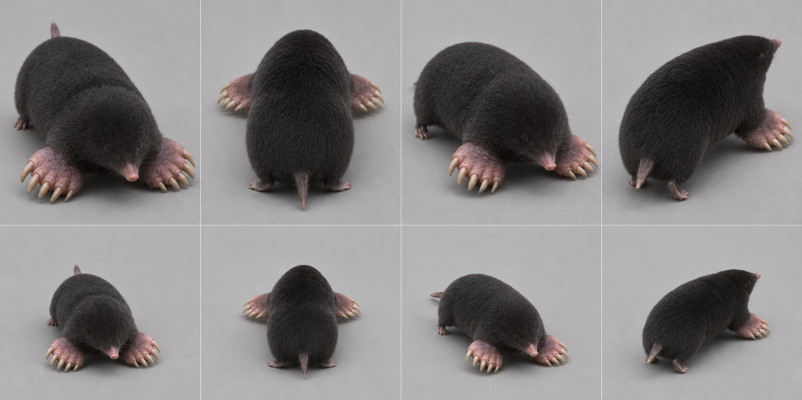
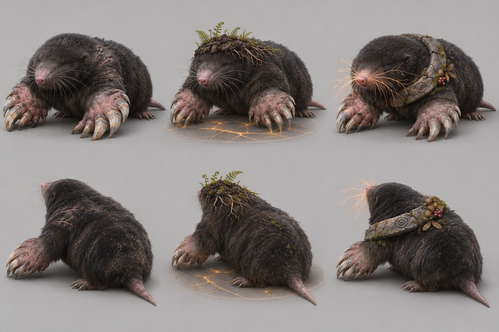

# European mole — graph target

Species scope: **mole** (Talpa europaea); L2, #1904. Target identity is inferred from the existing genome's natural cues, not a new gameplay/species decision. No hand-written-art fix or graph code is authorized here.

## Reference plate and provenance

Selected plate: [target-v2.png](https://raw.githubusercontent.com/edsaperia/witch/20d25e05fdc3b44a73ba23e7e270c8105498f1d0/previews/art-pass/mole/target-v2.png), SHA256 `954a0a0d09a32aca9ff0090de850cdd33f8de3afcb92ecf00a784d89060efbe9`. Generated 2026-11-07 with the built-in **image_gen.imagegen** tool (scientific-educational, photoreal target; model/version/seed not exposed). [Exact prompt](https://raw.githubusercontent.com/edsaperia/witch/20d25e05fdc3b44a73ba23e7e270c8105498f1d0/previews/art-pass/mole/prompt-v2.txt); [provenance](https://raw.githubusercontent.com/edsaperia/witch/20d25e05fdc3b44a73ba23e7e270c8105498f1d0/previews/art-pass/mole/provenance-v2.json). No Commons photo was input to imagegen or committed.

Eight cells: adult row1, mobile juvenile row2; columns standing-towards, standing-away, walking-towards, walking-away. Young represents game age0's mobile visual role, **not a literal neonate or scientifically verified age**. The game has young variants; many real neonatal mammals cannot stand/walk. Size ratios between generated cells are illustrative, not calibrated.

Camera target: art/model3d.js PITCH=.52rad (29.79° downward) and YAW={towards:.6,away:-.6}rad (±34.38°). Prompts approximate a long-lens affine-looking view. Generated heading, perspective, scale and foot contact are not constrained by the real renderer: some cells are more frontal/rearward, and v2 silhouettes can shift angle. **No pixel-exact game-camera match, game-size recognition verdict or actual motion cycle is claimed.**

## Real-photo comparison — real anatomy wins

[Commons comparison file: Talpa europaea.jpg](https://commons.wikimedia.org/wiki/File:Talpa_europaea.jpg). Viewed locally for comparison only; not on either committed branch. Commons frontal photo clearly shows lateral shovel hands, long claws, nearly hidden eyes, absent projecting ears and continuous neck. Hindquarters/tail are outside the useful view; no ratio claimed from those hidden parts.

Photo occlusion, fur, pose and lens prevent reliable joint/length measurement; do not treat this single photograph as a complete anatomical dataset.

## Identifying checklist

1. Low compact cylindrical velvet-furred trunk.
2. No visible external ear pinnae; tiny recessed eyes.
3. Long sensitive naked tapered pink snout, not a star nose.
4. Broad forehands rotated outward beside the shoulders, not forward-facing rodent fingers.
5. Five true clawed digits per hand; accessory digging sesamoid is not a sixth limb.
6. Small rear feet and short sparsely haired tail.
7. Mobile young: larger head relative to trunk but retain shovel hands and hidden ears.

## Body plan and proportion targets

**L = nose to tail-base length in a neutral quadrupedal pose, excluding tail**, not the torso-only spine length. Head means muzzle tip to occiput; exposed neck is occiput-to-shoulder transition; limb reach means vertical shoulder/hip-to-ground in quiet stance, not summed bone lengths. Ratios below are **artist starting ranges inferred from general anatomy/photos, not specimen measurements, fitted genome values or universal biological bounds**. Adjust for pose and actual photo evidence.

Head 0.22–0.28; exposed neck0–0.03; low limb reach0.10–0.18; tail0.15–0.25; forehand width about0.10–0.16.

Heavy shoulder/forelimb girdle in a compact tube; hindquarters less broad. Head barely separated from shoulders; avoid an obvious neck or hamster cheeks.

Age0 target: scale the whole animal down, then increase relative head/eye size and reduce muzzle/tail maturity as listed above; do not merely shrink an adult. These are qualitative age keys, not validated growth measurements. Preserve the natural four-limb body plan at every game age. Magical/legend adornments must not replace the identifiable natural silhouette; the separately authorized legend concepts below are proposals only.

## Graph requirements and missing features

Explicit oriented digging palm with claw/digit fan, forearm rotation and fore/rear asymmetry; generic leg family feet are ellipsoids. No furred pinna assembly is needed. These are structural graph requests, not hand-painted repairs.

Capability audit is source-only: prototype524b0acaa has generic head/leg/wing/tail/shell sockets. Read-only #1866 headde27db5154a3e8b1aa94255263bd2601b92aec36 additionally has neck, parent attachments and static triangular membrane sockets. Thus **neck and membrane kinds are present**, not missing. Its leg foot is an ellipsoid (hoof can split); no explicit reusable digging-palm/digit, ear/tuft, spine-field or folded-patagium deformation contract was verified. Generic ellipsoids can block out some shapes; absence of a named semantic control does not prove geometry is impossible. Requests here are shared graph/family capabilities to confirm with1866, never a permission to patch old builders.

## Ranked targets and image QA

1. Outward shovel forehands.
2. no external ears.
3. low tube+pink snout.

v1 rejected as a modelling target: small ear rims and forward-pointing long fingers contradict the photo. Targeted v2 requests removal/rotation; real photo and checklist override residual generated anatomy.

v2 removes obvious ear rims and broadens forehands, improving the silhouette. Palm/claw rotation is still more forward-facing than the real photograph; do NOT copy its finger arrangement as anatomy.

All selected plates were visually inspected for whole framing, adult/young rows and towards/away standing/walking coverage. A lifted paw is not gait validation; hidden far-side feet and exact digit counts are not certified. Generated-photo discrepancies are excluded from the graph specification by the checklist and real-photo priority. Optional shipped-art critique omitted: no shipped renderer run or native/4× acceptance was allocated; the later instruction supersedes that exhaustive review.

Review boundary: target note/reference output complete for coordinator review, with explicit uncertainties above. Species migration and likeness acceptance remain #1866/canonical/Ed decisions; no source, rig, render, registry, gameplay, text or default changed.

## Legend concepts — 2026-11-07 proposal

Authorized by1476#6707981581 and correction6707992824. Read ART-GUIDE0b/0c and legend-audit; crystals, flame crests and spirit wings are allowed when fitting. Fit and variety win over a blanket adornment ban. Ed judges these proposals; nothing is implemented.

Area story: Fern forest: leaf litter, moss, ferns, mossy birches, oaks and rowans.

| Today’s awake legend | Three generated alternatives |
|---|---|
| **PENDING exact-source comparison.** Requested in1904#6708045677 from prototype524b0acaa. The5Oct atlas is historical and is deliberately not relabelled today. |  |

Columns left→right A/B/C; upper row towards, lower row away. Whole-animal plain-background photographic concept targets; approximate camera only, not game-rendered or game-size acceptance.

- **A:** The Deep Delver: low velvet-black European mole with NO external ears, tiny eyes and pink tapering snout; two colossal outward-turned pink shovel palms and broad worn ivory digging claws with subtle mineral strata polished into them, age-grey whiskers, healed shoulder fur scars. Hands themselves are the signature, not a crown.
- **B:** The Earth-Crowned Elder: European mole with broad outward palms, small soft crown shaped from its own dark burrow earth and tiny fern roots, faint amber tunnel lines visible only in a small translucent ground disc immediately beneath it; no trees growing from its back.
- **C:** The Root Reader: low ancient European mole, nose and long tactile whiskers gently lit like fine copper root filaments, no star-nose, no visible ears; one old cracked stone torque low around shoulders, tiny mossy seed offerings, hands still broad natural shovels.

**Strongest proposed pick A; signature element: Enormous age-worn digging palms.** Digging is the mole's defining power. Vast outward shovel hands with worn claws suggest tunnels older than the forest; a low velvet tube, pink snout and hidden ears keep it a mole. Geological traces are optional surface history, not an unrelated crystal crown.

Actual image QA: A keeps the earless low mass, pink nose and dominant digging hands. All three plates still point too many claws forward/down: NOT accepted palm anatomy; the real-photo outward shovel orientation and written checklist override. B adds a garden crown; C has a heavy torque.

### Chosen legend checklist

1. Low cylindrical velvet body and minimal visible neck.
2. No external ears; tiny recessed eyes and tapered pink snout.
3. Broad outward-facing forepalms dominate the silhouette, with rear feet much smaller.
4. Worn claws/scars express immense age and digging power.
5. Any mineral history is confined to claw wear, not pasted gems everywhere.
6. Body remains a European-mole family, not a star-nosed species swap.

### Chosen legend body plan and graph needs

Legend HBL target1.3–1.5×adult; forehand width0.20–0.28L versus natural note's smaller hand, tail0.15–0.25L. Broad shoulder girdle but no large neck/head crown. All ratios are artist starting targets, not measured biology or accepted game size. L retains the nose-to-tail-base definition above; legend exaggeration is deliberate.

Rotatable shovel-palm/digit/claw assembly, claw wear/repair variants and per-surface scar/material bands. Real-photo palm orientation still wins over generated fingers. Shared graph work stays with1866. Existing neck/parent/static-membrane sockets are not reported missing; these requests describe species-ready behaviour/material/attachment contracts, not proof that generic geometry cannot express the shape.

### Exact generated evidence

[Plate](https://raw.githubusercontent.com/edsaperia/witch/e85e74d7ccff41e1ffc9447cfe0df7cd959d77bc/previews/art-pass/mole/legend-concepts-v1.png), SHA256 `e8e9a1bdf2ed7a8c288f64efb8c9c7acf4943e320584a7eb7c5010211b93cdc9`; [exact prompt](https://raw.githubusercontent.com/edsaperia/witch/e85e74d7ccff41e1ffc9447cfe0df7cd959d77bc/previews/art-pass/mole/legend-prompt-v1.txt); [provenance and A/B/C briefs](https://raw.githubusercontent.com/edsaperia/witch/e85e74d7ccff41e1ffc9447cfe0df7cd959d77bc/previews/art-pass/mole/legend-provenance-v1.json). Built-in image_gen.imagegen,2026-11-07; model/seed not exposed. Three concepts with two views each; no real photo input. All eight plates were visually inspected; written QA and real anatomy override generated defects.

Legend-addition status: concepts/selection notes complete, **PARTIAL until today’s exact-source comparison is supplied and placed beside them**. This does not reopen the completed anatomy target milestone or authorize activation.
