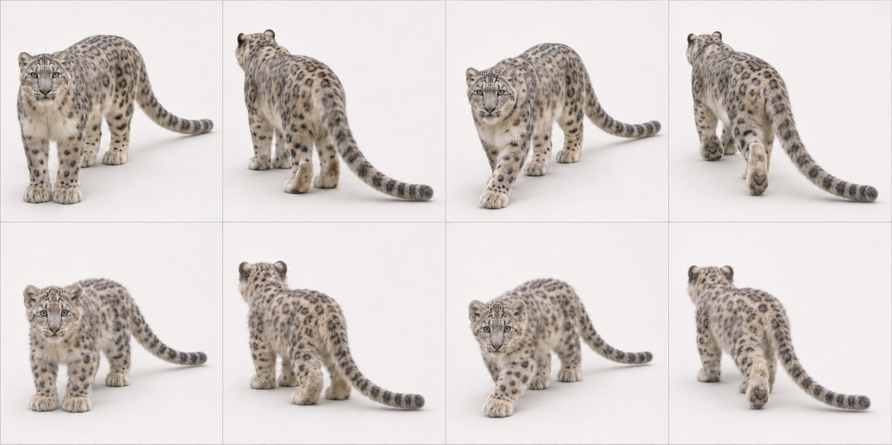
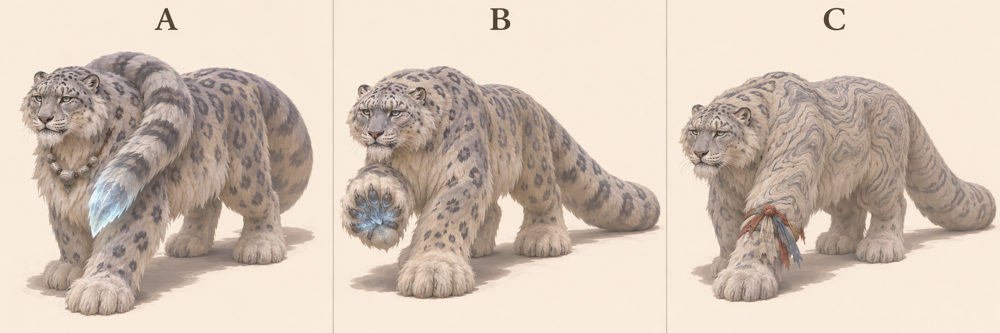
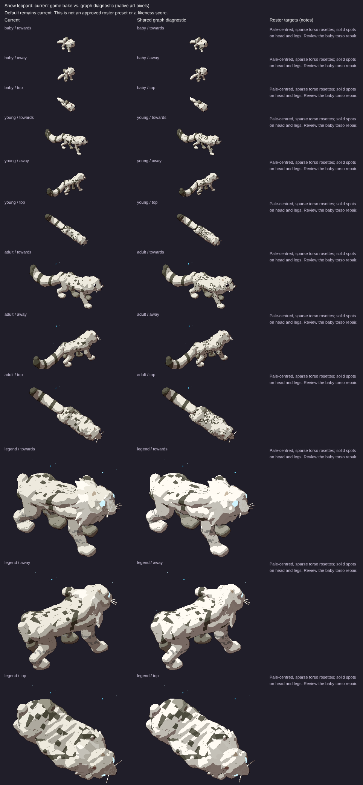

# Snow leopard: L3 graph target

7 November 2026. Species ID `snowleopard`; Panthera uncia. Draft design reference for PR1906, source base524b0acaa43bb9975e7b2834ff9a55cbca4b3319. Ed judges the legend recommendation. No activation, implementation or claim that the current game passes.

## Reads-as target

Smoky broad-faced cat with large furred paws and very long thick tail.

- Very long thick cylindrical tail with mild taper, not plume or bobtail
- Small rounded ears close to skull
- Broad short face with wide muzzle
- Dense smoky-grey fur and dark rosettes
- Large broad furred paws
- Strong hindquarters and deep chest under fur
- Low elongated feline trunk, not bear hump

## Adult and mobile-young references



Top row adult, bottom row mobile young/age0 target; columns standing towards, standing away, walking towards, walking away. Ages scaled independently: NOT a world-size comparison. Age0 means a mobile cub/kitten, not a newborn. Game levels remain0 baby/1 young/2 adult/3 legend. This does not redefine their biology or game sizes.

## Proportions and mass

Use L = nose to tail base (head-body length), excluding tail, mane and decorative fur. These are **artist starting ranges**, not measured zoological statistics, pixel measurements or acceptance thresholds. Perspective, pose, sex, subspecies and coat vary. Refine against multiple orthogonal photos before implementation.

| Quantity | Fraction of L |
|---|---|
| Exposed leg: ground to ventral trunk | .28–.39 |
| Head: occiput to nose | .18–.23 |
| Visible neck bridge | .08–.13 |
| Tail: base to tip along curve | .75–.95 |
| Ground to shoulder | .50–.65 |

Substantial chest and hindquarters inside dense coat; low elongated body remains visible. Fur increases apparent bulk, not bone mass. Tail is long and fairly even in diameter.

Young: Fluffy round-faced cub with large paws and short muzzle; tail remains elongated but less extreme than adult. Keep round small ears rather than kitten triangles.

Feline hindlegs are digitigrade: the visible backward hock is an ankle, not a backward knee. Preserve fore/hind distinction and paw support; a still generated frame does not prove a gait cycle.

## Photograph and anatomy cross-check

Adult photo is cropped at rump/paws: confirms small ears, broad face, dense coat and rosettes, NOT full tail or leg proportions. Young photo is head/forequarters only: round face/ears and fur. Expert description supports long tail/paws. First generated sheet had an exaggerated widening plume; selected v2 corrects it toward a thick cylindrical tail.

- [adult: File:Snow Leopard Walking (18029044299).jpg](https://commons.wikimedia.org/wiki/File:Snow_Leopard_Walking_(18029044299).jpg) — viewed privately.
- [young: File:Snow leopard cub (9654242595).jpg](https://commons.wikimedia.org/wiki/File:Snow_leopard_cub_(9654242595).jpg) — viewed privately.

[Expert species description](https://www.catsg.org/living-species-snowleopard) supports the identifying traits; ratios above are our design estimates. Commons photos are comparison-only, kept private and never published in this PR or shots.

## Three legend concepts and existing comparison

Area/story: Icefall: glacier ice/old snow, moraine, stones, cairns and standing stones, wind-bent trees, ring of weathered posts around stone (art/areas/icefall/recipe.js).

| Three new proposals, A/B/C left to right | Existing renderer comparison, ALL ages |
|---|---|
|  |  |

The right-hand sheet is **archival**, source/served SHA aad8b13327282d13d7d6a4e2e1b28aa2acfd6b6c, fixture cats-1. Read its Current column, level3 row for the old legend; its graph column is NOT the target. It is not a capture of today's524b0ac source. Fresh exact-head legend evidence must be supplied by the canonical renderer before a current-vs-target verdict; no laptop browser was allocated or run.

- A Glacier Stole — own tail curled over shoulder, stone beads and ice-lit tip.
- B Snowstep — immense furred paws with glacier crystals within raised sole.
- C Pass Rememberer — rosettes become contour loops, frayed cloth knot at foreleg.

**Recommended B; signature element: Glacier crystals within paw fur.** Snow travel and immense furred paws become the power of the high ice. Crystals fit this animal/place and are confined to soles, not another dorsal crystal uniform. A risks tail topology and a swallowed face; C risks markings too fine to read.

Chosen legend checklist/body plan: Keep low pale cat, small round ears and full cylindrical tail. Raise one broad paw to expose restrained blue crystal growth between pads, attached to foot-local frame; use weathered muzzle/old scar rather than more jewellery.

These are three concepts generated together in one sheet, not three independent calibrated render trials. Inspect all whole bodies and recognisability; labels identify proposals, not approved in-game names. Only Ed/coordinator can adopt a pick.

## Top three priorities and MISSING GRAPH FEATURES

Top three: long cylindrical tail; round ears/broad face; furred paws.

Independent fur envelope and paw underside regions; attached tail/shoulder relationship for any stole proposal; selected concept needs sole-local crystal attachments and age scars.

At the pinned source, `art/body-graph/graph.js` has head/leg/wing/tail/shell sockets, torso spine stations, head ellipsoid, two-bone digitigrade legs and a foot ellipsoid. `quadruped.js` already has torso profile/flex, pointed-ear cup helpers and region patterns; `families.js` has feline adapter; `tail-markings.js` already supports rings/spots/rosettes/tip paint. `gait.js` has a two-bone straight-line diagnostic solve. Do NOT request basic tails, all ears, all patterns or all gait as wholly absent. Missing contract: rotating station frames/socket-to-socket attachments (explicit future work), nested head/foot-local feature inheritance, age-linked fur/tuft/accessory attachment data and scar/weathering regions. Legacy features may draw these today; this is a request for shared graph representation, not a demand for handwritten species fixes. Refer implementation to graph owner#1866.

## Provenance and limits

Built-in `image_gen.imagegen`, 7 November2026; no model identifier/seed reported. Text-only generation, no source photograph supplied as input. Anatomy prompts ask photorealism; legends use sculptural concept art. Actual camera source `art/model3d.js`: pitch0.52rad (29.8° down), yaw±0.6rad (34.4°). Tool output only approximates this; no camera calibration, native-size rendering, pixel-diff, locomotion/contact or graph-fit proof. All selected generated sheets were visually inspected for panel/age/pose coverage and complete animals; natural occlusion remains.

Crystals are proposed magic, not anatomical fact. No paw-pad contact/animation proof; current render comparison remains archival.

### Exact anatomy generation prompt

```text
Scientific-educational PHOTOREAL whole-animal anatomy reference contact sheet; eight equal panels, two rows of four. Clean off-white studio ground/background, soft even daylight, no objects, no text or labels. Approximate game camera: elevation29.8 degrees looking down, long-lens orthographic-like perspective, long body axis34.4 degrees toward/away from side-on. TOP ROW SAME ADULT: standing towards, standing away, slow walking towards, slow walking away. BOTTOM ROW SAME MOBILE YOUNG: identical four poses/order. Exactly one animal in each panel, four anatomically correct digitigrade legs and clear natural slow-walk paw placement. Whole body, every ear/paw and ENTIRE TAIL including tip in frame with generous padding; no cropping or tail hidden behind body: gently sweep tail outward where needed. Adult/young scaled independently for inspection, not direct size comparison. Neutral natural expression, no stylization, no collars, no extra limbs. SNOW LEOPARD (Panthera uncia): adult thick pale grey/cream fur, dark grey open rosettes on torso and small solid head/limb spots, wide short muzzle, small round widely spaced ears, deep powerful chest, longer muscular hindquarters/hind legs than forelegs, enormous fur-covered broad paws. Tail extraordinarily LONG AND THICK, about0.85 times head-body length, cylindrical furry volume along its length, sweep it alongside so the FULL tail and rounded end are visible; never make a lynx bobtail. Young approximately3-month mobile cub: fluffy large rounded head, short broad muzzle, relatively large paws, shorter legs, already elongated thick furry tail (still growing), visible soft rosettes. No tufted lynx ears, no lion mane, no tiger stripes.
```

### Selected tail correction prompt

```text
Edit only the snow leopard tails in this eight-panel photoreal anatomy sheet. Preserve all eight animals, their bodies/heads/legs/paws, age rows, poses, framing, camera and background. In EVERY panel replace the exaggerated wide plume/pillow-like tail with a NATURAL long thick but CYLINDRICAL snow leopard tail: adult tail length about0.8–0.9 of nose-to-tail-base body length, diameter approximately one adult paw-width (about0.08–0.10 of head-body length), uniformly furry with mild taper to a rounded tip, NOT swelling into a giant brush at the end. Cub tails proportionately slimmer/shorter than adult but still clearly elongated, never bobtails. Retain dark tail rings and pale grey coat. Keep each whole tail tip inside the panel and curved outward for visibility. Do not alter anything else. No text.
```

### Exact legend generation prompt

```text
Concept art comparison sheet, THREE distinctly DIFFERENT legendary creature proposals in THREE equal columns labelled A, B, C only. One WHOLE creature per column, ears paws tail entirely visible with generous margin, plain warm ivory studio background and ground shadow, no scenery or extra animals. Approximate Witch GAME camera elevation29.8deg looking down, long-lens orthographic-like, body34.4deg toward camera from side-on. All are ancient powerful wise elders, animal's defining nature exaggerated into magic, still recognisably that exact species. Painterly sculptural concept art with bold coherent silhouettes, restrained palette/large readable shapes, not a UI/game sprite or calibrated render. Strong anatomy and natural quadruped standing or slow deliberate walking, no gore; healed scars only. Each concept its OWN idea, not uniform accessory swaps. SNOW LEOPARD, pale smoky rosetted coat, very small round ears, broad face, immense broad furred paws and VERY LONG THICK CYLINDRICAL tail not plume. Icefall glacier old snow moraine cairns weathered prayer posts. A: Glacier Stole, ancient silver-muzzled cat with its own extremely long RINGED tail curled once loosely over one shoulder like a natural fur stole, visibly CONTINUOUS from rump and not a second tail, a few worn stone beads on neck; cold translucent light trapped at tail-tip like glacier ice. B: Snowstep, elder with enormous fur-soled paws, one raised paw revealing blue ice-crystal growth in pad fur, chipped ear and pale healed scar, tail extended and cylindrical; no crystal dorsal spikes. C: Pass Rememberer, old snow leopard whose rosettes become faint topographic contour loops, a few frayed prayer-cloth knots tied at one foreleg, windworn face, low huge pale body and trailing heavy tail. No lion mane, giant plume tail or horns.
```

See [L3 summary](l3-summary.md) for evidence hashes, shared gaps and remaining checks.
