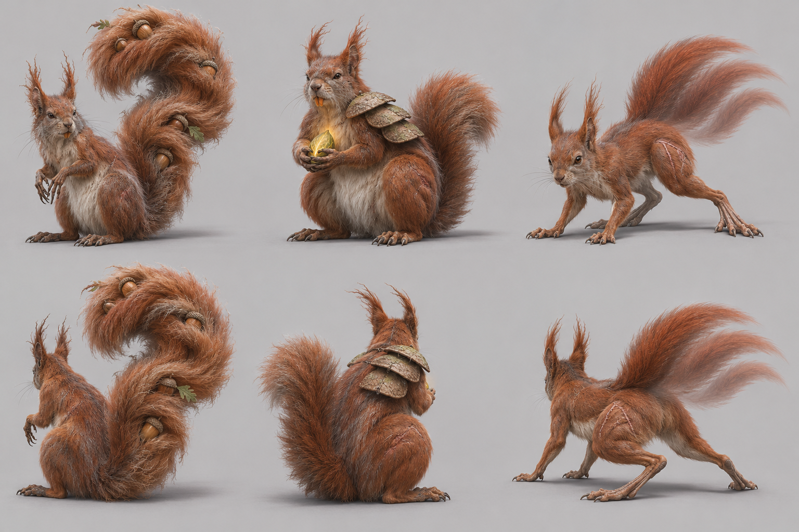

# Eurasian red squirrel target — graph target

Species scope: **squirrel** (Sciurus vulgaris); L2, #1904. Target identity is inferred from the existing genome's natural cues, not a new gameplay/species decision. No hand-written-art fix or graph code is authorized here.

## Reference plate and provenance

Selected plate: [target-v1.png](https://raw.githubusercontent.com/edsaperia/witch/20d25e05fdc3b44a73ba23e7e270c8105498f1d0/previews/art-pass/squirrel/target-v1.png), SHA256 `b8fe1e044d78a9ff265387cf1e1e253ad54fc4d3e6f28f29f27ae3739418ed20`. Generated 2026-11-07 with the built-in **image_gen.imagegen** tool (scientific-educational, photoreal target; model/version/seed not exposed). [Exact prompt](https://raw.githubusercontent.com/edsaperia/witch/20d25e05fdc3b44a73ba23e7e270c8105498f1d0/previews/art-pass/squirrel/prompt-v1.txt); [provenance](https://raw.githubusercontent.com/edsaperia/witch/20d25e05fdc3b44a73ba23e7e270c8105498f1d0/previews/art-pass/squirrel/provenance-v1.json). No Commons photo was input to imagegen or committed.

Eight cells: adult row1, mobile juvenile row2; columns standing-towards, standing-away, walking-towards, walking-away. Young represents game age0's mobile visual role, **not a literal neonate or scientifically verified age**. The game has young variants; many real neonatal mammals cannot stand/walk. Size ratios between generated cells are illustrative, not calibrated.

Camera target: art/model3d.js PITCH=.52rad (29.79° downward) and YAW={towards:.6,away:-.6}rad (±34.38°). Prompts approximate a long-lens affine-looking view. Generated heading, perspective, scale and foot contact are not constrained by the real renderer: some cells are more frontal/rearward, and v2 silhouettes can shift angle. **No pixel-exact game-camera match, game-size recognition verdict or actual motion cycle is claimed.**

## Real-photo comparison — real anatomy wins

[Commons comparison file: Sciurus vulgaris.JPG](https://commons.wikimedia.org/wiki/File:Sciurus_vulgaris.JPG). Viewed locally for comparison only; not on either committed branch. The inspected Julita Goszkowska Commons photo shows red coat/pale underside, fine forepaws, strong seated haunches and a bushy tail. It is low resolution and does not establish walking joints or tuft length. The higher-resolution Sciurus_vulgaris.jpg file was unavailable (HTTP429), not visually reviewed.

Photo occlusion, fur, pose and lens prevent reliable joint/length measurement; do not treat this single photograph as a complete anatomical dataset.

## Identifying checklist

1. Large bushy tail carried as an arc/fan behind the body.
2. Pointed ear tufts for the chosen tufted red-squirrel target, seasonal not universal.
3. Small head with whiskered short muzzle and dark eyes.
4. Narrow shoulders and distinctly strong haunches.
5. Long folded hind limbs/feet compared with delicate forepaws.
6. Reddish upper coat with pale underside, allowing natural colour variation.
7. Mobile kit: shorter less full tail and subtler tufts; not a miniature identical adult.

## Body plan and proportion targets

**L = nose to tail-base length in a neutral quadrupedal pose, excluding tail**, not the torso-only spine length. Head means muzzle tip to occiput; exposed neck is occiput-to-shoulder transition; limb reach means vertical shoulder/hip-to-ground in quiet stance, not summed bone lengths. Ratios below are **artist starting ranges inferred from general anatomy/photos, not specimen measurements, fitted genome values or universal biological bounds**. Adjust for pose and actual photo evidence.

Head 0.18–0.24; exposed neck0.05–0.10; forelimb reach0.20–0.28, hindlimb reach0.28–0.40; tail0.75–1.00.

Hindquarter-dominant with a light chest and tucked middle; tail adds silhouette area without moving the torso centre of mass into the tail.

Age0 target: scale the whole animal down, then increase relative head/eye size and reduce muzzle/tail maturity as listed above; do not merely shrink an adult. These are qualitative age keys, not validated growth measurements. Preserve the natural four-limb body plan at every game age. Magical/legend adornments must not replace the identifiable natural silhouette; the separately authorized legend concepts below are proposals only.

## Graph requirements and missing features

Tufted pinna assembly and anisotropic fur plume tail; grasping foredigits/elongated hind-foot controls. Plain tail chain exists but does not by itself specify the red-squirrel fan.

Capability audit is source-only: prototype524b0acaa has generic head/leg/wing/tail/shell sockets. Read-only #1866 headde27db5154a3e8b1aa94255263bd2601b92aec36 additionally has neck, parent attachments and static triangular membrane sockets. Thus **neck and membrane kinds are present**, not missing. Its leg foot is an ellipsoid (hoof can split); no explicit reusable digging-palm/digit, ear/tuft, spine-field or folded-patagium deformation contract was verified. Generic ellipsoids can block out some shapes; absence of a named semantic control does not prove geometry is impossible. Requests here are shared graph/family capabilities to confirm with1866, never a permission to patch old builders.

## Ranked targets and image QA

1. Hindquarter/forelimb contrast.
2. curved bushy tail.
3. ear tufts.

v1 shows fan tail, tufts and stronger haunches, but adult tufts are exaggerated and the camera is more frontal than a calibrated game heading. Keep a squirrel silhouette without copying the oversized ear-tuft length.

All selected plates were visually inspected for whole framing, adult/young rows and towards/away standing/walking coverage. A lifted paw is not gait validation; hidden far-side feet and exact digit counts are not certified. Generated-photo discrepancies are excluded from the graph specification by the checklist and real-photo priority. Optional shipped-art critique omitted: no shipped renderer run or native/4× acceptance was allocated; the later instruction supersedes that exhaustive review.

Review boundary: target note/reference output complete for coordinator review, with explicit uncertainties above. Species migration and likeness acceptance remain #1866/canonical/Ed decisions; no source, rig, render, registry, gameplay, text or default changed.

## Legend concepts — 2026-11-07 proposal

Authorized by1476#6707981581 and correction6707992824. Read ART-GUIDE0b/0c and legend-audit; crystals, flame crests and spirit wings are allowed when fitting. Fit and variety win over a blanket adornment ban. Ed judges these proposals; nothing is implemented.

Area story: Twiggy forest: small leafy plants, many thin-trunk saplings and straight but slanted multi-trunk trees.

| Today’s awake legend | Three generated alternatives |
|---|---|
| **PENDING exact-source comparison.** Requested in1904#6708045677 from prototype524b0acaa. The5Oct atlas is historical and is deliberately not relabelled today. |  |

Columns left→right A/B/C; upper row towards, lower row away. Whole-animal plain-background photographic concept targets; approximate camera only, not game-rendered or game-size acceptance.

- **A:** The Coppice Archivist: very old red squirrel with enormously enlarged question-mark bushy tail, several real-sized acorn offerings caught within distinct tufts as if a living ancestral store, weathered ear tufts, grey muzzle, powerful haunches and delicate grasping forepaws; tail is the signature, no crystals and no horns.
- **B:** The Seed-Armoured Guardian: aged red squirrel with enlarged orange incisors and powerful hindquarters, three overlapping weathered acorn-cup shoulder plates as small natural armour, scarred paws gripping one luminous seed, tail ordinary but bushy; no human knight uniform.
- **C:** The Twig Runner: ancient lean red squirrel in spring-loaded grounded crouch, exaggerated long hind feet, old scar lines along haunches, three soft displaced red-fur afterimages taper immediately from its real tail, no extra bodies, no wings. Ear tufts and pale belly stay clear.

**Strongest proposed pick A; signature element: Acorn-bearing question-mark tail.** The squirrel's tail and hoarding become an ancestral archive of the twiggy coppice. Great haunches, delicate forepaws and ear tufts retain the animal; weathered tufts and grey muzzle show many seasons. Acorns in the tail are offerings/story, not a claim squirrels naturally carry nuts there.

Actual image QA: A is the clearest tail/hoarding evolution, with age-grey muzzle and sparse offerings. B pushes toward a common armoured guardian; C is lean and leggy, with weak ancient identity. A needs tail attachment/weight and offering density checked in the graph.

### Chosen legend checklist

1. Strong squirrel haunches, delicate forepaws and recognisable tufted ears.
2. Huge bushy tail makes a clear curved question-mark silhouette.
3. Acorns remain discrete sparse offerings rather than obscuring all the fur.
4. Grey muzzle, worn ears/tufts and scarred paws show age.
5. Tail remains attached to the pelvis with a plausible base.
6. Pale belly and small face stay readable beneath the tail.

### Chosen legend body plan and graph needs

Legend HBL target1.4–1.6×adult; tail centreline1.2–1.6L with fur plume width0.30–0.45L. Bulk stays in hindquarters, not an oversized chest; offerings need their own silhouette/footprint audit. All ratios are artist starting targets, not measured biology or accepted game size. L retains the nose-to-tail-base definition above; legend exaggeration is deliberate.

Anisotropic curved fur-plume tail with stable ornament attachment points, acorn offering sockets/LOD, asymmetrical ear tuft wear and scar layers. Do not add dormouse-like hibernation shell. Shared graph work stays with1866. Existing neck/parent/static-membrane sockets are not reported missing; these requests describe species-ready behaviour/material/attachment contracts, not proof that generic geometry cannot express the shape.

### Exact generated evidence

[Plate](https://raw.githubusercontent.com/edsaperia/witch/e85e74d7ccff41e1ffc9447cfe0df7cd959d77bc/previews/art-pass/squirrel/legend-concepts-v1.png), SHA256 `a257c3ed6889e38eff7cbda79cf97223c352c3b5be31d396344a005294bd037c`; [exact prompt](https://raw.githubusercontent.com/edsaperia/witch/e85e74d7ccff41e1ffc9447cfe0df7cd959d77bc/previews/art-pass/squirrel/legend-prompt-v1.txt); [provenance and A/B/C briefs](https://raw.githubusercontent.com/edsaperia/witch/e85e74d7ccff41e1ffc9447cfe0df7cd959d77bc/previews/art-pass/squirrel/legend-provenance-v1.json). Built-in image_gen.imagegen,2026-11-07; model/seed not exposed. Three concepts with two views each; no real photo input. All eight plates were visually inspected; written QA and real anatomy override generated defects.

Legend-addition status: concepts/selection notes complete, **PARTIAL until today’s exact-source comparison is supplied and placed beside them**. This does not reopen the completed anatomy target milestone or authorize activation.
