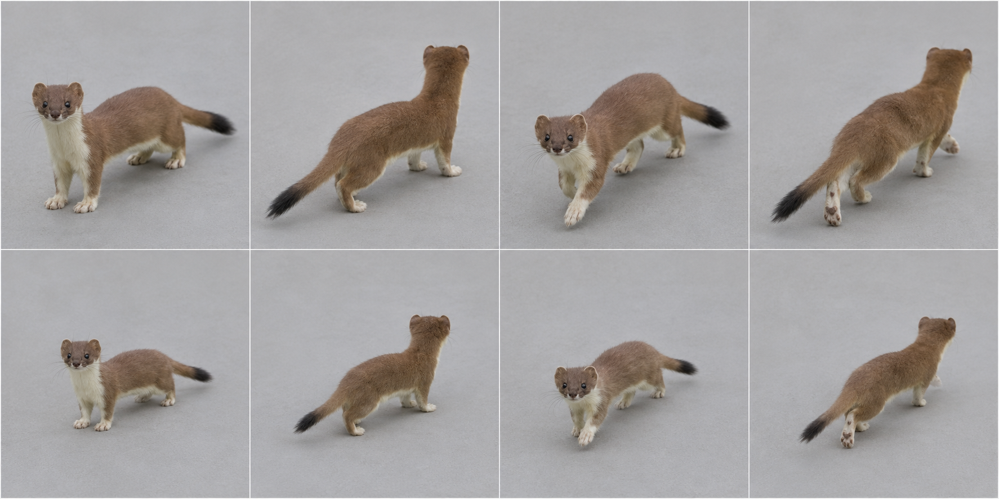

# Stoat, summer-coat target — graph target

Species scope: **stoat** (Mustela erminea); L2, #1904. Target identity is inferred from the existing genome's natural cues, not a new gameplay/species decision. No hand-written-art fix or graph code is authorized here.

## Reference plate and provenance

Selected plate: [target-v1.png](https://raw.githubusercontent.com/edsaperia/witch/20d25e05fdc3b44a73ba23e7e270c8105498f1d0/previews/art-pass/stoat/target-v1.png), SHA256 `4a701923e9d96ef14311ebe3523878c174be38199db12b1a5d29e8ca5d15ab76`. Generated 2026-11-07 with the built-in **image_gen.imagegen** tool (scientific-educational, photoreal target; model/version/seed not exposed). [Exact prompt](https://raw.githubusercontent.com/edsaperia/witch/20d25e05fdc3b44a73ba23e7e270c8105498f1d0/previews/art-pass/stoat/prompt-v1.txt); [provenance](https://raw.githubusercontent.com/edsaperia/witch/20d25e05fdc3b44a73ba23e7e270c8105498f1d0/previews/art-pass/stoat/provenance-v1.json). No Commons photo was input to imagegen or committed.

Eight cells: adult row1, mobile juvenile row2; columns standing-towards, standing-away, walking-towards, walking-away. Young represents game age0's mobile visual role, **not a literal neonate or scientifically verified age**. The game has young variants; many real neonatal mammals cannot stand/walk. Size ratios between generated cells are illustrative, not calibrated.

Camera target: art/model3d.js PITCH=.52rad (29.79° downward) and YAW={towards:.6,away:-.6}rad (±34.38°). Prompts approximate a long-lens affine-looking view. Generated heading, perspective, scale and foot contact are not constrained by the real renderer: some cells are more frontal/rearward, and v2 silhouettes can shift angle. **No pixel-exact game-camera match, game-size recognition verdict or actual motion cycle is claimed.**

## Real-photo comparison — real anatomy wins

[Commons comparison file: Mustela erminea (52550336777).jpg](https://commons.wikimedia.org/wiki/File:Mustela_erminea_(52550336777).jpg). Viewed locally for comparison only; not on either committed branch. Winter-white Commons photo confirms small ears, narrow head and long neck; its tail/feet are hidden, so it cannot validate the black tip, leg length or summer coat. Supplemental summer photo is used only for visible coat/body cues; not a juvenile growth measurement.

[Supplemental summer coat photo](https://commons.wikimedia.org/wiki/File:Mustela_erminea_in_summer.jpg) was also viewed; its tail is cropped, so neither photograph alone proves the black-tip proportion. The winter/summer difference is explicit, not a generated colour error.

## Identifying checklist

1. Very long thin torso with exceptionally short legs.
2. Neck flows into a narrow head without a bulky shoulder hump.
3. Small rounded low ears, not tall marten ears.
4. Tapered muzzle and fine whiskers; no ferret mask.
5. Brown upper coat and cream underside for the chosen summer target.
6. Black terminal tail tip remains diagnostic, including in a winter-white coat.
7. Kit: slightly fuller head, shorter muzzle and slimmer tail; retain the black tip.

## Body plan and proportion targets

**L = nose to tail-base length in a neutral quadrupedal pose, excluding tail**, not the torso-only spine length. Head means muzzle tip to occiput; exposed neck is occiput-to-shoulder transition; limb reach means vertical shoulder/hip-to-ground in quiet stance, not summed bone lengths. Ratios below are **artist starting ranges inferred from general anatomy/photos, not specimen measurements, fitted genome values or universal biological bounds**. Adjust for pose and actual photo evidence.

Head 0.16–0.22; exposed neck0.12–0.20; standing limb reach0.12–0.20; tail0.25–0.40.

Low narrow ribcage, very flexible long loin, modest hips. Avoid a cat waist or marten-sized ears/tail plume.

Age0 target: scale the whole animal down, then increase relative head/eye size and reduce muzzle/tail maturity as listed above; do not merely shrink an adult. These are qualitative age keys, not validated growth measurements. Preserve the natural four-limb body plan at every game age. Magical/legend adornments must not replace the identifiable natural silhouette; no new legendary concept is invented in this lane.

## Graph requirements and missing features

Body-relative underside and distal tail-tip material control through flex/age; reusable very-short limb/long-spine family. Generic tail chains exist; the missing item is their species-ready marking/profile contract.

Capability audit is source-only: prototype524b0acaa has generic head/leg/wing/tail/shell sockets. Read-only #1866 headde27db5154a3e8b1aa94255263bd2601b92aec36 additionally has neck, parent attachments and static triangular membrane sockets. Thus **neck and membrane kinds are present**, not missing. Its leg foot is an ellipsoid (hoof can split); no explicit reusable digging-palm/digit, ear/tuft, spine-field or folded-patagium deformation contract was verified. Generic ellipsoids can block out some shapes; absence of a named semantic control does not prove geometry is impossible. Requests here are shared graph/family capabilities to confirm with1866, never a permission to patch old builders.

## Ranked targets and image QA

1. Low long axis.
2. black tail tip.
3. small ears and narrow head.

v1 keeps the dark tail tip, brown/cream boundary and smaller kit. Standing neck/legs look more raised than a quiet low stoat; do not copy that posture into the graph. Walking is a pose sample, not a gait sequence.

All selected plates were visually inspected for whole framing, adult/young rows and towards/away standing/walking coverage. A lifted paw is not gait validation; hidden far-side feet and exact digit counts are not certified. Generated-photo discrepancies are excluded from the graph specification by the checklist and real-photo priority. Optional shipped-art critique omitted: no shipped renderer run or native/4× acceptance was allocated; the later instruction supersedes that exhaustive review.

Review boundary: target note/reference output complete for coordinator review, with explicit uncertainties above. Species migration and likeness acceptance remain #1866/canonical/Ed decisions; no source, rig, render, registry, gameplay, text or default changed.
