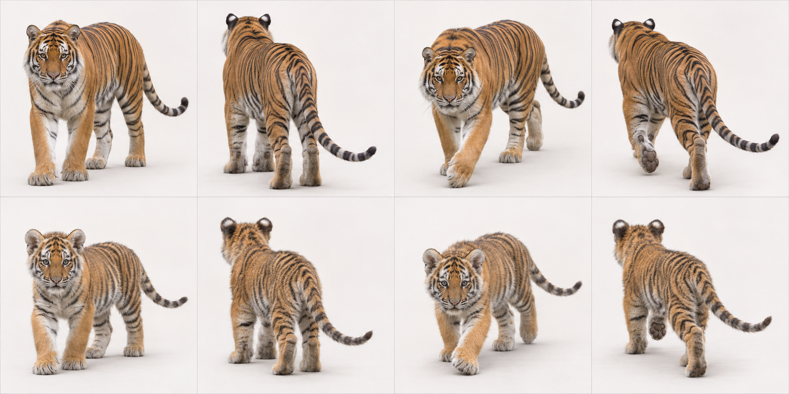
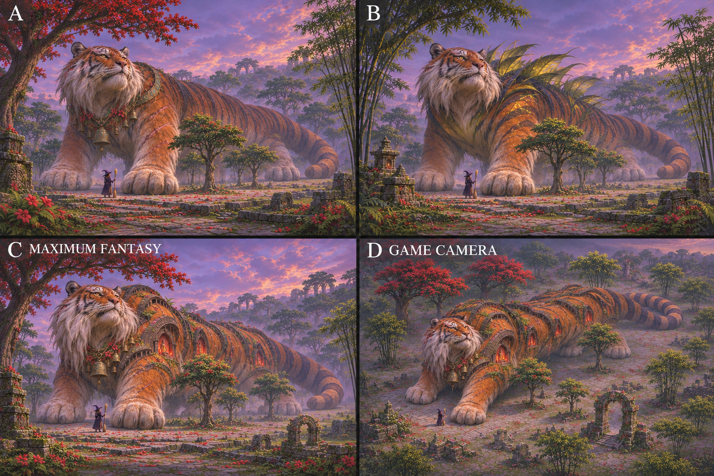
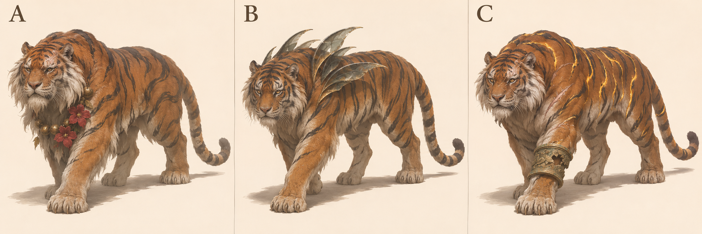
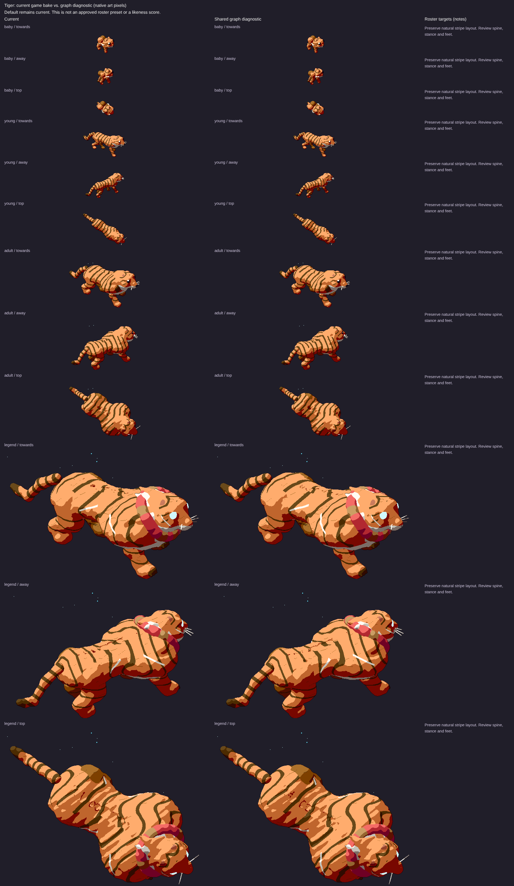

# Tiger: L3 graph target

7 November 2026. Species ID `tiger`; Panthera tigris. Draft design reference for PR1906, source base524b0acaa43bb9975e7b2834ff9a55cbca4b3319. Ed judges the legend recommendation. No activation, implementation or claim that the current game passes.

## Reads-as target

Long heavy striped cat with powerful shoulder and white cheek ruff.

- Elongated deep muscular torso
- Heavy shoulder and thick neck
- Broad head with short strong muzzle
- Small round ears with dark backs/light marks
- Orange-and-black stripes wrapping volumes
- White cheek/muzzle/underside separation
- Long tapering ring-striped tail
- Large broad paws and visible digitigrade hindleg

## Adult and mobile-young references



Top row adult, bottom row mobile young/age0 target; columns standing towards, standing away, walking towards, walking away. Ages scaled independently: NOT a world-size comparison. Age0 means a mobile cub/kitten, not a newborn. Game levels remain0 baby/1 young/2 adult/3 legend. This does not redefine their biology or game sizes.

## Proportions and mass

Use L = nose to tail base (head-body length), excluding tail, mane and decorative fur. These are **artist starting ranges**, not measured zoological statistics, pixel measurements or acceptance thresholds. Perspective, pose, sex, subspecies and coat vary. Refine against multiple orthogonal photos before implementation.

| Quantity | Fraction of L |
|---|---|
| Exposed leg: ground to ventral trunk | .28–.39 |
| Head: occiput to nose | .17–.22 |
| Visible neck bridge | .10–.16 |
| Tail: base to tip along curve | .45–.65 |
| Ground to shoulder | .48–.63 |

Low long ribcage, strong shoulders/thighs, thick neck bridge; cheek ruff adds fur around a clearly feline skull. Avoid lion mane or a short square jaguar trunk.

Young: Large round head/paws, short muzzle and broad soft stripes on a softer body. Still a tiger in silhouette; no mane.

Feline hindlegs are digitigrade: the visible backward hock is an ankle, not a backward knee. Preserve fore/hind distinction and paw support; a still generated frame does not prove a gait cycle.

## Photograph and anatomy cross-check

Adult side photo shows long deep torso, strong neck, wrapped stripes and complete curled tail; plants hide parts of feet. Young drinking photo shows face/ear markings and full striped tail but crouch cannot establish standing leg ratios. Generated sheet covers standing/walking for target inspection.

- [adult: File:Lateral tiger.jpg](https://commons.wikimedia.org/wiki/File:Lateral_tiger.jpg) — viewed privately.
- [young: File:Baby tiger cub.jpg](https://commons.wikimedia.org/wiki/File:Baby_tiger_cub.jpg) — viewed privately.

[Expert species description](https://www.catsg.org/living-species-tiger) supports the identifying traits; ratios above are our design estimates. Commons photos are comparison-only, kept private and never published in this PR or shots.

## Iteration2: colossal fantasy concepts — current recommendation

Later Ed feedback on7November2026, COORDINATOR6708227119/6708229124, supersedes iteration1’s modest fantasy/plain-background direction. [DESIGN.md](../../DESIGN.md#look) says legends are about20times a baby’s height and taller than treetops; ART-GUIDE0b/0c asks for a recognisable animal’s nature made fantastic, epoch age, wisdom, power and reverence. These are proposed designs, not changes to game sizes.



2×2 board: A upper-left, B upper-right, C MAXIMUM FANTASY lower-left; D lower-right repeats C at an approximate game-camera elevation29.8° down/yaw34.4° from side-on. **Exactly three designs; D is another view, not a fourth concept.** Witch and trees are included in every panel. A/B/C use low hero views to convey mass, far-side haze and landscape weathering. The witch is a scale stand-in, not an exact render of the game’s witch.

- A: Temple Witness, aged white cheeks, old scars and faded flower/bronze offerings.
- B: Bamboo Shadow, dark leaf-like shoulder-stripe fins and worn shrine fragments.
- C MAXIMUM FANTASY: Temple of the First Stripe; raised black stripe reliefs hold tiny eroded votive arches and lamplight within the orange coat.

**Recommend C for Ed’s second-pass review; signature element: Tiger stripes become sacred relief architecture.** C makes the tiger’s signature stripes themselves the sacred architecture of its bamboo-temple area. Its long heavy orange body, round ears, white cheeks, huge paws and striped tail remain readable. Weathered reliefs, ferns and old offerings imply centuries of worship. A is an aged animal with gifts; B risks becoming another generic crest. The building follows stripes rather than being placed on the back.

Chosen legend body-plan/checklist: Keep long muscular feline body and black/orange stripe rhythm. Attach shallow raised arch-reliefs along stripe regions, preserving joint bends and warm orange coat between them. White cheek ruff frames—not replaces—the head. Use few throat bells/flower remnants; the architecture should read before trinkets.

MISSING GRAPH FEATURES / shared integration needs: Surface-region-following relief meshes with age/weathering and cavity/niche data; nested votive lights/ferns, accessory throat curves, deformation/clearance constraints across shoulders. Existing stripe paint supplies coordinates but not carved architecture.

Actual inspected output/projection limits: Framing edit restores full tail and ears. Witch/trees appear all panels; C/D arches are conspicuous and body reads as a tiger. Foreground/nearer canopy can rise above its face, so the sheet implies colossus scale against nearby smaller crowns rather than proving height against every tree. D risks a literal building strapped on; keep orange fur and continuous stripe mapping prominent in eventual graph target.

Scale assessment: all four panels visibly contain a witch and trees; selected C/D read as colossal against the nearby witch and tree groups. Perspective/depth/variable tree size prevent an exact height comparison; no baby is depicted, so **20× baby height is a design prompt, not a verified measurement**. Native game projection, coverage/contact, accessory motion, occlusion and20× size must be tested on graph renders by the canonical owner. No local browser was allocated/run.

### Iteration2 exact generation prompt

```text
Witch videogame legendary creature second-pass design board. FOUR equal panels in a 2x2 grid, labelled A (upper left), B (upper right), C MAXIMUM FANTASY (lower left), D GAME CAMERA (lower right); no other text. A B C are THREE DIFFERENT concepts of SAME species; D repeats C's exact design from higher game camera. Every panel shows the ENTIRE huge creature including ALL ears/paws/tail, within ample margins. CRITICAL SCALE IN EVERY PANEL: a tiny human WITCH with pointed dark purple hat/dress holding broom STANDS on SAME ground plane next to front paw, clearly distinct and NOT riding animal; multiple complete FOREST TREES near paws and flank, with normal trunks/crowns and readable silhouettes. Creature head/shoulders TOWER ABOVE tree crowns; landscape-scale body mass, approximately20times a baby animal height, NOT a normal pet by a human. Trees about quarter to half creature shoulderheight, witch about one tenth to one fifteenth. Compose enough ground area to show scale without cropping creature. A B C cinematic slightly low/near-ground threequarter HERO viewpoint with atmospheric depth/haze on distant body, large weight-bearing landformlike masses. D SAME C at approximate actual game projection, elevation29.8deg DOWN, near-orthographic long lens, heading34.4deg from side-on facing viewer; whole giant+witch+trees still visible. Concept art: bold controlled painterly/small readable shape clusters, rich twilight with local magic light. Very ancient wise powerful mythical elder, animal's defining nature impossible, species instantly identifiable. No generic uniform, no gore, no modern buildings. Trees/environment support scale not hide anatomy. TIGER: long low deep muscular orange-and-black STRIPED cat, immense thick shoulders, broad white-cheeked face, small round ears, large paws, long striped tail. Bamboo jungle under kapok, old mossed temple rubble/ferns. A: massive temple witness, white aged cheek ruff, faded red offering flowers, eroded bronze garland and ancient scars. B: bamboo shadow, dark translucent bamboo-leaf fins rise from shoulder stripes, a few crumbled shrine ornaments, species stripes remain. C MAXIMUM FANTASY RECOMMENDED: Temple of the First Stripe, a colossal ancient TIGER whose black stripes are immense raised weathered black-stone reliefs IN the orange coat, forming architectural arch-like ridges over shoulders and flanks but preserving feline long trunk; small ruined temple votive alcoves carved within stripe ridges, warm red lamplight deep inside, tiny ferns at seams. White cheek ruff is like an ancient waterfall of coarse hair, scarred brows and gentle gold eyes visible. Huge orange body above kapok crowns, bronze bells/red flower remnants at throat; no temple building simply perched on back, stripes themselves are sacred architecture. D same C game camera.
```

### Selected framing correction

Built-in imagegen edit of this species’ generated iteration2 board, preserving original privately; correction selected after visual inspection.

```text
Framing correction ONLY to this four-panel A/B/C/D concept board. Preserve all three designs, C/D matching identity, colours, camera elevations, witch/tree scale relationships and landscapes. In EACH panel pull the camera BACK about25percent and recompose so the ENTIRE animal fits with at least8percent empty sky/ground margin around ALL ears, mane/corona, paws and COMPLETE tail including tip. Several current hero panels crop animal/tail/mane at edges: restore them from the same design, no added limbs/tails. Keep each witch and nearby tree group same relative physical size to animal, but visible and inside frame. Body still towers above nearby tree crowns. Keep A B C cinematic low views; D same C higher game-camera view. Keep the FOUR panel labels A/B/C MAXIMUM FANTASY/D GAME CAMERA and 2x2 layout. Do not zoom any panel close. Do not enlarge head, change anatomy or turn tree scale cues into mere shrubs. It is a wider framing of same scenes, not a new concept. All animal silhouettes must be bounded by air/ground, not panel edges.
```

Generation: built-in imagegen,7November2026, model/seed unreported; text-only initial prompt; framing edits referenced only the species’ generated board, no real photos or game captures. No generated concept is activated.

## Iteration1: three historical concepts and existing comparison

Area/story: Bamboo jungle: leaf litter, bamboo walls, ferns/long grass, bamboo under kapok, mossed temple rubble (art/areas/bamboo-jungle/recipe.js).

| Three new proposals, A/B/C left to right | Existing renderer comparison, ALL ages |
|---|---|
|  |  |

The right-hand sheet is **archival**, source/served SHA aad8b13327282d13d7d6a4e2e1b28aa2acfd6b6c, fixture cats-1. Read its Current column, level3 row for the old legend; its graph column is NOT the target. It is not a capture of today's524b0ac source. Fresh exact-head legend evidence must be supplied by the canonical renderer before a current-vs-target verdict; no laptop browser was allocated or run.

- A Temple Witness — grizzled white ruff, scarred brow and faded red-flower/bronze offering garland.
- B Bamboo Shadow — narrow translucent dark shoulder fins recalling leaves.
- C Ruin Guardian — eroded bronze cuff and illuminated stripe edges.

**Historical iteration1 recommendation A; signature element: Weathered temple offerings.** The temple’s old witness is revered, not merely decorated: faded flowers and worn bronze sit against an enormous scarred tiger. Age and calm physical power lead. B risks a generic crest, C risks uniform armour.

Chosen legend checklist/body plan: Keep long striped torso, white cheeks, full tail and low heavy shoulders. Attach sparse faded flowers and beads to a throat curve with collision clearance, not a chest-covering bib. Weather stripes/ruff while retaining tiger identity.

These are three concepts generated together in one sheet, not three independent calibrated render trials. Inspect all whole bodies and recognisability; labels identify proposals, not approved in-game names. Only Ed/coordinator can adopt a pick.

## Top three priorities and MISSING GRAPH FEATURES

Top three: long heavy torso; wrapped stripes; cheek ruff/paws.

Head-local cheek ruff and attached throat garland contract, scar/age overlays preserving stripe identity. Torso profiles and surface markings exist and should be reused.

At the pinned source, `art/body-graph/graph.js` has head/leg/wing/tail/shell sockets, torso spine stations, head ellipsoid, two-bone digitigrade legs and a foot ellipsoid. `quadruped.js` already has torso profile/flex, pointed-ear cup helpers and region patterns; `families.js` has feline adapter; `tail-markings.js` already supports rings/spots/rosettes/tip paint. `gait.js` has a two-bone straight-line diagnostic solve. Do NOT request basic tails, all ears, all patterns or all gait as wholly absent. Missing contract: rotating station frames/socket-to-socket attachments (explicit future work), nested head/foot-local feature inheritance, age-linked fur/tuft/accessory attachment data and scar/weathering regions. Legacy features may draw these today; this is a request for shared graph representation, not a demand for handwritten species fixes. Refer implementation to graph owner#1866.

## Provenance and limits

Built-in `image_gen.imagegen`, 7 November2026; no model identifier/seed reported. Text-only generation, no source photograph supplied as input. Anatomy prompts ask photorealism; legends use sculptural concept art. Actual camera source `art/model3d.js`: pitch0.52rad (29.8° down), yaw±0.6rad (34.4°). Tool output only approximates this; no camera calibration, native-size rendering, pixel-diff, locomotion/contact or graph-fit proof. All selected generated sheets were visually inspected for panel/age/pose coverage and complete animals; natural occlusion remains.

Generated proposals A/C resemble current authored intentions; originality is not a claim of implementation improvement.

### Exact anatomy generation prompt

```text
Scientific-educational PHOTOREAL whole-animal anatomy reference contact sheet; eight equal panels, two rows of four. Clean off-white studio ground/background, soft even daylight, no objects, no text or labels. Approximate game camera: elevation29.8 degrees looking down, long-lens orthographic-like perspective, long body axis34.4 degrees toward/away from side-on. TOP ROW SAME ADULT: standing towards, standing away, slow walking towards, slow walking away. BOTTOM ROW SAME MOBILE YOUNG: identical four poses/order. Exactly one animal in each panel, four anatomically correct digitigrade legs and clear natural slow-walk paw placement. Whole body, every ear/paw and ENTIRE TAIL including tip in frame with generous padding; no cropping or tail hidden behind body: gently sweep tail outward where needed. Adult/young scaled independently for inspection, not direct size comparison. Neutral natural expression, no stylization, no collars, no extra limbs. TIGER (Panthera tigris): adult natural orange Bengal-type tiger, powerful elongated deep torso, massive forequarters and shoulders smoothly joined to back, muscular limbs, broad round paws, large broad head with white cheek ruffs, rounded small ears with black backs and white spots, long tapering ringed tail. Black vertical/branching body stripes and white belly/inner limbs; no rosettes or lion mane. Young approximately3-month mobile cub: larger head and ears relative to torso, shorter immature limbs, broad paws, short muzzle, soft fluffy cheek ruff, already clear tiger stripes. Do not overinflate cub belly or shorten the tiger into a bulldog.
```

### Exact legend generation prompt

```text
Concept art comparison sheet, THREE distinctly DIFFERENT legendary creature proposals in THREE equal columns labelled A, B, C only. One WHOLE creature per column, ears paws tail entirely visible with generous margin, plain warm ivory studio background and ground shadow, no scenery or extra animals. Approximate Witch GAME camera elevation29.8deg looking down, long-lens orthographic-like, body34.4deg toward camera from side-on. All are ancient powerful wise elders, animal's defining nature exaggerated into magic, still recognisably that exact species. Painterly sculptural concept art with bold coherent silhouettes, restrained palette/large readable shapes, not a UI/game sprite or calibrated render. Strong anatomy and natural quadruped standing or slow deliberate walking, no gore; healed scars only. Each concept its OWN idea, not uniform accessory swaps. TIGER, long deep heavy orange body with black stripes, white cheeks, small round ears, long striped tail. Bamboo jungle with leaf litter, kapok canopy, mossed temple rubble. A: Temple Witness, huge grizzled tiger whose old stripes soften into weathered calligraphic strokes, white cheek ruff, scarred brow, asymmetrical garland of a FEW faded red flowers and tarnished bronze beads at throat, revered and powerful, no crown. B: Bamboo Shadow, ancient tiger with stripes raised into narrow translucent dark glass fins along shoulders ONLY, echo bamboo leaves, chipped tips, still no wings, tail fully visible. C: Ruin Guardian, muscular old tiger with one eroded temple-bronze foreleg cuff, deep pale healed scars, glowing gold stripe edges like cracks in old lacquer; no human clothing.
```

See [L3 summary](l3-summary.md) for evidence hashes, shared gaps and remaining checks.
