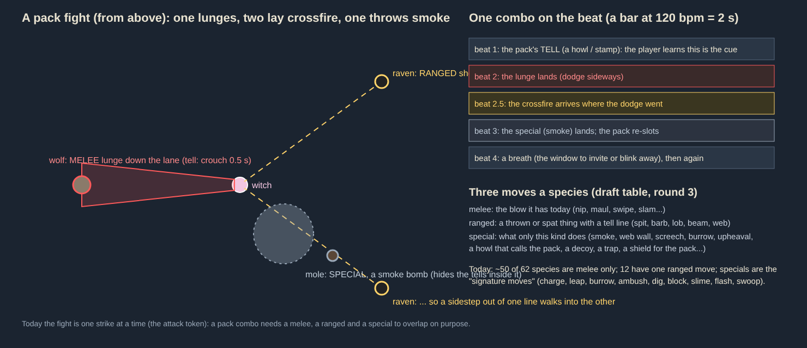

# Pack combat and three moves per animal

Backlog (Ed, 2026-10-15, from an interview with Juliet). **Build step 1 built (Ed's go, 2026-10-19): home's ten, behind `combat.packs.on` (on by default since Ed, 2026-10-20); and Phase 1's eleven (Echo, 2026-10-19, the same switch); kinds keep their own moves inside a pack (Ed, 2026-10-20: below, "Kinds keep their own moves"; #993); every other kind's pack and the knockback, pull, decoy and mind-control specials (step 5: #1048 to #1074, #1050, #1053, #1061); the rest not built yet.** This page is the plan for fights: animals fighting in packs that combo their moves, and every animal with three moves (melee, ranged, special) so kinds feel different from each other. It overrides DESIGN.md's "Level-ups" line (young one attack, adults two, legends one) for every level but the legends'. **Legends are not part of this work** (Ed): they keep their long-range attack and their own moves.

Ed's words: "Maybe they should all have three [melee, ranged, special]. The place where this game should shine is animals fighting in packs (where they combo all their attacks differently) and animals feeling different from each other. If one lunges while two lay down crossfire and the last throws a smoke bomb, that would be exciting."

## What's there today (2026-10-15, before packs)

- Every species has **one move per level** (`config/combat.json`, each species' `creature.js`): a melee blow (nip, maul, swipe, slam) for about 50 of the 62 kinds; a shot, lob, beam or pulse for 12 (spit, barb, lob, beam, web, screech, upheaval, slam); legends a quake or their long-range throw.
- Each kind has a **movement profile** (`config/movement.json`, DESIGN.md "Creature movement"): its speed, its steering behaviours, a **pack tactic** for some (surround, pincer, hit and run, volley, flank, swarm) and a **signature move** (charge, leap, burrow, ambush, swoop, dig, block, slime trail, flash).
- A pack is **one kind, one side, one target**, re-picking its tactic every 6 s.
- Fights are **one strike at a time**: the attack token (the tuning's `dodge.a`: `tokens` 1, `swarmTokens` 1 past 12 attackers) lets one creature wind up or strike at her at once, so a pack takes turns, each strike a dodge can answer.
- Every move has a **tell** (its wind-up: a crouch, an aim line, a target circle, a ring), and traits with visible counters (flier, armoured, swarm, heavy, nimble, burrower).

## Decisions (Ed, 2026-10-15)

### Packs

- **A pack is one kind** (today's), and **the packs in one fight take turns** (Ed: both). A wolf pack combos with wolves; when an area's wolves, ravens and moles are all on her, their packs coordinate loosely: one pack's combo at a time, the others holding, slotting or shelling.
- **Roles come from position** (Ed: 2b): **the nearest lunges, the ones at range fire, the one behind her throws the special.** Nobody is "the melee one" for good: as the pack moves, its roles move.
- **Timing is each species' own rhythm** (Ed: 3b), not the music's beat: a wolf pack combos fast and tight, a snail pack slow and wide. And **the combo is reactive** (Ed: 3c): the next move answers what she did:
  - **a dodge**: the crossfire aims where the blink went;
  - **a 💌 thrown**: the one she's inviting is covered (a packmate steps between, or the special lands on her);
  - **her retreat**: the pack cuts her off (today's `dodge.c`, every pack kind);
  - **her party animal engaging**: the pack splits, some turn on it.
  - Not her rising to the treetops: the flyers don't follow her up.
- **A shared pack tell** before a combo (Ed: 4a), **plus each move's own tell**: a howl, a stamp, a chirr, a shared glow on every member, so the player learns the cue.
- **How many strike at once varies by creature** (Ed: 5): each kind has its own **pressure**, the number of its pack that may be winding up or striking at her at once (today's token, by species): a wolf pack 1 lunge plus any shots, a bat swarm 3, a bear 1. Built, the dodge's tokens (`dodge.a`, one at a time) still cap it at her, the call included (Ed, 2026-10-20: twelve wolves had ten winding up at her at once).

### The rhythm of a fight: lulls, retreats, chases

Ed: "(some) groups retreating/regrouping/scattering between attacks will make fights feel more varied rather than constant pressure." A pack's fight runs in **phases**: approach, the pack tell, a combo, a **lull**, regroup, again.

- **Lulls of all three kinds** (Ed: 7d): **after every combo** the pack pulls back out of reach, re-slots and comes again (a rhythm the player learns); **after a loss** (one of them knocked down or invited) the rest scatter and regroup; and **by species**: hit-and-run kinds always pull back, heavies never, swarms scatter and reform.
- **Lulls are longer for bigger packs** (Ed: 8c): a pair comes back in a second, a pack of eight takes a few.
- **Hurt members run while the healthy attack** (Ed): a creature under half health leaves the combo and keeps its distance (it comes back healed by a berry if it finds one; it's still invitable); the healthy ones carry the fight. With no healthy packmate (alone, or all of them hurt) it fights on, so a fight always ends (Ed, 2026-10-20: a boar at 1 hp kept off her parked wolf for good).
- **Each species has its own retreat pattern** (Ed: 20): run in a circle round her; all in different directions; into the trees and freeze, hard to see; split into two groups; and so on (the table below gives each kind one).
- **A chase is sometimes right** (Ed: "sometimes a chase is interesting and makes fights more varied"), **but never the norm**: the challenge is "how quickly you can clear an area so that you're ahead of the pulse", so a pack that has run comes back by itself within its lull, and a retreat that hides (the trees) ends with the pack coming in again from another side. Nothing runs off for good but a beaten animal, as today.

### Three moves per animal

- **Every animal has three slots from young** (Ed: 6b): **melee**, **ranged** and **special**; **a few species have no melee, and a few no ranged** (Ed), so a kind's identity can be "only ever at range" (the moth, the salamander, the spider) or "never from afar" (the boar, the bear, the snail, the beetle): the table marks them `none`, a draft for Ed to edit. Young are weaker, slower, shorter in range, with smaller areas; adults are stronger and faster, and their ranged move may be several projectiles where a young one's is one. Legends keep their own (not this work).
- **Melee** lands in reach, as today (nip, maul, swipe, slam, kick, shove); its tell the crouch and the lane.
- **Ranged is a real projectile** (Ed: 13b), never a pounce: a shot, a lob, a beam, a spit, a thrown thing. **Magic from young, weaker** (Ed: 18b): most mammals have nothing to throw, so they throw magic in their species' neon (the fox's fox-fire, the hare's moon-dust, the badger's stone shard, the mole's earth bolt, the wolf's frost breath), a young one's a single small bolt, an adult's a volley or a bigger one. (Ed: "remember animals can be 'magic', especially adult ones.")
- **The special is a pack move** (Ed: 13c), more than a solo trick: it changes the fight rather than dealing damage, and it is the species' identity. The set (Ed: 19, all of them):
  - **call**: the pack strikes together within 2 s;
  - **feint**: a fake lunge tell, a packmate's real one lands;
  - **cloud**: smoke, dust or spores that hide the tells inside it;
  - **wall**: a web, a slime line or a mound across her path for a few seconds;
  - **scatter**: the pack blinks apart and re-slots round her;
  - **decoy**: one draws her 💌s (they land on it, not the one she aimed at);
  - **mirage**: fake decoys, images of the pack that take a 💌 and vanish;
  - **cover**: one steps between her and a hurt packmate and takes its hits;
  - **rally**: the pack heals a hit or shakes off a slow;
  - **knockback**: a shove, a ram, a gust that throws her;
  - **pull**: she's dragged toward the pack (a web line, a current, a wind);
  - **confusion**: her aim or her movement is turned for a moment (a reversed stick, a drifting cursor);
  - **mind control**: her animals turn on her for a moment (adults of a few kinds only; never a legend);
  - **sync**: they blink as she blinks, so a dodge lands her among them again;
  - **stampede**: the pack lines up and charges her as one.
  - Today's signature moves fold in: the charge and the ram are stampedes, the burrow and upheaval a cloud with a knockback, the spider's web a wall, the snail's trail a wall, the beaver's block a cover, the stoat's dance a confusion, the moth's flash a confusion, the badger's dig a cover.
- **A move's slot decides its tell's shape** (Ed: 16a, "mostly shapes rather than colours"): melee a **lane** (a strip from the attacker to where its lunge ends), ranged a **line** (a shot's) or a **circle** (a lob's landing), a special a **ring** (a cloud's or a call's reach) or a **bar** (a wall's line). **Colour says the effect, not the slot** (Ed: "red means damage, other colours mean slow/stun etc."): red hurts, blue slows, yellow stuns, violet confuses or controls, green heals (the pack's own rally), white the pack tell. The tints use today's effect masks (`art/effects.js`: a tint mask over greys).

### Flyers

Ed: "flying animals are not fun to fight right now ... they should only take off to attack, like a pounce, not fly all the time"; "the thing that's not fun is having nothing to do while waiting for enemies to land".

- **Flyers fight on the ground** like anyone (they walk and hop; their melee a peck, a bite, a buffet) and **take off only to attack** (Ed: 10c): **young hop-swoop**, a short low swoop like a pounce (its tell the wings spread, half a second), landing where she was; **adults add the circling dive**, today's swoop, but once and down again, on a cooldown.
- **In a pack, at least half its flyers are on the ground at any time** (Ed: 10d): a pack rule, so there is always something to invite or dodge while the others are up.
- The owl, the raven and the bat (the moth, the dragonfly, the heron and the griffin after them); their ranged moves stay what they are (the owl's lob, the raven's long spit and barb) or become magic like the rest.
- **Until step 3 (Ed, 2026-10-20: kinds keep their moves in a pack):** a wild flyer in a pack keeps today's swoop. It circles out of reach through the pack's approach, tell and lull, and its **dive is its strike**: a bout's first dive goes on its pack's turn (its lunge's, a lane) under its pressure and a dodge token, the rest of its bout each a token as before, so a pack of them dives at her one at a time; the pack tell and its special (the bat's confusion, the raven's mirage) are the pack's as for any kind. Why not keep flyers out of packs till step 3 instead: that loses the pack's tell, turns, lulls and specials Phase 1 built for them, and the dive already is "take off to attack, then come back up"; step 3 changes where they wait (on the ground, half of them) and adds the young's hop-swoop, not how a dive takes its turn. (Before this, a flyer in a pack landed and fought on the ground: no dive at all.)

### Sieges

- **A mix** (Ed: 14): some besiegers **shell the soundsystem from the trees** (ranged ones at the clearing's edge, out of its 15 m, firing from their 25 to 40 m, so she has to go out to them), while the melee ones **walk in** as today; which does which is by kind and by how many are coming.
- **Defenders defend the soundsystem** (Ed, round 2): animals she leaves to guard an area defend its soundsystem from attacks **even beyond today's leash range** (`config/travel.json`'s 60 m, the guard's radius): a parked pack goes out to the shellers at the clearing's edge and comes back.

### Her own pack

- **Her leashed animals use the same combos** against the wild, roles by position round their target, **but no retreats or scatters** (Ed: 12b): they hold near her sigil or her leash. She commands nothing but where they are (DESIGN.md: "leash position only").

### Difficulty, readability, performance

- **Combos everywhere** (Ed: 15c), on home from the first night, their speed and overlap tuned up the **master curve** (journey.md): home's packs young, small and slow, so combos come rarely and loosely; the later islands' tight and fast.
- **Readability** at the game's pixel size: tells as shapes by slot and colours by effect (above); a pack tell every member shares (a glow, and the call's own art: a howl's rings, a stamp's dust); never more than one lane and two lines at her at once.
- **Performance** (Ed: 17a): a pack's combo takes at most 8 members (the rest hold back and slot), at most 6 shots in the air a pack, the pack planning once a step for packs within the creature simulation radius only, and the retreat patterns steered by the same behaviours as today (nothing a frame per creature beyond a slot).

### Kinds keep their own moves (Ed, 2026-10-20)

Ed: "Kinds keep their movement.json moves within pack combat: charges, dives, burrowing, screeches, slime and the wolves surrounding her." Built (`rules/combat.ts`, `rules/combat/packs.ts`: `ownStrike`, `strikingNow`, `lungeMove`). A pack still decides **when** each member strikes (its turn, its pressure, the dodge's tokens); the kind decides **how**:

- **A strike is the kind's own move where it has one** (`config/movement.json` `move`): a charger (boar, hedgehog, woodlouse, heron) charges as its lunge; the toad leaps and slams; the mole burrows in on its turn and strikes as it surfaces; a wild flyer dives (above, Flyers). Each takes the pack's turn and a dodge token like a lunge: its charge (till it brakes), its leap (not the toad's harmless cloud leap) and its dive count as **striking at her** for the pressure and the tokens, so at most `dodge.a.tokens` strike at her at once (the stampede included: at her it makes every member's turn to charge, one after another as the tokens free; her pack's on the wild charges all at once). Waiting its turn, a member whose move is ready holds where that move sets off from (in its reach), and its pack engages from that move's reach.
- **A kiter's strike is its shot**: the raven never takes the lunge.
- **Its kind's own attack where it's the identity**: the bat's melee is its screech, a pulse all round it.
- **Continuous moves keep running**: the snail's slime trail as it goes (its wall besides).
- **Its kind's tactic places it while it waits** (the wolves' surround and pincer, the fox's and marten's flank, the raven's volley line and beat); only the member whose lunge it is goes straight in. Hit and run is the pack's own lull, so it isn't added.

## The three moves, kind by kind (a draft; Ed edits)

Ranged moves are magic in the species' neon unless named otherwise; a young one's is one small bolt, an adult's a volley or a bigger one (the cell gives the adult's). The special is its pack move; the retreat is the pattern its pack runs between combos. Rhythm: tight (combos a few seconds apart), steady, or slow. New art: every magic bolt is one projectile sprite tinted (`art/effects.js` has `spit`, `barb`, `mote`, `feather`, `lobSeed`, `lobStone`, `webGlob`); the specials need a cloud, a wall bar, a mirage shimmer, a pull line, a confusion swirl, a control glyph, a sync flash and a stampede lane, each in the effects' families.

### Home's ten

| Kind | Melee (tell) | Ranged (tell) | Special: pack move (tell) | Retreat | Rhythm |
|---|---|---|---|---|---|
| hedgehog | nip (crouch) | spine fan: 3 spines in a cone, 12 m (bristles up) | **stampede**: the pack rolls at her curled up, armoured (the curl) | all curl and roll off in different directions | slow |
| squirrel | scratch (crouch) | acorn bolts, 14 m, adults 3 (winds back) | **scatter**: the pack blinks up the trunks and drops round her (a rustle in the crowns) | up the trees, out of sight, down again from another side | tight |
| hare | double kick, knockback (turns its back) | moon-dust bolt, 12 m (ears flat) | **call**: a drum on the ground, the pack strikes together (the thump) | all in different directions, zigzagging | tight |
| fox | bite (crouch) | fox-fire, 15 m, adults a pair (tail up) | **feint**: a fake lunge tell, a packmate's real one lands (ears flat) | split in two, round to her back | steady |
| marten | bite | ember bolt, 12 m (chirrs) | **call**: a hunting chirr, the pack strikes within 2 s (head up) | leapfrog: half falls back behind the other half | tight |
| stoat | bite | a dart of light, 10 m (sways) | **confusion**: the war dance, her aim drifts within 6 m (the dance) | a circle round her, all one way | tight |
| mole | claw | earth bolt leaving a mound, 15 m | **cloud**: burrows, surfaces in a dust cloud that hides the tells (the mound moving) | burrow away, surface apart | steady |
| snail | rasp | none | **wall**: a slime line across her path (the trail) | withdraw into the shell where they stand, untouchable 2 s | slow |
| dormouse | nibble | nut bolt, 12 m | **rally**: a yawn, the pack heals a hit and shakes off slows (stretches) | into the undergrowth and freeze, hard to see | steady |
| badger | maul, knockback | stone shard, 14 m (turns its back) | **cover**: digs in and takes a hurt packmate's hits, rooted, armoured (the dig) | hold: badgers don't run, they dig in and wait | slow |

### Phase 1

**Built** (Echo, 2026-10-19; `config/packs.json`, behind `combat.packs.on`): all eleven, with two new specials (mirage, sync), kinds' own variants of a special (`specialWith`: the bat's confusion turns her movement, the moth's cloud flashes, the toad's cloud comes from a leap, the beetle's cover locks two shells), the raven's ranged move on its own spit and barb, the toad's lob leaving a slow patch, and seven new retreats. The bat and raven fought on the ground in a pack until Ed, 2026-10-20: wild ones now keep their dive as their strike (above, Flyers); "into the water" hides like a burrow (no water map yet).

| Kind | Melee (tell) | Ranged (tell) | Special: pack move (tell) | Retreat | Rhythm |
|---|---|---|---|---|---|
| wolf | lunge bite (crouch) | frost breath, a short cone 10 m (head low) | **call**: a howl, the pack strikes together; cuts off her retreat (the howl) | split in two, circling to her flanks | tight |
| boar | tusk shove, knockback | none | **stampede**: the pack charges in a line (heads down) | hold ground, backing off slowly in a line | slow |
| bat | bite in a hop-swoop (wings) | screech bolt, 10 m (mouth open) | **confusion**: the screech, her movement turns within 6 m (the ring) | flutter apart in every direction, half landing | tight |
| raven | peck in a hop-swoop (wings) | long spit and barb as today, 36 m, adults 2 (aim line) | **mirage**: black shimmers of the flock that take a 💌 and burst (a caw) | up into the branches, half staying down | steady |
| newt | none | spit, 12 m | **wall**: a wet line that slows (the gleam) | into the water, back out elsewhere | slow |
| moth | none | dust bolt, 10 m | **cloud**: a dust cloud, a flash that confuses inside it (the flash) | a swirl round the nearest light, half landing | tight |
| heron | a stab in a hop-swoop (the neck draws back) | a water jet, 18 m (aim line) | **sync**: it blinks where she blinks (a stillness, then a flash) | freeze at the water's edge, hard to see, then stab again | slow |
| beetle | shove, knockback | none | **cover**: locks shells with a packmate, both armoured (the clack) | plod back into a huddle | slow |
| woodlouse | nip | none | **stampede**: rolls at her in a line (the curl) | all curl and roll off | slow |
| otter | bite | a water bolt, 12 m | **rally**: a whistle, the pack heals a hit (the whistle) | into the water and out elsewhere | steady |
| toad | tongue slap | spore lob, 16 m, lands a slow patch (puffs up) | **cloud**: a spore cloud on landing from a leap (the leap) | hop off in arcs, apart | steady |

### Phase 2

**Built a biome at a time, data only** (Juliet, from 2026-10-23; `config/packs.json`, each kind's `pack-<kind>` arena and its special's sign in `packs.test.ts`): volcanic (komodo, salamander, stegosaurus); badlands (armadillo, meerkat, rattlesnake, scorpion); hot (cat, cheetah, fennec, lion); jungle (elephant, jaguar, snake, tiger); mangrove (crab, dragonfly, hydra); mountains (frostwyrm, lynx, redpanda, snowleopard); cold rainforest (bear, flyingsquirrel, roe); cold (arcticfox, elk, frosttroll, penguin, polarbear); temperate (beaver, stag). Their specials and retreats are today's: a movement-reversing confusion is the bat's (`specialWith.move`), the salamander's flame line a slowing wall, a freeze the `freeze` retreat. The kinds that need a new special (knockback, pull, decoy, mind control) come with it (Lima).

| Kind | Melee (tell) | Ranged (tell) | Special: pack move (tell) | Retreat | Rhythm |
|---|---|---|---|---|---|
| bear | heavy swipe, knockback, short lunge | none | **cover**: stands over a hurt packmate and takes its hits (rears up) | hold ground, backing off | slow |
| elk | antler shove, knockback | a gust of breath, 10 m cone | **stampede**: the herd charges in a wide line (heads down) | run off together, wheel, come back from the side | slow |
| stag | antler shove | a bolt of antler light, 14 m | **stampede**: pairs charge together, as today (heads down) | split in two, come back as two lines | steady |
| ram | head butt, knockback | a dislodged stone, 12 m | **knockback**: the run-up and ram as today, throws her 10 m (backs off) | back off together up a slope | steady |
| lynx | bite in a pounce (crouch, 2 m high) | a shriek bolt, 12 m | **feint**: one springs short, the next lands (crouch) | freeze in the trees, hard to see | steady |
| owl | peck in a hop-swoop (wings) | lob as today, 30 m (the circle) | **mind control**: adults only, a stare that turns one of hers for 3 s (the eyes glow) | up into the branches, half down | slow |
| salamander | none | beam as today, 20 m (aim line) | **wall**: a line of flame that burns 3 s (the glow) | into the mud and freeze | slow |
| spider | none | web shot as today, 22 m, adults slow | **pull**: a web line drags her toward the pack 6 m (the line) | up a tree, down behind her | steady |
| snake | strike (coils) | venom spit, 14 m | **confusion**: a sway that reverses her movement within 5 m (the sway) | into the grass and freeze | slow |
| cat | bite in a pounce | a hiss bolt, 10 m | **sync**: pounces where she blinks to (a stillness) | into the undergrowth, out from another side | steady |
| beaver | tail slap, knockback | a wood chip bolt, 10 m | **wall**: a dam of sticks across her path 4 s (the carry) | into the water, out at the dam | slow |
| meerkat | bite | a sand bolt, 10 m | **call**: the lookout's chirp, the pack strikes together (stands tall) | all in different directions, then a huddle | tight |
| raccoon | bite | a thrown stone, 12 m | **decoy**: one draws her 💌s (waves) | split in two, round to her back | steady |
| armadillo | shove | none | **stampede**: rolls at her in a line (the curl) | curl and roll off | slow |
| cheetah | bite in a sprint | a dust bolt, 12 m | **sync**: sprints to where she blinks (a crouch) | a wide circle round her at speed | tight |
| ibex | head butt, knockback | a dislodged stone, 14 m | **knockback**: a ram off a slope (backs off uphill) | up the crags, hard to reach, back down from another side | steady |
| arcticfox | bite | a snow bolt, 12 m | **mirage**: white images in the snow that take a 💌 (vanishes) | into the snow and freeze, hard to see | steady |
| polarbear | heavy swipe, knockback | none | **cover**: stands over a hurt packmate (rears up) | hold ground, backing off | slow |
| roe | a kick | a bolt of light, 12 m | **scatter**: the herd blinks apart round her (a bark) | all in different directions, then regroup | tight |
| redpanda | bite | an ember bolt, 10 m | **rally**: the pack heals a hit (chirps) | up the trees, out of sight | steady |
| penguin | a beak jab | an ice pellet, 10 m | **stampede**: a line slides at her on their bellies (the drop) | huddle and shuffle back | slow |

### Phases 3 and 4

| Kind | Melee (tell) | Ranged (tell) | Special: pack move (tell) | Retreat | Rhythm |
|---|---|---|---|---|---|
| crocodile | bite (jaws open) | a water jet, 14 m | **pull**: a death-roll current drags her 5 m to the water (the roll) | into the water and freeze | slow |
| komodo | bite | venom spit, 14 m | **confusion**: its venom, her aim drifts for 3 s (a hiss) | into the scrub and freeze | slow |
| hydra | bite, each head (heads rear) | one spit a head, 16 m | **rally**: a cut head regrows two, the pack heals (the regrowth) | hold ground, backing into water | slow |
| rattlesnake | strike (rattle) | venom spit, 12 m | **confusion**: the rattle, her movement reverses within 6 m (the rattle) | into the rocks and freeze | slow |
| scorpion | none | venom bolt, 10 m | **wall**: a line of stinging sand 3 s (the dig) | under the sand, surface apart | slow |
| fennec | bite | a sand bolt, 12 m | **mirage**: heat-shimmer images that take a 💌 (ears flat) | split in two, round to her back | tight |
| crab | pinch | none | **cover**: a claw raised over a hurt packmate (the raise) | sidle off in a line | slow |
| dragonfly | bite in a hop-swoop (hover) | a water drop bolt, 10 m | **sync**: darts where she blinks (a hover) | hover apart, half landing | tight |
| lion | heavy swipe, knockback | a roar bolt, 12 m | **call**: a roar, the pride strikes together (the roar) | split in two, come at her flanks | steady |
| tiger | heavy swipe in a pounce | a growl bolt, 12 m | **feint**: a short spring, the real pounce from behind (crouch) | into the long grass and freeze | slow (built: at steady it reached its place after the freeze, 2026-10-23) |
| jaguar | bite in a pounce | a bolt, 12 m | **sync**: pounces where she blinks to (a stillness) | up a tree, down behind her | steady |
| snowleopard | bite in a pounce | a snow bolt, 14 m | **feint**: a spring short, the next lands (tail up) | up the crags, hard to see | steady |
| elephant | trunk slam, knockback | none | **stampede**: the herd charges in a line (ears out) | back off together, trumpeting | slow |
| rhino | horn shove, knockback | a dust bolt, 10 m | **knockback**: a charge that throws her 12 m (paws the ground) | wheel away, come back in a line | slow |
| griffin | talons in a hop-swoop (wings) | a feather bolt, 18 m, adults 3 | **pull**: a wingbeat gust drags her 6 m (the wings) | up, circling, half down | steady |
| unicorn | a horn jab | a horn bolt of light, 16 m | **mind control**: adults only, a glow that turns one of hers for 3 s (the horn glows) | a wide circle at speed | steady |
| frosttroll | a club swing, knockback | none | **cover**: stands over a hurt packmate (crouches) | hold ground, backing off | slow |
| frostwyrm | bite | a frost beam, 20 m (aim line) | **wall**: a line of ice that slows 4 s (the breath) | into the ice and freeze | slow |
| flyingsquirrel | scratch in a glide (the launch) | an acorn bolt, 12 m | **scatter**: the pack glides apart and drops round her (the launch) | glide off into the trees, out of sight | tight |
| stegosaurus | tail swing, knockback | a thrown stone, 10 m | **stampede**: a line of them advances, tails swinging (the plates flush) | back off together | slow |
| sphinx | a screech all round it, the riddle (its mouth opens) | a sun bolt, 14 m (the stare) | **confusion**: its riddle, her aim drifts for 3 s (the stare) | back off together, facing her | slow |
| featheredserpent | a bite in a lunge (the ruff flares) | venom spit as today, 24 m (aim line) | **mirage**: plumed images round her that take a 💌 (the ruff fans) | up into the canopy, half down | steady |

## The prototype: how it plays, step by step

1. **The pack forms** as today (one kind, one side, one target), and decides its **rhythm** (its kind's), its **pressure** (how many may strike at once) and **roles by position** each step: the nearest member the lunger, the ones at range the shooters, the one behind her (or the furthest) the special.
2. **The pack tell**: every member glows and the kind's call plays (a howl, a thump, a chirr); half a second to a second by kind.
3. **The combo**: the lunger winds up and lunges (a lane); as it commits, the shooters fire (lines or circles) **aimed where a dodge would go** (ahead of her, or where her last blink went); the special lands last (a ring or a bar). What she does answers it: a 💌 at one of them brings cover or the special onto her; her retreat brings the cut-off; her party animal engaging splits the pack.
4. **The lull**: the pack falls back by its kind's retreat pattern (a circle, a scatter, the trees, a split), longer for a bigger pack; the hurt keep their distance; a lost member makes the rest scatter and regroup. At its place a member doesn't halt but prowls round her at that distance till the pack comes again (Ed's playtests, 2026-10-23: "lulls between pack attacks seem to have the animals stand still instead of retreat"; `packs.json` `prowl`); only the retreats meant to stand (the snail's shell, the badger's hold) stand, and a freeze holds its place for the lull's first part (`prowl.freeze`), then prowls like the rest (Ed, 2026-10-23).
5. **Fight styles by species** (Ed's playtest, 2026-10-29: "enemies (and friends, even more) bunch up, and I think their lulls are too close; I think the feeling should be enemies thundering around the area, running past me, circling, flanking, more dynamic. Enemies that move in big hops were fun to fight"; he chose movement styles by species; `config/packs.json` `_styles`, `styleOf` in `rules/combat/packs.ts`, `rules/combat.ts`). A wild pack at her moves by its kind's style while it waits its turn; its strikes are as ever, telegraphed, under the same turns and dodge tokens.
   - **charger** (boar, ram, ibex, stag, elk, rhino, elephant, stegosaurus, armadillo, hedgehog, woodlouse, penguin, lion, unicorn, griffin, cheetah, polar bear): its strike its own charge (committed, overshooting, turning at its limit); in the lull it carries on past her and wheels round wide (`charger.wheel` times the lull's distance), the pack all one way round, to come again from the far side (`wheelSlot`).
   - **circler** (wolf, stoat, marten, otter, dormouse, meerkat, fennec, heron, and the flyers between their swoops: bat, dragonfly, moth, owl, raven): waiting, it orbits her `circler.orbit` m past its reach (a shooter at its own range, firing as it goes), the pack all one way round; on its approach it spirals in; its turn come, it darts in.
   - **flanker** (fox, raccoon, cat, lynx, jaguar, tiger, snow leopard, frost wyrm, sphinx, komodo): waiting, it keeps `flanker.from` to `to` degrees off her front (her heading, or the way she faces her pack standing), each side in turn, and strikes from there.
   - **hopper** (hare, roe, toad, squirrel, flying squirrel, red panda, arctic fox): it moves in bounds (`c.hop`, harmless, flown by the time like a leap: `advanceHop`, `startHop` in `rules/movement.ts`; drawn up in its arc), each as long as its run takes it over a bound and a beat (`hopper.length` at least), a beat on the ground between; it waits on a ring past its reach, shoots between bounds, and runs the last stretch in for its strike.
   - **steady** (the rest: the slow, armoured and lying-in-wait kinds): as before.
   - **The lull, wider**: at her (not between creatures), each member's place `lullOut` (1.5) times as far, its own radius within `jitter`, and every two places at least `lullGap` (8 m) apart (`spreadLull`); a freeze only spread apart; the shell and the hold still stand.
   - **Friends' places**: her animals and happy ones on one creature each take a place evenly round it at their reach (`styles.friends`), not piling in on one spot.
   - **💌s against quick movers**: a 💌's homing leads its creature by how it's moving and turns harder after one over 10 m/s (`rules/invites.ts`): aimed where they are, about 48% land on a circling stoat pack (57% before the styles) and 87% on a hopping hare pack (58%).
6. **Again**, from step 2, until the pack is beaten, invited or she's gone.

A besieging pack does the same at a soundsystem, its shooters at the clearing's edge; her parked pack goes out to them and back. (Until step 4, at a soundsystem or speaker a creature fights as before packs, its own attack at its full rate: Ed, 2026-10-20, packs pacing there dealt under half.)

## Build order (proposed)

1. **Built (2026-10-19, behind the switch; on by default since 2026-10-20, Ed: "Turn pack combat on by default"; `rules/combat/packs.ts`, `config/packs.json`, docs/HOW-THE-GAME-WORKS.md section 5).** **A prototype on the home island behind a switch** (`combat.packs.on`, a pause-page toggle; on by default since 2026-10-20): **all ten home kinds** (Ed: 21c) with their three moves from the table, the pack tell, roles by position, the combo with its reactive answers, the lull with each kind's retreat pattern, pressure by kind, and her own pack using the combos without retreats. Magic bolts as one tinted projectile; the specials with placeholder art (today's rings and lines, tinted by effect) until the art lands. A debug arena preset a kind (`?arena=`) and a shot sheet.
2. **The tells and the art**: the shapes by slot (lane, line, circle, ring, bar), colours by effect, the pack tell's own art per kind (a howl's rings, a drum's dust), the specials' art (cloud, wall, mirage, pull line, confusion swirl, control glyph, sync flash, stampede lane) in `art/effects.js`'s families, and the moves' poses where the rig needs one (a rear-up, a wings-spread take-off).
3. **Flyers on the ground** (until then a wild flyer in a pack keeps its swoop, its dive its strike: Ed, 2026-10-20): take-off only to attack (young hop-swoop, adults the dive once), half a pack's flyers grounded, the owl, raven and bat first.
4. **Sieges**: shellers at the clearing's edge, defenders going out beyond the leash range and back.
5. **Phase 1 and 2 kinds** from the table, a few kinds a PR, each with its arena preset and shot sheet; then phases 3 and 4. **Phase 1 built** (Echo, 2026-10-19). **Every kind** (Ed, 2026-10-23: "pack behaviour for all creatures"; every kind's young and adults by its row, legends solo, none at a soundsystem yet): the table's data-only kinds a biome at a time (Juliet); the three specials the table names that weren't built, **knockback** (the ram, ibex, rhino: the special one's own charge, that blow throwing her its `throw`), **pull** (the spider, crocodile, griffin: dragged toward it, no hurt, a blink dodging it) and **decoy** (the raccoon: the one waving catches her 💌s, each one wasted: Ed, 2026-10-23, "it's wasted - otherwise it's not a decoy"), with their seven kinds, **built** (Lima, 2026-10-23); and the sphinx's and the feathered serpent's rows (the table), **built** too (Lima, 2026-10-23). **Mind control** (the owl, the unicorn; adults only): one of her animals turns on her for 3 s, the one it's fighting else the nearest of hers within 14 m (none, her aim drifts); hers on the wild stun the foe they're on: **built** (Lima, 2026-10-23).
6. **Tuning up the master curve**: rhythm, pressure and lulls by wave (`population.swarm`'s share), the balance tools (`tools/balance/fightbot.mjs`, `fight.mjs`) extended to play packs, and the switch becomes the default (the default already, Ed's call, 2026-10-20; the tuning still to come).

## Open questions

- **Pressure numbers by kind** (how many strike at once): a first guess is 1 for heavies and shooters, 2 for packs of small fast kinds, 3 for swarms; to tune in play.
- **Mind control and confusion** on a gamepad and on touch: a reversed stick is cruel on a pad; confusion may need to be the aim only there.
- **Her pack's specials**: a call or a rally fits her side; a mirage or a mind control on the wild side less so (an invited owl controlling a wild wolf would be strange). Proposal: her pack keeps the species' special unless it's mind control, which becomes a stun.
- **Young ranged magic and the budget**: three moves from young must stay on the level's equal power budget (combat.json `levels`): a young one's bolt is weak and slow, its special short.
- **Which kinds have no melee and which no ranged**: the table's `none`s are a draft (the shooters without a bite: moth, salamander, spider, newt, scorpion; the heavies and the shelled without a throw: boar, bear, polar bear, elephant, frost troll, snail, beetle, woodlouse, armadillo, crab); Ed picks.
- **The 💌 under a cloud**: can she invite what she can't see the tells of? Proposal: yes, the cloud hides tells, not bodies.
