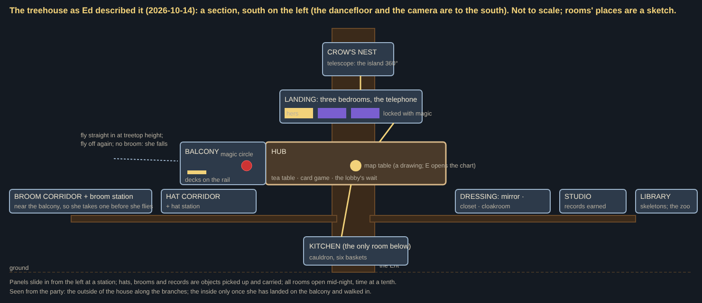

# The treehouse

Backlog (Ed, 2026-10-14, from an interview with Juliet). **Not built yet; don't build without Ed's go.** This page is the treehouse's plan: its shape, its rooms and what each is for, how she moves between them, the night's loop through it, how it grows over the campaign, and how it ties to the hats and brooms, the records, the zoo and the journey. Where it overrides older notes: the room table and "the octagon, for now" in [journey.md](journey.md) section 3, and the "where she chooses" notes in [unlocks.md](unlocks.md) and [creator-and-house.md](creator-and-house.md). What's built today (the deck on the Ent, #717; the Bedroom button, #737; the character creator) stays until this replaces it.

## The shape

- **A walkable house, not a set of panels** (Ed): "no transitions, just different rooms you can walk between". She walks from room to room as she walks the deck today; nothing opens over the game.
- **Organised round a hub with the map at its centre.** The hub is the room behind the balcony; every other room is reached from it, by a door, a corridor or a stair. The map is a water feature under a glass dome with a clockwork moon (the rooms table, below).
- **Three-dimensional:** "it spreads out but also rooms are higher and lower, and you walk up and down stairs to get to them". The house spreads **wide**, with **corridors running out along the Ent's branches**. The bedrooms are above the hub, and **the dressing rooms lie between the bedrooms and everything else: you get to the hub by going through them** (Ed). **The kitchen is the only room below the hub**.
- **The game's own camera, zoomed in** (Ed): "a seamless transition from treehouse to game, but the camera zooms in so you can see the detail". No cut to another scene: the camera that followed her over the island follows her in, pushing in closer indoors.
- **Seen from the party, the house is seen from outside** (Ed): from the dancefloor you see the outside of the house along the branches, never its rooms; "you only see the inside after you land on the balcony and walk inside".
- **The Ent itself doesn't change** over the campaign, and **no new rooms unlock**: the house is whole from the first night.
- **Not the deck as built** (Ed: "I don't think the deck will stay how it is"): the round deck with the map table in its middle (#717) gives way to this.

## Coming and going

- **The balcony is the door.** Facing south over the dancefloor, at treetop height: she **flies straight onto it**, no button and nothing in the way (today she must fly above the deck and press Space to land, and a balustrade keeps her from falling). She leaves by flying off it again.
- **Without a broom she falls**: walking off the balcony with no broom, "she falls (hits the ground off camera) and respawns at the circle". So **the brooms hang near the balcony**, where she takes off and lands.
- **The decks are on the balcony's rail**, where she stands behind them facing the party (the "DJ over the crowd" shot of journey.md: filmed low through the party up to her at the rail).
- **The magic circle** is a few metres behind the decks, inside: "a red pentagram on the floor with the three claw marks in the middle of it and candles around it". It is where she comes back after a knockout (below).

## The rooms

| Room | Where | What you do there |
|---|---|---|
| **Balcony** | south, facing the dancefloor | fly in and out; the decks on its rail; the magic circle behind them |
| **Hub** | behind the balcony | **the map, a water feature** (Ed, 2026-10-14): the world's disc at table height, the sea flowing off its sides into a pool on the floor, with **koi** in it; a **golden grating** over the pool, so she walks up to the map; **flagstones** round it; a **glass domed roof** overhead, and **a clockwork moon** going round the edge of the room like an orrery (the moon's phase as it is tonight). The map is **a drawing, not the chart itself** (Ed: the real thing on the table might be expensive, and the disc won't be large): it hints at the islands, their biomes and sigils, one size for good; a button (E) opens the sea chart to look and to sail. The live miniature on today's deck table (`render/mapTable.ts`) retires with the deck. It is also the house's altar of sigils: the legends she has befriended are on it. And **a crystal ball** (backlog, below): the run history and its stats |
| **Tea room**, perhaps a **greenhouse** | a room of its own off the hub | wait, drink tea, play a card game at the table (the lobby's waiting place). **For now just an animation** (she sits, deals, sips); the custom game, with **tarot cards**, is a backlog item of its own (below). Nothing grows here that matters: mushrooms are found in the world, never grown at home |
| **Bedrooms**, three | up a stair, off a landing | sleep: the end of a night, where the next one starts. **The host's in the middle, the other two either side**, locked with magic until a friend joins. Each player's bedroom is their own: **furniture and personal items** to choose (a **hot tub** among them), **trophies** from achievements; it carries across to other games: joining a friend's game you see **your own bedroom**, as you made it, in their house |
| **Telephone** | near the bedrooms | multiplayer: call friends to the party (a party code) |
| **Dressing rooms**: the mirror, the closet, the cloakroom | between the bedrooms and the hub, on the way down | the character creator split into places, no tabs: the **mirror** for hair, face and earrings; the **closet** for trousers and jacket; the **cloakroom** for the cloak; more stations as the look needs (shoes, scarf). A **nightie** is one of the options. And **a washing machine** (Ed: "the mix of spooky witch stuff with the odd mundane modern thing"): go to it for **yesterday's clothes** or **randomise** |
| **Hat corridor** and **hat station** | out along a branch | the hats she has unlocked hang in a line; she **picks one up as a game object** (E) and wears it. **Each hat has one power but any shape**: the station is where she brings it to change its shape and colour, with **the creator's hat sliders as they are** (shape, height, brim, tilt, band, curl). **The hat station is a grimoire**: it describes the hat's power as a spell |
| **Broom garage** (was the broom corridor and station; Ed, 2026-10-16, unlocks.md "The broom garage") | **on the ground floor**, a door between the Ent's roots | one broom with three slots (tip, chassis, exhaust); rare parts found at wrecks and picked up (no towing: Ed, 2026-10-21); the bay with the creeper and welding sparks, the lathe as the customiser, the pegboard laid out as the 3 × 3 biome map. The older plan: | out along a branch, near the balcony | the brooms, the same way: lined up, one power each, pick one up, its shape and colour changed at its station (the creator's broom rotator and width slider). **The broom station is a workbench with tools**: it describes the broom's power |
| **Studio** | off the hub | the records she has earned; take one to the decks (below). And **three instruments: keys, a drum kit and a microphone**, so three players can play very simple music together with their controls: **the notes are locked to the music's key, but you can play off the beat**; nothing is recorded or kept. Played mid-night, **it's heard on the island as a layer over the music**. **Only the buttons the game has** (Ed): the mapping below |
| **Kitchen** | the only room below the hub | the cauldron and its six baskets ([cauldron.md](cauldron.md)) |
| **Library** | off the hub | a natural history library: specimens and animal skeletons. **The way into the zoo** (as the map table is the way to the islands). A new skeleton per biome; each biome has one key fantasy creature (the unicorn, the stegosaurus...) and something of it appears once every island in that biome is cleared. **The biome souvenirs live here too: the skull of each island's animal** |
| **Crow's nest** | at the top | an observatory with a telescope: **a view of its own, panning round the island 360°**, as the chart opens over the game (the game's camera itself never turns). **Built** (Ed, 2026-10-21, his answers to the mock, previews/ed/telescope-mock: just the view, true to the island, nothing marked; the whole island, its far side a cheaper forest; full screen with a soft vignette and a small readout; time at the house's tenth): E at it looks, E or Esc leaves; since 2026-10-23 (Ed: "opens when you walk up to it, look around with aiming keys"; "higher"; "a compass at the top") walking up opens it, the aiming keys and the mouse look round, walking away closes it, the eye at 100 m and a compass strip along its top (`rules/telescope.ts`, `app/telescope.ts`, `render/view/camera.ts` placeTelescope; knobs `telescope`) |

**Decided (Ed, 2026-10-21; built in part):** three bedrooms, one per witch; **hats, brooms and satchels are shared between witches**, so they live in the shared rooms past the bedroom doors, while each witch's own dressing (hair, skin, face and earrings at the dressing table, the wardrobe, the cloak pegs, the shoe rack) is in her own bedroom, reachable before its door unlocks ("all of the customisation options (except for broom, hat, and bag) should be before the locked door"; "bedrooms should be larger to fit everything"). Built: the host's bedroom (18 × 18 m) off a landing beside the hat room (the hat's mirror and the hats' floor); the guests' two are reserved either side of it along the landing (`reserved` in config/house.json, their floors and doors kept clear), to be built when multiplayer comes.

**Built (Ed, 2026-10-23; the layout v3, previews/ed/treehouse-layout-v3):** the house is the Ent's own: round plank rooms on its branches, joined by bark-covered branch walkways, laid out as Ed's room graph (Terrace → Atrium → Parlour → Boudoir → the bedrooms), each room walled at the back with a canopy of leaves for a roof that opens while she's near. The guests' two bedrooms are built off the Boudoir beside the host's, locked ("The branch stops at the door, and a bubble says it's a friend's room, locked for now"). The Terrace (the hub and the balcony) lost its walls and its map: the map table stands in the Atrium.

Some of these are **areas of the hub or of another room rather than rooms of their own** (Ed): the telephone on the bedrooms' landing. "One button per room" stands: E at the thing, no menus where a thing in the room will do.

**Panels slide in from the left** when she stops at a station (the mirror, a closet, a hat or broom station): only that station's choices, so there are never tabs. Hats, brooms and records are the exceptions: they are **objects in the world** she walks to and picks up, not choices on a panel.

**Tables slide up from the bottom** (Ed, 2026-10-23: "Clothes menus slide in from the left and can have a border. 'Tables' slide in from the bottom and have a soft edge (they're more diegetic)"; "It can fill the screen once risen"). The rule for any table (the Atrium's map table now, its sea chart; the card table when its game comes): walking up to it slides its thing up from the bottom of the screen to fill it, no E, no frame or border, its edges fading to the night held behind it (the chart's orbiting moon exempt: Ed, "this is exempt from the fading out") (the world frozen and not drawn while it's up, for the frame rate); the aiming keys and the mouse choose (the arrows, the d-pad, the right stick), the use button acts (E, Enter, the pad's square: at the map table held, a ring filling over the tuning's `chart.sailHold`, to sail; Ed: "You have to hold the button to select a new island to sail to (ring fills)"; a click only chooses), and the movement keys walk her (WASD, the left stick), so moving slides it away, and it stays away till she's left the table (E there brings it back). Built on the stations' nearness (`rules/stations.ts`: `tableOf`, `TABLE_USES`; the house's reach in, 0.8 m of slack before it goes, the nearest) and the shared slide (`ui/slideIn.ts`: 220 ms, ease-out, the side the panel's own); a new table adds its use kind to `TABLE_USES` and opens its own thing with `SlideIn(el, "bottom")` and the soft edge (`ui/chartOverlay.ts` `table`). Clothes stations keep `SlideIn(el, "left")` and may keep a border. In the house she can only rise on the Terrace (Ed, 2026-10-23: "She shouldn't be able to rise while in the treehouse, except on the terrace"; `rules/treehouse.ts` `noRiseAt`).

**Extra rooms are welcome** (Ed): "we can have a few extra rooms if we can think of fun things for them to be or do; they can have game effects or not, or we can have minigames". The tea table's card game and the studio's instrument are the first two.

## A night through the house

1. **She wakes in her bed, in her nightie.** The game waits here (no clock, no boot) as it waits for the party spell today.
2. **She dresses, or doesn't.** The way from the bedrooms to the hub runs through the dressing rooms, so she passes every station. "She has to dress every time she wakes up, but yesterday's clothes are the defaults": at a station she puts on yesterday's clothes at once, and changes what she likes. She may walk on in her nightie if she wants to (it is one of the options).
3. **A hat and a broom** from their corridors. Without a broom she can't fly, and the balcony is a drop.
4. **A record.** In a **brand new game there is one record and it is already on the decks**, so a new player has nothing to find. **Unlocked records appear in the studio**, and she learns she can carry one to the decks.
5. **The decks.** The needle drops on the record: that is the party spell (journey.md: "the dancefloor is a spell"). She flies off the balcony and the night begins.

**Mid-night:** **every room is open** during the party (change hat, brew, swap the record). Inside the house time runs at a tenth, as on the deck today and in a calm legend's circle, the music slowing like a tape.

**A knockout** brings her back to the magic circle: **a respawn animation: blood rises from the floor and forms her shape** (Ed), then she walks to the decks and plays her scratch routine, **all within the respawn timer** (the candles round the circle count it down, as journey.md planned). She **respawns dressed**, in what she went down in.

**The end of the night:** she goes up to bed (creator-and-house.md); on a win the voyage happens while she sleeps (journey.md).

## Growing over the campaign

- **The corridors fill:** each hat and broom unlocked appears on its hook.
- **The studio fills** with records earned (an island's record for every quest dealt that night done in one run, journey.md section 2).
- **The library fills** with a skeleton per biome, and its key creature once the biome is cleared.
- **The bedroom** gains trophies from achievements.
- **The map stays one size**, a drawing hinting at islands, biomes and sigils; the chart it opens is what grows.
- **Biome souvenirs are the skulls in the library**: the skull of each island's animal (the earlier snow-and-sand idea is dropped).
- **No new rooms, and the Ent unchanged.**

## The lobby (three players)

- The house is the lobby: "players may be waiting here while their friends join".
- **The host calls from the telephone** by the bedrooms (a party code). A friend who joins **wakes in one of the locked bedrooms, its lock lifting**. Everyone dresses, picks a hat and a broom, and waits (tea, cards). **The host drops the needle** and the night starts for all.
- Each player's bedroom customisation is their own and carries across games: in a friend's house you see your own bedroom, the host's in the middle and the guests' either side.
- **The studio is the lobby's band:** keys, drum kit and microphone, three players playing together while they wait, and over the music once the night runs.
- **The tea room's card game** is the lobby's other pastime: a custom game for 1 to 3 players, later.

## Ties

- **Hats and brooms** ([unlocks.md](unlocks.md)): hats after the first are **found at shrines on the islands and carried home to the corridor mid-night** to become hers, and **brooms are built from rare parts in the garage on the ground floor** (Ed, 2026-10-16; unlocks.md); chosen in the corridors as objects; **one power per hat and per broom, any shape**, the shape and colour changed at the hat and broom stations (the creator's hat and broom boxes retire); the corridor's one hook per hat is where "one of each in play" lives.
- **Records** ([journey.md](journey.md) section 2): earned ones on the studio's shelf; the first game's single record already on the decks.
- **The sea chart** (journey.md section 1): the Atrium's map table's, sliding up by nearness (above, "Tables slide up from the bottom"); sail at any time, mid-night ending the night unwon, as built. No Start over (Ed, 2026-10-23); the island she's on can't be sailed to (the bed starts its next night).
- **The zoo** (`?zoo`): opened from the library.
- **The cauldron** ([cauldron.md](cauldron.md)): the kitchen, below the hub.
- **The character creator** ([creator-and-house.md](creator-and-house.md)): becomes the dressing stations; its Next/Back step order becomes the walk along the stations. Options, Controls and What's new still move out of it.

## What's built today, and what this replaces

- **The deck on the Ent** (#717): round, the map table in the middle, the decks on the south rim, time at a tenth, nothing fights her up there, landing by Space from the treetops, a rail she can't fall over. Replaced by the balcony and the hub; the tenth-speed time, the map table's E and "nothing reaches her" carry over.
- **The Bedroom button** (#737): F on the deck opens the creator over the game. Replaced by walking to the stations; "a hat left in the world stays there, still working" stays as decided.
- **The character creator** (`ui/creator.ts`, the isometric bedroom): its sliders become the stations' panels; the bedroom's art becomes her bedroom in the house.
- **The Ent** (`art/ent.js`): stays as the house's tree (Ed: it doesn't change), the house built out along its branches.

## The instruments' controls (proposed mapping, on the buttons the game already has)

The action bar's nine slots (1 2 3 4 Q E R, Space, the right mouse button) and the left button, so the gamepad and touch get the same by their slots. Every note is snapped to the music's key and scale; nothing quantises to the beat.

| Instrument | 1 2 3 4 Q E R | Space (held) | Left click | Right click | Wheel |
|---|---|---|---|---|---|
| **Keys** | the scale's seven notes, low to high | an octave up | a chord on the note nearest the cursor's height | sustain | shift the octave |
| **Drum kit** | kick, snare, closed hat, open hat, clap, rim, crash | a roll on the last drum hit | the kick | the snare | |
| **Microphone** | the seven notes, sung "aa" | "oo" instead | hold to sing the note at the cursor's height, sliding as it moves | a breath | vibrato on or off |

## Backlog from this page

- **The tea room's card game:** a custom game for 1, 2 or 3 players with **tarot cards**, to design; the animation stands in until then.
- **The crystal ball** in the hub (a placeholder line for now: Ed, 2026-10-22, its trunk hint moved to the stars, the telescope's constellation): shows one permanent upgrade and the island it lies on, from the islands she's unlocked, once she has finished the second phase (Ed, 2026-10-18; unlocks.md). The earlier idea: the run history and its stats (what the playtest log keeps: past nights, how long she lasted, how many came), looked into rather than read.
- **The washing machine** in the dressing rooms: yesterday's clothes, or randomise.
- **Pins to show her round the house** (Ed, 2026-10-26: "We will use pointers to help the witch get dressed for the first time, and to show her new things in the treehouse when they are unlocked"): not built yet; the piece is ready, `src/render/pins.ts`: `view.pin(target, look)` with a house object (`{ object: "wardrobe" }`, config/house) or a point (`{ x, z, top, house }`), any colour, glyph or sigil and label, then `pin.hide()`, `pin.show()`, `pin.remove()`; in the house it sits on the object as drawn (`View.herOffset`).

**Not in the house** (Ed): live animals (a familiar, bats, an owl): confusing beside the game's creatures. Mushrooms grown at home: they are found in the world. A separate altar of sigils: the world map is the altar.

## The build order (Ed, 2026-10-14: the balcony and the hub first)

1. **The balcony and the hub** (**built**, 2026-10-14, the first pass: `rules/treehouse.ts`, `art/ent.js` HOUSE; the deck kept behind `treehouse.house.on` false): fly straight in, the camera pushing in, walk the hub and out again, the fall without a broom, the magic circle as the respawn spot with the scratch routine inside the timer. The deck's rules carry over (time at a tenth, nothing reaches her, the map table's E to the chart, her seat at the decks). **The deck as built stays playable until this step lands, and this step replaces it whole** (Ed, 2026-10-14), the old deck kept behind a tuning switch for a build or two, as `treehouse.deck.on` keeps the old treehouse today, since the balcony takes the deck's decks and seat and the hub takes its map table.
2. **The dressing rooms and their panels:** the creator's sliders split into the mirror, closet and cloakroom; wake in the nightie, yesterday's clothes at a station.
3. **The corridors and stations:** hats and brooms as objects on hooks; one power each; the stations' panels.
4. **The studio and the records**, with the first record on the decks; then its instruments.
5. **The bedrooms, the telephone and the lobby** when multiplayer comes (platform.md); the tea room's animation.
6. **The library and the crow's nest**; the card game.
