# Random scenery catalogue (for Ed's review)

Every kind of scenery the map generator puts down at random, drawn with the game's own art, numbered so you can say "cut 12, 17, fewer 23". Pictures: `contact-sheet.png` (everything) and one sheet per letter (`A.png`…`O.png`), each with the witch for scale.

**Counts** are the average number on one island (home + 10 areas), over seeds 1–200 (rare items need many maps to show up; ~20 seeds gives mostly zeros) with the rules' own map builder (`generateMap` / `Forest`, the game's fingerposts on), counting only what lands inside the island's areas (the beach column is the whole coast). Two columns:
- **now**: today's tuning (paths.linkChance 0.55, deadEndChance 0.3, rails [2,4]);
- **Ed's paths**: linkChance 0.1, no dead ends (deadEndChance 0), rails [0,1]. Only the path pieces (L) change with it.

Small numbers mean "on 1 island in N": 0.05 is one island in twenty. Scenes and set pieces can only appear in the area types that suit them, so on a 10-area island most never show.

Footprints (O, 181–184) count each print: they come in trails of 30 to 90. Campfires (M) are placed everywhere but drawn only once their area is partified.

Not listed (not random scenery): the trees, undergrowth, tufts and berry bushes (each area's own flora); the party's dancefloor, treehouse, soundsystems and party objects (only in partified areas); the legend clearings' rim stones; magic stones (chance 0) and the lake kit (never placed).

## A. Scenes: small vignettes

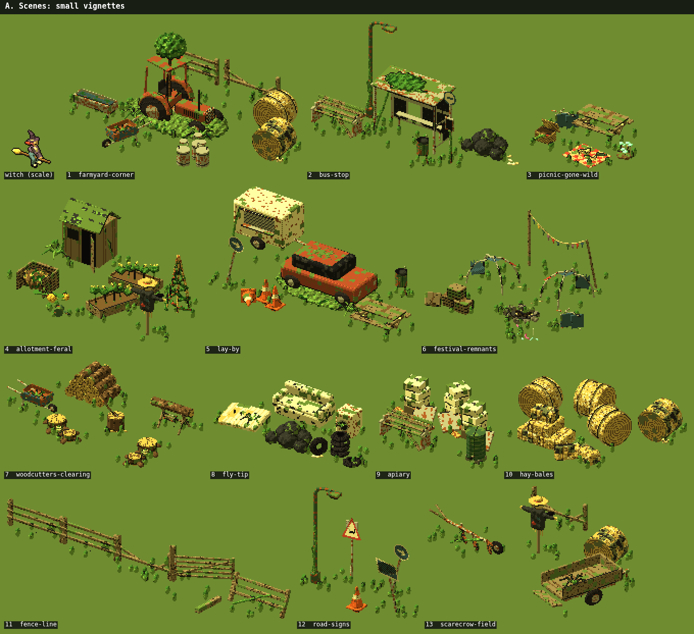

Knob: `scenes.chance` 0.12 per area (each scene once per map, only in area types it `suits`; art/scenes.js)

Per island, all of A: **0.52** now, **0.53** with Ed's paths.

| # | item | now | Ed's paths |
|---|---|---|---|
| 1 | farmyard-corner | 0.03 | 0.03 |
| 2 | bus-stop | 0.01 | 0.01 |
| 3 | picnic-gone-wild | 0.03 | 0.03 |
| 4 | allotment-feral | 0.04 | 0.04 |
| 5 | lay-by | 0.01 | 0.01 |
| 6 | festival-remnants | 0.06 | 0.06 |
| 7 | woodcutters-clearing | 0.06 | 0.06 |
| 8 | fly-tip | 0.09 | 0.10 |
| 9 | apiary | 0.04 | 0.04 |
| 10 | hay-bales | 0.02 | 0.02 |
| 11 | fence-line | 0.05 | 0.05 |
| 12 | road-signs | 0.07 | 0.07 |
| 13 | scarecrow-field | 0.01 | 0.01 |

## B. Scenes: large landmarks

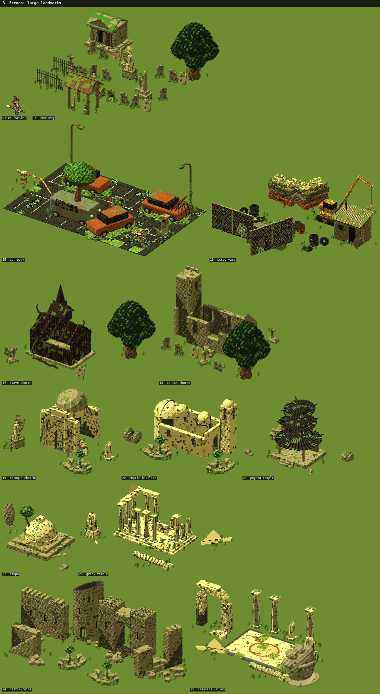

Knob: same roll as A: `scenes.chance` 0.12 per area, suits-gated, once per map

Per island, all of B: **0.50** now, **0.50** with Ed's paths.

| # | item | now | Ed's paths |
|---|---|---|---|
| 14 | cemetery | 0.07 | 0.07 |
| 15 | car-park | 0.04 | 0.04 |
| 16 | scrap-yard | 0.04 | 0.04 |
| 17 | stave-church | 0.07 | 0.07 |
| 18 | parish-church | 0.05 | 0.05 |
| 19 | baroque-church | 0.04 | 0.04 |
| 20 | coptic-basilica | 0.04 | 0.04 |
| 21 | pagoda-temple | 0.07 | 0.07 |
| 22 | stupa | 0.01 | 0.01 |
| 23 | greek-temple | 0.02 | 0.02 |
| 24 | castle-ruins | 0.04 | 0.04 |
| 25 | classical-ruins | 0.01 | 0.01 |

## C. Grounds (playground and sports)

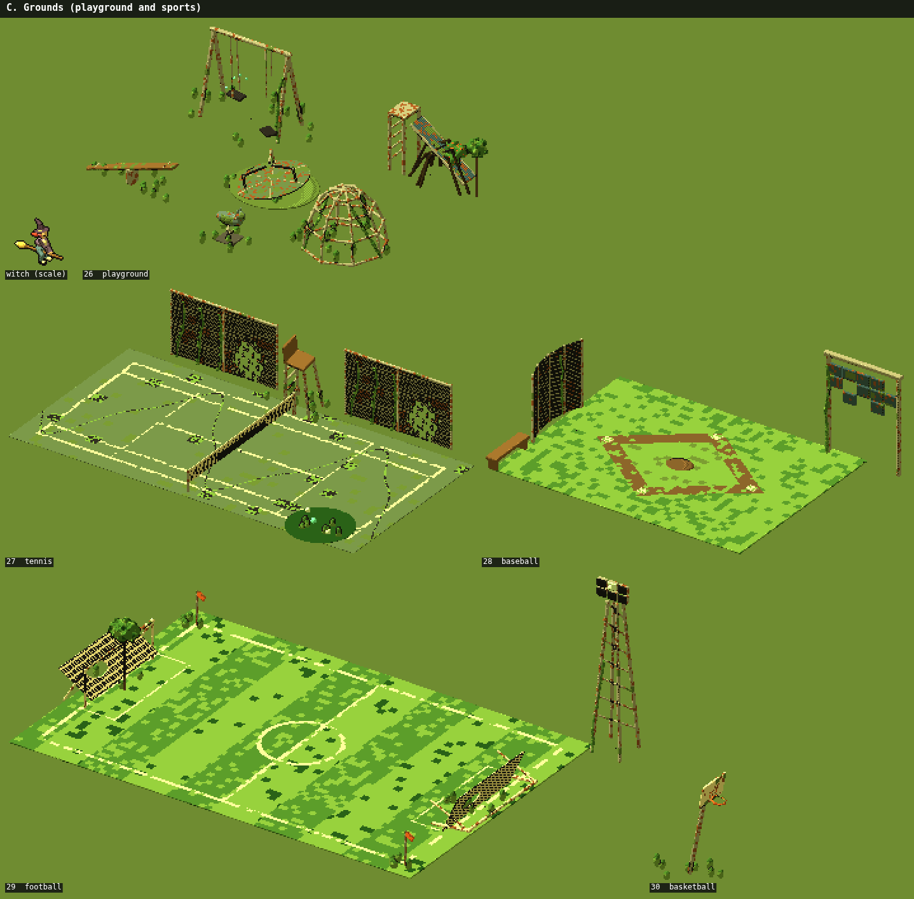

Knob: `grounds.chance` 0.035 per area, each kind once per map

Per island, all of C: **0.37** now, **0.37** with Ed's paths.

| # | item | now | Ed's paths |
|---|---|---|---|
| 26 | playground | 0.03 | 0.03 |
| 27 | tennis | 0.01 | 0.01 |
| 28 | baseball | 0.20 | 0.20 |
| 29 | football | 0.10 | 0.10 |
| 30 | basketball | 0.03 | 0.03 |

## D. Area set pieces (one per area type, in its clearing)

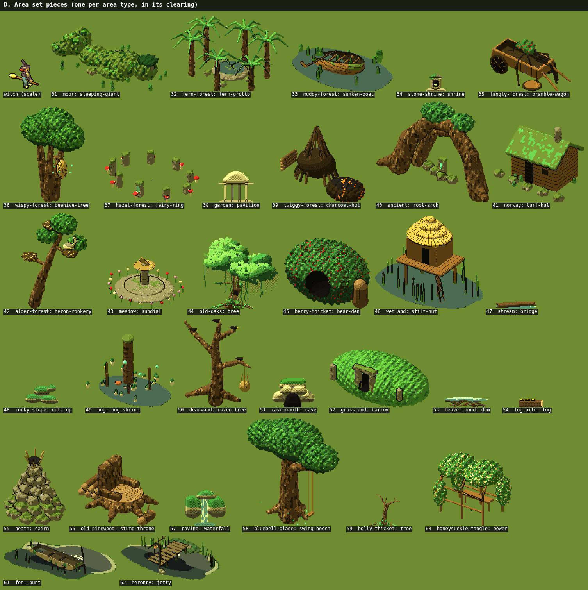

Knob: `setPieceChance` 0.25 per area, one per area type per map (nearest home)

Per island, all of D: **2.42** now, **2.42** with Ed's paths.

| # | item | now | Ed's paths |
|---|---|---|---|
| 31 | moor: sleeping-giant | 0.10 | 0.10 |
| 32 | fern-forest: fern-grotto | 0.07 | 0.07 |
| 33 | muddy-forest: sunken-boat | 0.09 | 0.09 |
| 34 | stone-shrine: shrine | 0.11 | 0.11 |
| 35 | tangly-forest: bramble-wagon | 0.06 | 0.06 |
| 36 | wispy-forest: beehive-tree | 0.06 | 0.06 |
| 37 | hazel-forest: fairy-ring | 0.08 | 0.08 |
| 38 | garden: pavilion | 0.09 | 0.09 |
| 39 | twiggy-forest: charcoal-hut | 0.05 | 0.05 |
| 40 | ancient: root-arch | 0.07 | 0.07 |
| 41 | norway: turf-hut | 0.06 | 0.06 |
| 42 | alder-forest: heron-rookery | 0.07 | 0.07 |
| 43 | meadow: sundial | 0.06 | 0.06 |
| 44 | old-oaks: tree | 0.06 | 0.06 |
| 45 | berry-thicket: bear-den | 0.06 | 0.06 |
| 46 | wetland: stilt-hut | 0.07 | 0.07 |
| 47 | stream: bridge | 0.06 | 0.06 |
| 48 | rocky-slope: outcrop | 0.07 | 0.07 |
| 49 | bog: bog-shrine | 0.07 | 0.07 |
| 50 | deadwood: raven-tree | 0.07 | 0.07 |
| 51 | cave-mouth: cave | 0.09 | 0.09 |
| 52 | grassland: barrow | 0.09 | 0.09 |
| 53 | beaver-pond: dam | 0.12 | 0.12 |
| 54 | log-pile: log | 0.09 | 0.09 |
| 55 | heath: cairn | 0.07 | 0.07 |
| 56 | old-pinewood: stump-throne | 0.10 | 0.10 |
| 57 | ravine: waterfall | 0.07 | 0.07 |
| 58 | bluebell-glade: swing-beech | 0.09 | 0.09 |
| 59 | holly-thicket: tree | 0.10 | 0.10 |
| 60 | honeysuckle-tangle: bower | 0.06 | 0.06 |
| 61 | fen: punt | 0.04 | 0.04 |
| 62 | heronry: jetty | 0.07 | 0.07 |

## E. Decor: ruins (weathered, overgrown)

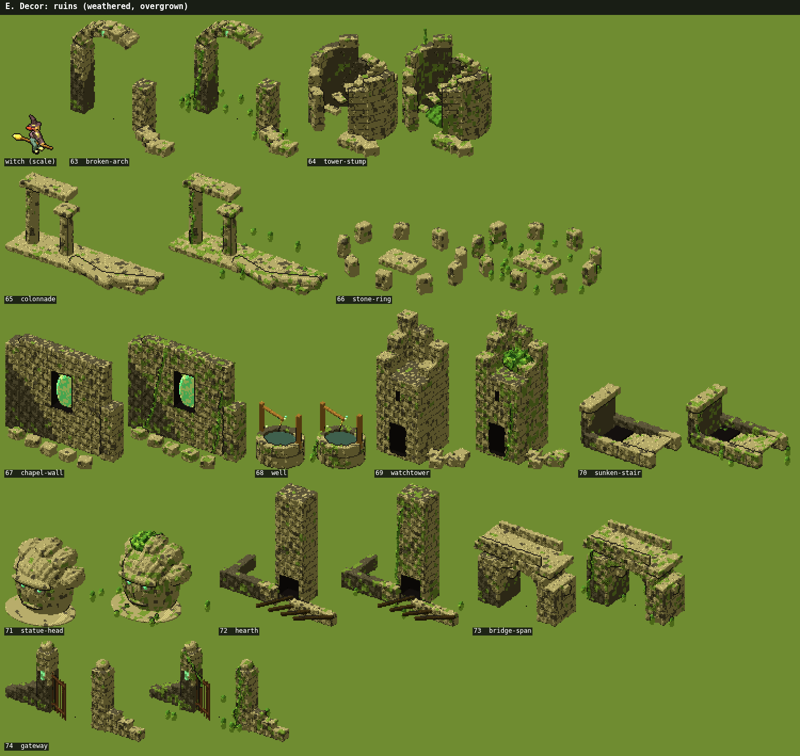

Knob: `decor.ruins` 0.01 × area `layout.decor.rate`/`ruins` (spacing 26 m, minGap 80 m); each ruin once per map

Per island, all of E: **2.98** now, **3.09** with Ed's paths.

| # | item | now | Ed's paths |
|---|---|---|---|
| 63 | broken-arch | 0.23 | 0.27 |
| 64 | tower-stump | 0.22 | 0.22 |
| 65 | colonnade | 0.25 | 0.29 |
| 66 | stone-ring | 0.30 | 0.28 |
| 67 | chapel-wall | 0.22 | 0.21 |
| 68 | well | 0.27 | 0.24 |
| 69 | watchtower | 0.19 | 0.22 |
| 70 | sunken-stair | 0.22 | 0.22 |
| 71 | statue-head | 0.24 | 0.24 |
| 72 | hearth | 0.34 | 0.33 |
| 73 | bridge-span | 0.26 | 0.31 |
| 74 | gateway | 0.24 | 0.26 |

## F. Decor: rocks

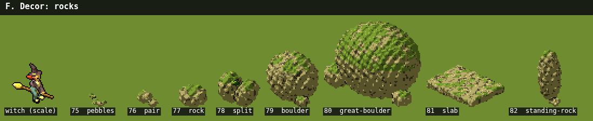

Knob: `decor.rocks` 0.03 × area `layout.decor.rate`/`rocks` (×1.5 on rocky terrain)

Per island, all of F: **2.96** now, **3.16** with Ed's paths.

| # | item | now | Ed's paths |
|---|---|---|---|
| 75 | pebbles | 0.28 | 0.32 |
| 76 | pair | 0.39 | 0.44 |
| 77 | rock | 0.35 | 0.37 |
| 78 | split | 0.42 | 0.47 |
| 79 | boulder | 0.33 | 0.33 |
| 80 | great-boulder | 0.40 | 0.41 |
| 81 | slab | 0.38 | 0.38 |
| 82 | standing-rock | 0.41 | 0.44 |

## G. Decor: freak trees

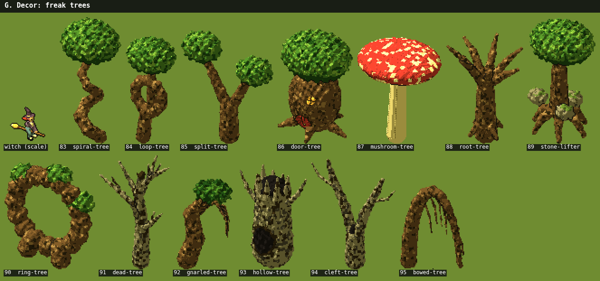

Knob: `decor.freak` 0.004 × area `layout.decor.rate`/`freak`; each once per map

Per island, all of G: **1.46** now, **1.61** with Ed's paths.

| # | item | now | Ed's paths |
|---|---|---|---|
| 83 | spiral-tree | 0.14 | 0.15 |
| 84 | loop-tree | 0.07 | 0.07 |
| 85 | split-tree | 0.10 | 0.12 |
| 86 | door-tree | 0.18 | 0.22 |
| 87 | mushroom-tree | 0.14 | 0.15 |
| 88 | root-tree | 0.13 | 0.14 |
| 89 | stone-lifter | 0.07 | 0.09 |
| 90 | ring-tree | 0.11 | 0.11 |
| 91 | dead-tree | 0.05 | 0.06 |
| 92 | gnarled-tree | 0.04 | 0.05 |
| 93 | hollow-tree | 0.20 | 0.20 |
| 94 | cleft-tree | 0.13 | 0.13 |
| 95 | bowed-tree | 0.10 | 0.12 |

## H. Modern relics (scattered singles)

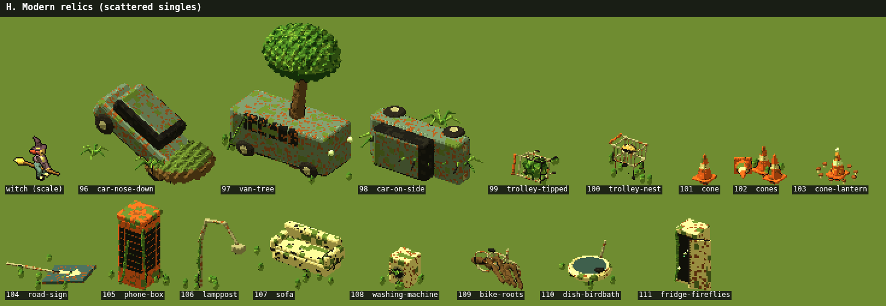

Knob: `relics.chance` 0.0067 per 34 m cell × (0.5 + 5 × area `layout.decor.modern`), ×4 near a road/rail; each id once per map

Per island, all of H: **0.59** now, **0.59** with Ed's paths.

| # | item | now | Ed's paths |
|---|---|---|---|
| 96 | car-nose-down | 0.06 | 0.06 |
| 97 | van-tree | 0.03 | 0.03 |
| 98 | car-on-side | 0.04 | 0.04 |
| 99 | trolley-tipped | 0.06 | 0.07 |
| 100 | trolley-nest | 0.03 | 0.03 |
| 101 | cone | 0.09 | 0.07 |
| 102 | cones | 0.03 | 0.03 |
| 103 | cone-lantern | 0.03 | 0.03 |
| 104 | road-sign | 0.03 | 0.03 |
| 105 | phone-box | 0.01 | 0.01 |
| 106 | lamppost | 0.04 | 0.04 |
| 107 | sofa | 0.03 | 0.04 |
| 108 | washing-machine | 0.02 | 0.03 |
| 109 | bike-roots | 0.02 | 0.01 |
| 110 | dish-birdbath | 0.06 | 0.06 |
| 111 | fridge-fireflies | 0.01 | 0.01 |

## I. Farm singles (scattered with the relics)

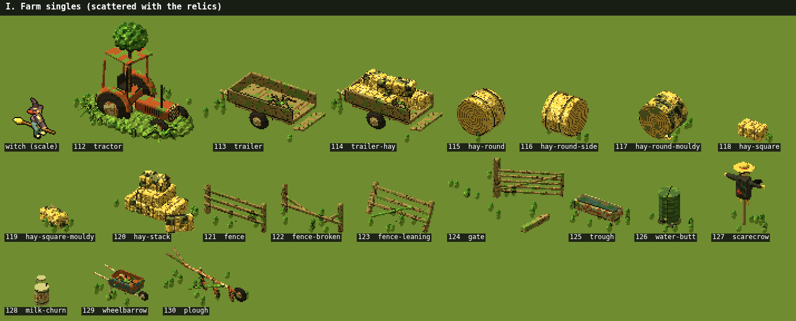

Knob: as H (the 46-item modern pool)

Per island, all of I: **0.61** now, **0.59** with Ed's paths.

| # | item | now | Ed's paths |
|---|---|---|---|
| 112 | tractor | 0.03 | 0.03 |
| 113 | trailer | 0.04 | 0.04 |
| 114 | trailer-hay | 0.03 | 0.03 |
| 115 | hay-round | 0.04 | 0.04 |
| 116 | hay-round-side | 0.07 | 0.06 |
| 117 | hay-round-mouldy | 0.03 | 0.02 |
| 118 | hay-square | 0.02 | 0.02 |
| 119 | hay-square-mouldy | 0.03 | 0.02 |
| 120 | hay-stack | 0.01 | 0.02 |
| 121 | fence | 0.03 | 0.03 |
| 122 | fence-broken | 0.01 | 0.01 |
| 123 | fence-leaning | 0.01 | 0.01 |
| 124 | gate | 0.04 | 0.04 |
| 125 | trough | 0.03 | 0.02 |
| 126 | water-butt | 0.03 | 0.04 |
| 127 | scarecrow | 0.04 | 0.04 |
| 128 | milk-churn | 0.07 | 0.07 |
| 129 | wheelbarrow | 0.01 | 0.01 |
| 130 | plough | 0.04 | 0.04 |

## J. Street singles (scattered with the relics)

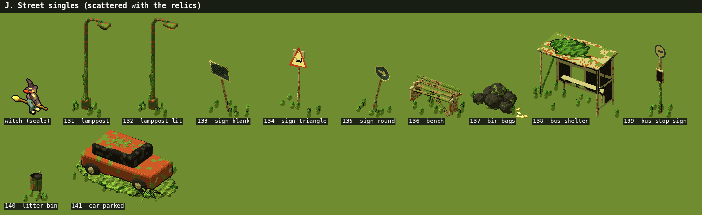

Knob: as H (the 46-item modern pool)

Per island, all of J: **0.43** now, **0.46** with Ed's paths.

| # | item | now | Ed's paths |
|---|---|---|---|
| 131 | lamppost | 0.03 | 0.03 |
| 132 | lamppost-lit | 0.01 | 0.01 |
| 133 | sign-blank | 0.04 | 0.05 |
| 134 | sign-triangle | 0.04 | 0.04 |
| 135 | sign-round | 0.03 | 0.03 |
| 136 | bench | 0.07 | 0.08 |
| 137 | bin-bags | 0.05 | 0.05 |
| 138 | bus-shelter | 0.04 | 0.04 |
| 139 | bus-stop-sign | 0.04 | 0.04 |
| 140 | litter-bin | 0.03 | 0.04 |
| 141 | car-parked | 0.05 | 0.05 |

## K. Walls, hedges, stone rings, clumps (by area type)

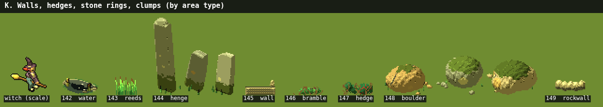

Knob: `walls` knobs (runs [3,5], rings [1,2], clumps [2,4], gateChance .5, avenueChance .35, loneChance .3); the area type's first wall kind; count = pieces

Per island, all of K: **80.79** now, **86.10** with Ed's paths.

| # | item | now | Ed's paths |
|---|---|---|---|
| 142 | water — pools of open water (moor, stream, bog, beaver pond, wetland, fen, heronry) | 27.20 | 28.27 |
| 143 | reeds — reeds (the wet areas' second wall art) | 0.00 | 0.00 |
| 144 | henge — stone rings, avenues and lone stones (stone shrine) | 6.41 | 6.59 |
| 145 | wall — garden walls, with flower beds beside them | 10.41 | 11.38 |
| 146 | bramble — bramble runs (berry thicket, honeysuckle tangle) | 14.13 | 15.04 |
| 147 | hedge — hedge runs (holly thicket) | 5.61 | 6.12 |
| 148 | boulder — boulder clumps (rocky slope) | 3.14 | 3.33 |
| 149 | rockwall — rock wall runs (cave mouth, ravine) | 13.89 | 15.37 |

## L. Path pieces: railway, bridges, stairs, fingerposts

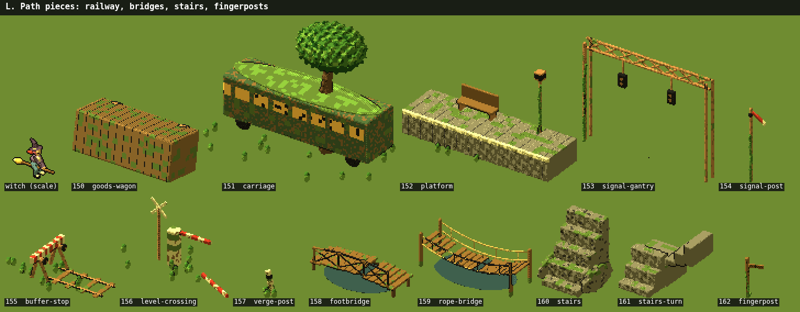

Knob: `paths`: landmarkSpacing 260 m × landmarkChance 0.35 on rails; signal-post 0.3, buffer-stop 0.5 at breaks; bridges where paths cross streams; stairs ≤2 per map in steep types; fingerposts at footpath ends (`paths.fingerposts`, forced on in the game); verge posts and level crossings need roads (`paths.roads` [0,0])

Per island, all of L: **17.51** now, **6.52** with Ed's paths.

| # | item | now | Ed's paths |
|---|---|---|---|
| 150 | goods-wagon | 0.10 | 0.02 |
| 151 | carriage | 0.17 | 0.07 |
| 152 | platform | 0.30 | 0.09 |
| 153 | signal-gantry | 0.14 | 0.03 |
| 154 | signal-post | 0.57 | 0.15 |
| 155 | buffer-stop | 0.94 | 0.22 |
| 156 | level-crossing | 0.00 | 0.00 |
| 157 | verge-post | 0.00 | 0.00 |
| 158 | footbridge | 1.79 | 0.44 |
| 159 | rope-bridge | 1.93 | 0.42 |
| 160 | stairs | 0.83 | 0.83 |
| 161 | stairs-turn | 0.47 | 0.47 |
| 162 | fingerpost | 10.27 | 3.78 |

## M. Light sources outside the party

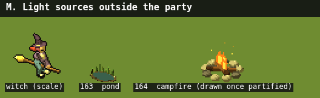

Knob: `lightSources`: pond 0.02 (wetPond 0.12) and campfire 0.03 per 10 m cell, ×0.25 away from an area's edge or middle

Per island, all of M: **142.02** now, **142.01** with Ed's paths.

| # | item | now | Ed's paths |
|---|---|---|---|
| 163 | pond | 87.39 | 87.40 |
| 164 | campfire (drawn once partified) | 54.63 | 54.61 |

## N. Party relics (giant bottles, the quest relic)

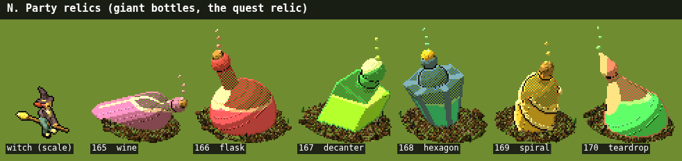

Knob: config/legends.json `relics.perAreas` 10 (one per 10 areas, at least 1); bottle by kind

Per island, all of N: **1.00** now, **1.00** with Ed's paths.

| # | item | now | Ed's paths |
|---|---|---|---|
| 165 | wine | 0.20 | 0.20 |
| 166 | flask | 0.17 | 0.17 |
| 167 | decanter | 0.18 | 0.18 |
| 168 | hexagon | 0.14 | 0.14 |
| 169 | spiral | 0.14 | 0.14 |
| 170 | teardrop | 0.17 | 0.17 |

## O. Beach finds and footprints

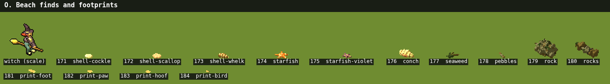

Knob: `beach.decor`: finds 0.7 per sector (×3 on rocky coast), trails 0.07 (prints 30–90 each), 720 sectors

Per island, all of O: **2773.21** now, **2773.21** with Ed's paths.

| # | item | now | Ed's paths |
|---|---|---|---|
| 171 | shell-cockle | 114.04 | 114.04 |
| 172 | shell-scallop | 76.60 | 76.60 |
| 173 | shell-whelk | 76.27 | 76.27 |
| 174 | starfish | 45.42 | 45.42 |
| 175 | starfish-violet | 22.57 | 22.57 |
| 176 | conch | 18.80 | 18.80 |
| 177 | seaweed | 76.83 | 76.83 |
| 178 | pebbles | 59.66 | 59.66 |
| 179 | rock | 2.67 | 2.67 |
| 180 | rocks | 4.15 | 4.15 |
| 181 | print-foot | 783.60 | 783.60 |
| 182 | print-paw | 631.49 | 631.49 |
| 183 | print-hoof | 408.86 | 408.86 |
| 184 | print-bird | 452.25 | 452.25 |

